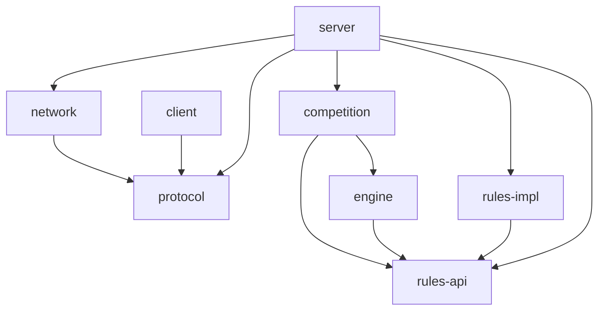
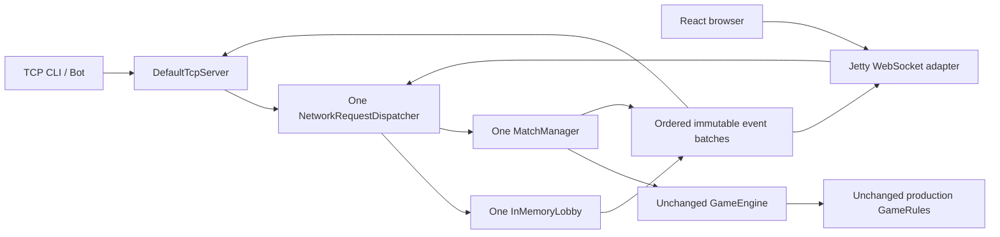

# Kiến trúc Mini Battlecode Platform

## Phase 8C — Local trusted JavaScript runner

`bot-runner → rules-api` (+ Jackson cùng phiên bản server); `bot-match → bot-runner, competition, rules-impl` là composition root local. Root Maven profile `local-bots` tự bật trên Windows. Production server không phụ thuộc hai module này; Docker/Linux Render graph không yêu cầu QuickJS. Không đổi frontend, deployment hoặc TCP1.0/web-1.

DefaultMatchManager giữ immutable committed GameState references và implement internal BotMatchAccess cho BOT-mode lease có expectedTurn/generation/token. Projector trusted lấy BotObservation từ RuleState dưới lifecycle lock; Runner I/O hoàn toàn ngoài lock. Engine/GameRule/MatchManager public contracts và production rules không đổi. BOT watchdog hủy infrastructure deadline; manual tick giữ nguyên. Các bot seats do server sinh, không nhận manual ACTION; failure bot có bằng chứng được OTT adjudicate FORFEIT, infrastructure đi qua manager cancellation/cleanup.

Một local slot, bốn pending và256 execution records fail-closed; mỗi lượt dùng QuickJS process mới, chỉ reviewed fixture bytes/hash. JS heap/stack CLI flags được cấu hình, CPU/total-process-memory/OS isolation chưa enforce/prove. Runtime không mở public submissions và không chạy trên Render. [Báo cáo Phase8C](phase8c-report.md) mô tả executable demo, replay và giới hạn.

## Phase 8B — OTT board rule và bot-1 DTO

`OttBoardRule` đăng ký `ott-board-9x9-v1` tại ServerMain và RoomTcpServer. Domain immutable Board/Piece/Position/Move/BoardState/MoveEvent ở rules-impl; bot-1 DTO ở rules-api.bot. Dependency graph không đổi, không dependency mới. Không sửa GameRule/GameEngine/MatchManager, TCP1.0, web-1 hoặc RPS/Number Guessing. Private rule state giữ mapping UUID→A/B; observation chỉ chứa side, board/moves đã sort và thời gian do caller Phase8C cung cấp.

Rule tuần tự dùng engine chung; engine turn0 và bot turn1 là hai giá trị được ánh xạ, không đổi envelope turn. Room OTT cần maxPlayers2/maxTurns>=200/no options. isActionAllowed nhận active submission để phân xử, applyAction trả state FORFEIT nếu BotAction sai; không throw lỗi nước đi bình thường để tránh RULE_ERROR. Theo xác nhận người dùng, request ngoài lượt/stale/session/requestId vẫn ERROR. onTurnTimeout/onDisconnect FORFEIT; validMoveCount/history chỉ tăng khi áp dụng nước hợp lệ. Các điều kiện thắng đúng thứ tự contract; outcome hòa ở200 ưu tiên trước engine MAX_TURNS.

Wire view là projection public gọn (board/legalMoves encoded trong string values) dưới budget hiện có. BotObservation typed không chứa session token, không lấy execution budget từ deadline transport. History in-memory tối đa200 validated events để replay; không thêm API endpoint/storage/JS runner/sandbox/board viewer. [Thiết kế](phase8b-design.md), [contract](phase8a-technical-contract.md), [báo cáo](phase8b-report.md).

Phase 7D thêm transport mode `LOCAL` (mặc định, constructor cũ giữ nguyên) và `WEB_ONLY` qua constructor RoomTcpServer bốn tham số. ServerMain đọc `BATTLECODE_MODE`; WEB_ONLY bắt buộc `PORT` và exact `BATTLECODE_ORIGINS`, bind gateway 0.0.0.0, không tạo DefaultTcpServer. Một bộ services và ConnectionManager vẫn dùng chung; không sửa Engine/MatchManager/production rules hoặc TCP 1.0. Admission mặc định WEB_ONLY 16, outbound queue 32, Docker heap 192 MB; health /health và shutdown hiện có vẫn hoạt động. Xem docs/free-deployment.md và docs/phase7d-report.md.

Java 21, Maven reactor; không database hoặc frontend. Phase 1 tạo contracts/model/codec, Phase 2 có TCP runtime, Phase 3 có session/lobby/room, Phase 4 có DefaultGameEngine/DefaultMatchManager; Phase 5 đăng ký hai production rule chạy qua cùng engine.

## Dependency (mũi tên là phụ thuộc compile)



`protocol` và `rules-api` là hai module nền độc lập. Không circular dependency. Network không import competition, engine hoặc luật. Server là composition root: adapter cài RequestDispatcher, gọi Lobby/MatchManager và ánh xạ domain exception sang protocol error. Competition gọi GameEngine interface; server sử dụng engine qua dependency bắc cầu từ competition. Không đưa adapter vào network.

| Module | Trách nhiệm / hợp đồng |
|---|---|
| network | TcpServer, ConnectionHandler, ConnectionManager, RequestDispatcher; lifecycle socket và giới hạn tài nguyên |
| protocol | Message, Command, ErrorCode, MessageCodec; codec length-prefix không chứa thắng/thua |
| competition | Lobby, Room, PlayerSession, MatchManager; membership, owner, session và lifecycle phòng |
| engine | GameEngine, GameState, GameResult; điều phối, deadlines, gọi luật |
| rules-api | GameRule, RuleState, RuleOutcome, RuleRegistry, GameConfig |
| rules-impl | RoomOnlyRule descriptor, RockPaperScissorsRule, NumberGuessingRule |
| client | TcpClient, interactive CLI, event-driven bot clients, strategies, demo and bounded benchmark |

## Quyền sở hữu và concurrency (hợp đồng Phase 2)

- Một virtual thread đọc mỗi socket; một writer/queue bounded cho mỗi connection. Không ghi frame đan xen. ConnectionManager dùng concurrent map; cleanup idempotent trong finally.
- UUID session được server sinh sau HELLO và gắn với connection. UUID không phải cơ chế đăng nhập hay bí mật. Client không được dùng session trên connection khác; reconnect tạo session mới.
- Lobby và MatchManager dùng cùng khóa lifecycle cho membership/start/action/disconnect/shutdown; mỗi session thuộc tối đa một phòng/trận. Engine serialize mỗi trận bằng khóa riêng. Snapshot immutable được trả ra ngoài lock.
- Engine serialize từng trận; kiểm tra match đang chạy, membership, lượt và deadline trước GameRule.isActionAllowed. Kết quả terminal chỉ công bố một lần. RuleState phải immutable; viewFor chỉ trả thông tin được phép cho người chơi.
- GameRule chịu trách nhiệm tính hợp lệ theo luật, biến đổi trạng thái, thắng/thua, timeout và disconnect. Engine quản lý giới hạn maxTurns và hủy trận khi vượt giới hạn hoặc lỗi luật; không tự suy luận người thắng.
- Scheduler dùng đồng hồ monotonic cho deadline; action và callback timeout tranh cùng cơ chế serialize, timeout lỗi thời được bỏ qua bằng turn/token. Không giữ lock khi ghi socket.
- Outbound queue giới hạn 256 frame/connection; queue đầy hoặc write không tiến triển trong 10 giây thì đóng connection. Rate limit 20 request/giây, burst 40; tối đa 256 connection mặc định. Phase 2 phải kiểm thử slow reader và slow sender.
- Lỗi luật bất ngờ: cancel trận, ghi log nội bộ, gửi INTERNAL_ERROR không lộ stack trace. Disconnect chuyển session CLOSED và giải phóng membership. Theo xác nhận Phase 3, owner rời/disconnect WAITING thì chuyển host cho thành viên còn lại tham gia sớm nhất; phòng rỗng bị xóa. Trận RUNNING gọi rule.onDisconnect, owner không có quyền thay luật.

GameConfig độc lập và bất biến theo phòng, không thay khi trận đang chạy. Registry chỉ nhận implementation đáng tin cậy do người vận hành đóng gói. Trò chơi mới có thể nằm trong module mới phụ thuộc rules-api; composition root đăng ký implementation, không sửa network. Không tải, biên dịch hay chạy source/class/JAR do client gửi.

## Giới hạn Phase 1 (lịch sử)

Interfaces là hợp đồng, không phải service đang chạy. Codec đã thực thi framing và kiểm tra cấu trúc; xác thực command/session/state và timeout sẽ do adapter/server/engine Phase 2 thực thi. Không có persistence, reconnect/resume, ranking, auth tài khoản hay sandbox thực thi code.

## Runtime Session/Lobby/Room từ Phase 3

ServerMain tạo RoomTcpServer ghép TcpServer/ConnectionManager, Lobby, RuleRegistry, GameEngine và MatchManager. Network vẫn chỉ phụ thuộc protocol. InMemoryLobby chỉ phụ thuộc rules-api và các model competition, không import socket/network/protocol. Production composition registers RoomOnlyRule, RockPaperScissorsRule and NumberGuessingRule.

InMemoryLobby dùng một ReentrantLock cho sessions, membership và rooms: create/join/leave/disconnect nguyên tử; một session tối đa một room, host luôn thuộc room, room rỗng không tồn tại. LinkedHashSet nội bộ giữ thứ tự join để chọn host; snapshot Room/PlayerSession/GameConfig bất biến trả ra ngoài khóa. Không có lock ordering giữa các phòng. Closed session bị xóa khỏi active map và mọi hành động sau cleanup bị INVALID_SESSION; UUID chỉ do server sinh sau HELLO, không resume.

Callback notification của Lobby chỉ offer immutable RoomNotification vào queue hữu hạn 4096, không I/O/chờ. RoomEventPublisher tại server có một worker gửi thông qua ConnectionManager/ConnectionHandler interfaces; thứ tự queue trùng thứ tự mutation. Queue đầy đánh dấu các recipient phải disconnect, worker thực hiện ngoài khóa Lobby; không âm thầm giữ client đang thiếu event. Queue ghi/socket timeout/admission/rate/quota Phase 2 giữ nguyên. Không gọi callback mạng trong khóa Lobby nên cleanup do slow reader không tạo lock cycle.

RoomOnlyRule descriptor `room-only-no-gameplay` nằm trong rules-impl, chỉ validateConfig; mọi phương thức gameplay ném UnsupportedOperationException. Registry có thể đăng ký luật khác mà không sửa network. CLI dùng JLine riêng cho nhập terminal/printAbove; protocol và transport không dùng thư viện socket bên ngoài.

## Runtime Phase 4 — Engine và Match

API được người dùng xác nhận trước khi triển khai; các phương thức cũ giữ nguyên:

| API bổ sung | Hợp đồng |
|---|---|
| GameRule.supportsGameplay() | Default true; RoomOnlyRule false, không gọi initialState descriptor |
| GameRule.minimumPlayers(config) | Default 2, phải trong 2..maxPlayers |
| GameRule.activePlayers(state) | Default singleton currentPlayer; luật đồng thời override |
| GameRule.isTurnComplete(before,after) | Default true; false giữ turn/deadline/generation |
| GameEngine.submit(id,player,expectedTurn,action) | expectedTurn >= 0; kiểm tra và apply trong cùng per-match lock |
| GameEngine.timeout(id,generation) | Stale/early/terminal callback no-op; timeout đóng lượt quá hạn |
| GameEngine.snapshot(id,player) | PlayerSnapshot immutable chỉ gồm metadata và view riêng, không RuleState |
| MatchManager.submitAction(session,id,expectedTurn,action) | Kiểm tra bound membership và gọi overload engine |
| MatchManager.shutdown() | Idempotent; ngừng start/action, cancel active, shutdown scheduler |

Engine khởi tạo từ GameRule, kiểm tra roster/config và evaluate. Turn bắt đầu 0. Active player chỉ submit thành công một lần trong shared turn; rejected action không tiêu thụ quyền. Khi rule chuyển lượt, turn tăng, submitted được xóa và deadline/generation mới được tạo. Sequential default chuyển sau mỗi action; simultaneous giữ chung deadline cho đến khi rule báo round complete. maxTurns đếm lượt hoàn tất, không đếm từng action đồng thời. GameRule quyết định thắng/thua qua RuleOutcome; outcome finished ưu tiên hơn MAX_TURNS.

Mọi candidate state, active player IDs, winners và private views được validate trước commit. View tối đa 120 fields/60,000 bytes UTF-8 để dành chỗ cho envelope MATCH_EVENT 65,536 bytes/128 fields; reason tối đa 2,048 bytes. Vi phạm hoặc RuntimeException từ luật hủy đúng trận RULE_ERROR, không trả stack trace qua TCP. RuleState phải immutable; rule stateless/reentrant giữa các phòng và callback phải hoàn tất nhanh. Engine không thể suy luận secret của từng luật: viewFor chịu trách nhiệm projection, engine chỉ gửi đúng projection cho đúng session.

```text
Room: WAITING -> RUNNING -> FINISHED (tạm thời) -> CLOSED/xóa
Match: CREATED (khởi tạo nội bộ) -> RUNNING -> FINISHED hoặc CANCELLED
Session: IN_ROOM -> IN_MATCH -> IN_ROOM (tạm thời) -> LOBBY
```

START_MATCH giữ khóa lifecycle: validate session/member/Room.ownerId/status/rule/capability/config/roster, initialize engine, rồi publish match và room RUNNING cùng transaction. Lỗi initialization không để lại match active; phòng vẫn WAITING. Không có hai trận cho cùng phòng. ACTION dùng session từ socket, kiểm tra membership, expectedTurn, monotonic deadline, active player và rule validation; ACK trả turn được chấp nhận, STATE chứa turn hiện tại. Request-ID dedup/quota Phase 2 chặn replay trước mutation.

Scheduler một daemon platform thread quét active match mỗi 10ms, dùng generation snapshot và timeout overload. Action/timeout/disconnect/cancel tranh cùng khóa; now >= deadline là muộn kể cả scheduler chưa chạy. Callback timeout lỗi thời không ảnh hưởng lượt mới. Timeout gọi onTurnTimeout cho active player chưa submit, theo UUID tăng dần, dừng nếu rule finished rồi đóng lượt một lần. Rule có thể encode kết quả timeout theo trạng thái riêng.

Thứ tự khóa duy nhất: Competition lifecycle -> Engine per-match. Engine không gọi ngược Competition. Khởi tạo engine serialize ID để không initialize trùng. Trusted callbacks luật chạy đồng bộ dưới khóa để không áp dụng trên state lỗi thời; notification callback bị giới hạn chỉ enqueue và không throw/block. Một queue server chung 4096 batch chứa cả ROOM_EVENT/MATCH_EVENT, giữ thứ tự mutation; FINISHED/CANCELLED enqueue trước ROOM_EVENT CLOSED. Worker enqueue socket output ngoài khóa Competition/Engine, queue đầy disconnect recipient ngoài khóa. Không socket I/O dưới khóa nghiệp vụ.

Disconnect RUNNING đi qua MatchManager trước Lobby: onDisconnect cho rule quyết định tiếp tục/finish, thành viên còn lại có thể tiếp tục; host chuyển cho người join sớm nhất, không đổi config/rule. Không còn người kết nối -> NO_CONNECTED_PLAYERS, lỗi rule -> RULE_ERROR, giới hạn lượt -> MAX_TURNS. LEAVE_ROOM và join RUNNING bị INVALID_STATE. Terminal xử lý đúng một lần, xóa active/membership/room, session còn kết nối về LOBBY; engine lưu kết quả in-memory cho result(id).

Shutdown ngừng start/action và cancel mọi active match với SERVER_SHUTDOWN trước đóng transport. Match scheduler, event worker và socket tasks được dừng/await trong deadline transport. Client disconnect có thể không nhận event; khi shutdown đóng socket, delivery terminal event là best effort, kết quả cancellation nội bộ vẫn được lưu. Không có resume/persistence hoặc guaranteed event delivery sau socket close.

Giới hạn: khóa lifecycle chung ưu tiên tính nguyên tử/dễ đọc, chưa tối ưu throughput giữa các phòng; callback luật dài sẽ trì hoãn operation khác, không có sandbox cưỡng chế dừng plugin. Các result/state terminal lưu đến hết đời engine, chưa có eviction/history API. Production registry không tải rule động; fake sequential/simultaneous tiếp tục chỉ ở test scope.

## Runtime Phase 5 — Production Rules

Production composition registers three rules through `InMemoryRuleRegistry`: `room-only-no-gameplay` is a non-gameplay descriptor; `rock-paper-scissors` and `number-guessing` support gameplay. NetworkRequestDispatcher remains generic: LIST_RULES reads registry IDs, CREATE_ROOM resolves and validates the selected rule, and MatchManager starts the rule from room config. There is no rule-ID switch in the dispatcher and no protocol change.

Both games require a room capacity of exactly two, so room capacity also bounds match rosters at two. RPS accepts only `roundsToWin` (default 3, range 1..10); its immutable state contains roster, scores, round, current hidden submissions, last reveal and terminal result. It overrides `activePlayers` and `isTurnComplete` so both players share a turn and deadline. Before reveal, views expose submitted status and the recipient's own choice only; after resolution, views expose both choices and score. If one player has submitted at timeout, that player wins the round; if neither submitted, timeout callbacks settle a draw. A disconnect forfeits the match. The final round reveal is encoded in the existing FINISHED reason field because the Phase 4 terminal snapshot has no private view.

Number Guessing accepts `minNumber` and `maxNumber`, defaults 1 and 100, with an inclusive range of 2..1,000,000 values calculated using `long` before conversion. The no-argument production rule obtains a per-match secret using `ThreadLocalRandom`; deterministic offset injection is available for tests. State keeps the secret, roster, current player, turn count and immutable public guess history. Player views contain the range, current player and recent guesses/hints, never the secret. The public history window is capped at 28 guesses so its four fields per entry plus fixed view fields stay under the engine's 120-field limit. A correct guess publishes the secret through the existing FINISHED reason field. Wrong guesses and timeouts pass the turn; engine `maxTurns` cancellation remains authoritative and does not invent a winner. A disconnect forfeits to the remaining connected player.

Rules have no socket/server dependency and share no match state. Rule implementations depend only on rules-api and Java standard-library classes. TCP integration tests use production rule classes and loopback clients to cover individual matches, privacy, timeout, disconnect, terminal cleanup and simultaneous matches in separate rooms.

## Runtime Phase 6 — Client bots and benchmark

The bot runtime is in the client module and depends only on the existing `DefaultTcpClient` and protocol messages. Each `BotClient` owns one transport/session, consumes the bounded event queue using blocking polls, and submits actions only from its recipient-specific `MATCH_EVENT` view. RPS observes its own submitted marker; Number Guessing derives a binary-search interval from public history. `BotMain` joins an existing room; `BotDemoMain` creates a room with one bot as host and starts a second bot. Both use only protocol 1.0.

`BenchmarkRunner` uses two independent bot sessions per room, explicit even participant counts up to 50, an overall deadline, and an existing TCP server. The 2-client profile is the only default. It reports client-side handshake/request/match metrics and is not a capacity guarantee. LAN preflight/checklist is in `docs/lan-testing.md`; only actual tests across separate physical devices can change its NOT VERIFIED status.

## Runtime Phase 7 — Shared TCP/WebSocket and React



Maven dependencies không circular: server → network/protocol/competition/rules-api/rules-impl; competition → engine/rules-api; engine/rules-impl → rules-api; network → protocol; client → protocol. Jetty/Jackson chỉ trong server. frontend là React+TypeScript+Vite riêng, dùng JSON qua WS /ws; TCP vẫn protocol 1.0 cũ. DefaultTcpServer watchdog chỉ kiểm tra TCP handlers trong shared ConnectionManager, không cast WS handler.

Bổ sung đã được phê duyệt: RoomDetails(roomId,ruleId,status,hostId,players,capacity,revision), players chỉ playerId/nickname; default Lobby.roomDetails(sessionId) giữ implementation cũ source-compatible, runtime override dưới lifecycle lock. Unknown session bị từ chối, session ngoài room nhận empty; không arbitrary roomId lookup. RoomNotification bổ sung details immutable với constructor 5 tham số cũ, snapshot capture trong mutation. GameEngine và hai production rules không thay đổi.

RoomTcpServer giữ constructor TCP-only hiện có, thêm (NetworkConfig,RuleRegistry,WebSocketConfig) và websocketPort(). Một instance mỗi service/registry/manager/routes/publisher cho cả hai transport. START_MATCH vẫn authorize Room.ownerId. Browser identity lấy từ HELLO ACK và được gateway bind vào connection; JSON request không chứa identity do browser chọn.

Publisher captures RoomDetails trong transaction và chỉ enqueue, không I/O. Worker gửi ROOM_EVENT rồi ROOM_STATE cho web; STARTED batch gửi ROOM_STATE RUNNING trước MATCH_EVENT. FINISHED/CANCELLED trước CLOSED và room=null. Departed member chỉ nhận null projection, current members nhận đúng roster/host ở thời điểm event. TCP ROOM_EVENT bytes/schema không đổi. Revision theo room giúp frontend bỏ snapshot cũ; WebSocket có ordered delivery nhưng không guaranteed delivery sau close.

Jetty 12.1.14 core upgrade handler, exact Origin allowlist, parser Jackson 2.22.0 strict duplicate/type/nesting/UTF-8 size, 64KiB JSON và TCP codec budget. HTTP admission ConnectionLimit; admitted TCP+WS chung maxConnections. Jetty max32 platform threads; internal continuation queue theo Jetty mặc định. Virtual tasks bị chặn theo admission/demand, một handler/connection; mỗi WS connection queue256 outbound, một async send và write10s. Queue overflow/slow client force-close rồi idempotent business cleanup trên task; không IO dưới Competition/Engine lock. HELLO/idle theo NetworkConfig, control frames không reset app idle. Shutdown hủy match, đóng hai transports, dừng và await workers/watchdogs/tasks.

React không giữ secret hoặc tính thắng/thua. Correlation requestId, deadline10s, PING20s; timeout đóng session, không ambiguous retry. Submit lock theo matchId/expectedTurn và server private submitted view. Sequential current player và simultaneous partial same-turn STATE đều do server cấp. ROOM_STATE hostId chỉ giúp UI; authorization luôn ở server. Result giữ sau CLOSED; stale room revisions/turns/foreign match state bị bỏ. Mất connection chỉ cho phép HELLO thủ công session mới, không reconnect/resume/resync API. Chi tiết và giới hạn triển khai: docs/websocket-protocol.md, docs/web-deployment.md, docs/phase7-report.md.

## Phase 10 — persistent local account application

Local bot-match composition extends the existing loopback HTTP server, Arena and verified worker. AuthService resolves HttpOnly cookie sessions to account UUIDs; source/tournament authorization stays server-side. JDBC/Flyway/BCrypt are local-module dependencies only, with SubmissionRepository and TournamentRepository separating domain contracts from PostgreSQL adapters. Production server, TCP 1.0, web-1, engine and game rules are unchanged.

PostgreSQL owns immutable source versions, ownership, durable idempotency, tournament state/results/replay and standalone Arena history. Bot repository reads use DB directly. Tournament execution uses a bounded write-through projection under an exclusive DB application lease: persist transition/schedule before execution, commit result/replay before advancing, rebuild and cancel unfinished executions before HTTP admission after restart. DB/lease failure invalidates the projection and stops execution; there is no automatic resume or loss assignment. Canonical domain snapshots and normalized FK rows/events are committed in the same transaction. Only one local scheduler process per DB is supported. See docs/phase10-report.md for transaction boundaries, cookie/Origin policy, recovery, migrations and bounds.