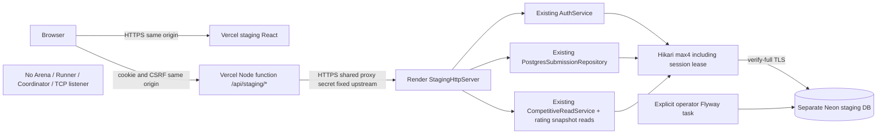

# Phase 11B.1 — Safe free-cloud staging architecture

This runtime can store user source but **cannot execute bots**. Full production competitive execution remains blocked by Phase11A. No cloud deployment has been performed; cloud cookie behavior and free-tier measurements are NOT TESTED.

## Audit baseline and compatibility

Inspected Phase11A report/architecture/threat/checklist/deployment options, Phase10 auth/persistence and10.9 read projections, Flyway V1–V5, SecureLocalArenaMain/LocalArenaHttpServer/ProductionPreflight, Docker/Compose and React routing/client/Vercel config. Existing local HTTP is127.0.0.1 with Host/Origin protection and HTTP Strict cookies; its route registry includes execution and cannot be exposed by rebinding. Existing Docker/WEB_ONLY serves a separate room WebSocket graph. Frontend production defaults intentionally disable competitive account tools and require a real WSS URL. Database originally had no pool and all repository/auth calls require a global application lease. Ranking reads originally call closeDue (a write).

Those constraints are retained. No historical migration, TCP1.0/web-1, GameEngine, MatchManager, production rule or rating policy changes. Local/legacy builds still work. ProductionPreflight is unchanged and still always refuses online competitive runtime. A new Maven `safe-staging` profile adds `staging-web`; build with both `local-bots,safe-staging` because existing persistence lives in bot-match.

## Hard execution boundary

`StagingMain` composes only config, bounded pool, Database, AuthService, submission repository, read services and StagingHttpServer. It never constructs LocalArenaHttpServer, LocalArenaService, GameEngine, BotExecutionService, coordinator or worker. The route registry is an explicit method/path allowlist. Unknown/encoded/unsupported routes fail before business dispatch. Backend denial is independent of React buttons and BFF routing. Guest source is stored/hashed/validated using existing immutable version model, never parsed as executable code.

The bot-match artifact currently combines persistence/read DTOs and local execution classes, and BotSubmission lives in bot-runner. Their jars are therefore unavoidable transitive runtime artifacts in this phase. They are inert: no execution object is referenced by the staging composition. Defense in depth adds ExecutionEnvironment guards to all real runner/execution-service constructors; a separate-JVM test verifies they throw in staging before using a config/path/delegate. Docker copies no Python supervisor, QuickJS executable, Docker CLI/socket or worker image. Future module extraction can reduce jars without introducing a second implementation.

## Route contract

Java prefix `/api/staging/` is also the BFF browser prefix. BFF and Java maintain independent explicit allowlists, covered by tests.

| Method | Path | Authorization / behavior |
|---|---|---|
| GET | `/healthz` | Public minimal liveness200; no DB/config/metrics |
| GET | `/readyz` | Public minimal200/503; DB connectivity, V5 schema, global lease and least-privilege checks; no diagnostics disclosed |
| GET | `auth/csrf` | Authenticated proxy only; bound signed token for current session or HttpOnly pre-auth nonce |
| POST | `auth/register`, `auth/login` | Proxy, exact frontend Origin, CSRF bootstrap, strict username/password schema and rate limits |
| GET | `auth/me` | Proxy plus valid opaque session |
| POST | `auth/logout` | Session + CSRF; DB revocation and cookie expiry |
| GET / POST | `submissions` | Session; own metadata list / create with requestId,name,source |
| GET / PUT / DELETE | `submissions/{botId}` | Owner identity; save/delete require requestId,expectedVersion; PUT also name/source |
| POST | `submissions/{botId}/validate` | Owner + CSRF; source/metadata acceptance only; NOT_EXECUTABLE, NOT_VERIFIED |
| GET | `bot-profiles/{id}` | Existing own-or-rated profile rules; no source, private account identity or runner fields |
| GET | `match-history?page=N` | Participant/owner authorized;50/page,0–200 |
| GET | `matches/{id}` | Existing participant projection/replay; inaccessible404 |
| GET | `rankings`, `rankings/glicko2` | Authenticated existing stored profiles only, no period closure/write |
| GET | `rankings/{botId}/history` | Profile visibility checked first; stored Elo events, bounded100; no synthetic period updates |

No battles, worker, capabilities, ranked queue, tournament operations, admin, TCP challenge, arbitrary source execution or local-controller fallback. No source-version mutation route exists; saves append immutable versions. Extra fields, malformed UTF-8/JSON, duplicate keys, unknown queries and invalid UUID/version are rejected. Source remains<=32KiB exact UTF-8; HTTP body<=200000bytes, responses<=4MiB, JSON nesting8. Existing source-version count16, bot count32 (global) and account count128 are deliberate bounded MVP limits, not scalable quotas.

## Authentication architecture

Vercel and Render default domains are cross-site. SameSite=None cannot ensure third-party cookies work. This implementation uses a real same-origin proxy/BFF: browser never calls Render and stores no bearer token. Cookie returned by Java is forwarded as host-only on the Vercel origin: `__Host-battlecode_session; Secure; HttpOnly; SameSite=Strict; Path=/; Max-Age=28800`. Pre-auth nonce uses a separate __Host cookie,30min. No Domain attribute, token in JSON or token/source in browser storage. Existing bcrypt12, opaque32-byte tokens/hashed DB storage,8h expiry/revocation stay authoritative.

Before each mutation frontend GETs CSRF through BFF; Java issues HMAC-SHA256 token with random nonce and expiry, bound to the session or pre-auth nonce. Signature cannot be moved to another session/bootstrap cookie. Origin checks apply before token processing. Login rotates session and expires pre-auth nonce; logout revokes DB session and expires cookies. Tokens live only for the request in tab memory. A failed mutation is not automatically replayed. Existing requestId/expectedVersion provide durable idempotency/concurrency.

BFF validates exact browser Host and Origin (Origin mandatory for mutations), forwards a small fixed header set, overwrites proxy assertions, bounds request/response, disables upstream redirects and has55s timeout. Shared STAGING_PROXY_SECRET stays only in Vercel function/Render environment, never Vite. Java requires constant-time proxy secret equality, exact backend Host, exact frontend Origin and authenticated `X-Staging-Proto:https`. Arbitrary Forwarded/X-Forwarded-* headers do not establish trust. Direct API callers lack the proxy secret and cannot authenticate through spoofed HTTPS headers. Secret compromise remains a risk; rotate both ends, restrict operator/log access. Render platform TLS and Vercel upstream HTTPS validation are assumed at deployment and require live verification.

Vercel's platform client-IP header is HMAC-pseudonymized by BFF and used by Java; no raw IP logs. Local in-memory AuthService rate limiter is retained for single-instance staging: per-client plus global limits (register3/min, login10/min), bounded128 buckets, resets on process restart. This is intentionally conservative for Free CPU and does not claim distributed abuse protection. No MFA/password reset workflow introduced.

Java responses and BFF are no-store, nosniff; staging Vercel config adds CSP/self-only connect-src, frame denial/referrer policy. Exact credentialed CORS exists at backend only; browser uses same-origin BFF, which does not reflect cross-origin CORS. No wildcard origins/credentialed CORS. Cookies are Secure even during loopback tests; test HTTP clients explicitly exercise headers and do not pretend to prove browser delivery.

## PostgreSQL and lifecycle

StagingConfig requires direct PostgreSQL URL with exactly `sslmode=verify-full`, no URL credentials or arbitrary SSL override, no Neon `-pooler` hostname (global session advisory lease must retain a physical session). pgJDBC DefaultJavaSSLFactory uses JRE CA trust and verify-full hostname checks. Tests use an isolated JVM test truststore, never modify machine trust or weaken runtime TLS. Dedicated role cannot own schema/tables or have DDL/superuser/role/database creation rights. Readiness rejects elevated DDL/rating/source-version mutation privileges. Runtime grants allow only auth/source writes; result/rating/queue/tournament writes remain denied by SQL permissions as well as routes.

Hikari max4/minIdle0,8s acquisition/2s validation,5s connect/15s socket,10s idle/5min lifetime; one connection is held by the existing global advisory lease. SQL statement10s/lock5s preserved. No network execution under locks. Database gets an additive DataSource adapter and explicit reconnectLease used only by stateless staging; lost connection is closed and lease reacquired, conflicting owner remains denied. It never blindly reruns a request with unknown commit; caller retries original idempotency identity. Unavailable DB/readiness503 uses generic errors and bounded waiting. Cold-start request may fail; user retries explicitly.

Flyway V1–V5 remain unchanged, no new migration needed. StagingMain never migrates. Operator-only StagingMigrateMain uses separate migration credentials; reviewed SQL grants applied after migration. Use a fresh Neon staging branch/database, never production import. Existing global lease enforces one app instance/database; reconnect is safe here because no process-local competition projections/coordinators exist. Graceful shutdown stops diagnostics, drains HTTP, closes lease/pool; SIGTERM goes directly to JVM.

## Observability and limits

Structured logs use generated request UUID/status/duration only; auth failure, request/failure counters and heap usage are fixed bounded counters emitted to private service logs. Generic database_unavailable event has correlation ID, no URL/password/SQL. No bodies/source/cookies/token/credentials logged, no public metrics/admin endpoints. Hikari log binding is nop to avoid raw driver configuration logs. Health and readiness return only status, no internal counters.

Container: nonroot Java21 JRE, HTTP PORT only,32 HTTP connections,4 handlers/queue16, heap128MiB/metaspace96/direct16/code32/stack512KiB/SerialGC/CPU1 hint. These caps do not sum to total RSS; native/JIT/TLS/threads consume more. Local measurements are in the report; Free CPU, Render cold start and Neon suspend/resume remain cloud NOT TESTED. No persistent local filesystem relied upon. Source and auth data remain in Neon; free-tier limits/retention are not a backup or uptime promise.

Sources: [Vercel Node functions](https://vercel.com/docs/functions/runtimes/node-js), [platform headers](https://vercel.com/docs/headers/request-headers), [Neon TLS](https://neon.com/docs/connect/connect-securely), [Render Blueprint](https://render.com/docs/blueprint-spec). Live default-domain HTTPS cookie/CSRF E2E must pass before calling this a verified working cloud staging deployment.
