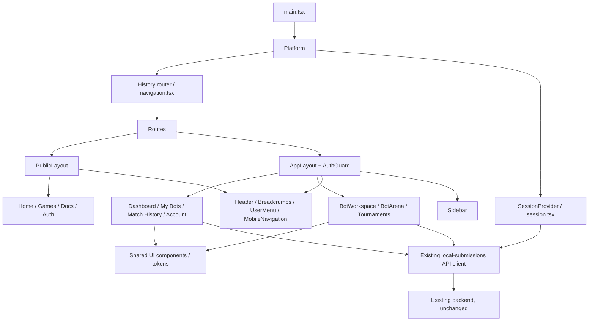

# Phase 10.5 — Frontend architecture & UI redesign

Completed 2026-10-13. Scope: React frontend, frontend tests, README and this report/screenshots. No Java source, GameEngine, rules, worker, database schema, Maven dependencies, TCP 1.0, web-1 or deployment configuration changed in this phase. No commit, push or deployment.

## 1. Audit and actual capabilities

The existing main entrypoint selected pages once from `window.location.pathname`. Workspace, Arena, tournaments and authentication had separate navigation and styles. The existing APIs already supplied immutable submissions, execution eligibility, authoritative board frames/MoveEvents, tournament results and cookie authentication.

| Capability | Existing backend contract used | UI treatment |
|---|---|---|
| Authentication | `auth/register`, `auth/login`, `auth/me`, `auth/logout` | Shared session context; private routes gated by server identity |
| My Bots / editor | `submissions`, `submissions/{id}`, immutable versions | Metadata list, owned-source editor, version/hash display |
| Arena | `bots`, `battles`, `battles/{id}` | Actual fixture/saved-version selection, server frames and results |
| Tournaments | `tournaments`, detail/mutation/match endpoints | Listing, registration, lifecycle, bracket, standings, replay |
| Organizer permission | Detail response `canManage`, `viewerOwnerId`, tournament `ownerId` | Explicit `canManage === true` **and** matching identity required |
| Multiplayer | Existing WebSocket transport/model | Preserved at `/multiplayer` |

Constraints found in source:

- Tournament listing requires authentication. The public page explains this and offers Login; it does not invent a public endpoint or fake tournaments.
- Standalone battle history has no player ownership filter. Dashboard/history explicitly label it **shared local arena history**, rather than claiming it is a user's private match history.
- There is no ranking, aggregate win rate or per-match start-time API. Those numbers/timestamps are not fabricated. Schedule shows backend round numbers and describes the missing timing capability.
- Player tools and REST APIs remain local-development-only. The production build retains public pages and multiplayer; it does not enable local account/bot endpoints on Render.

## 2. New architecture



`Router` handles internal Links with History API, query deep links, back/forward updates and dirty-editor navigation confirmation. Route transitions update the document title and focus the content region. Normal modified-click/new-tab links keep native browser behavior.

`SessionProvider` checks `auth/me`, aborts stale requests and clears private content on 401 or cross-tab identity change. `AuthGuard` mounts private components only after a server-issued identity is confirmed; children are keyed by user ID. SPA login refreshes the shared session without a full reload. The older exported `AuthGate` remains compatible with existing consumers/regression tests.

`AppLayout` adds a collapsible desktop sidebar. `PublicLayout` shares the header, footer and breadcrumbs. Mobile navigation uses native modal `<dialog>`; background content is inert, Escape closes it and prior focus is restored. Logout remains available inside the mobile drawer.

## 3. Routes

| Route | Access / purpose |
|---|---|
| `/` | Public landing page |
| `/games` | Public game/contract overview |
| `/docs` | Public developer guide |
| `/login`, `/register` | Existing cookie authentication forms |
| `/tournaments` | Public introduction when signed out; actual listing when signed in |
| `/tournaments/:id` | Authenticated tournament detail, organizer/participant tabs |
| `/dashboard` | Protected overview from existing APIs |
| `/my-bots` | Protected metadata list |
| `/bot-workspace` | Protected bot editor; original route preserved |
| `/bot-workspace?bot=<id>` | Owned bot deep link, server authorization still required |
| `/bot-arena`, `/arena` | Protected Arena; `/arena` is an alias |
| `/bot-arena?battle=<id>` | Replay/live-state deep link |
| `/my-tournaments` | Server-returned tournaments filtered by owner or participant identity |
| `/match-history` | Protected view of shared local arena history |
| `/account` | Protected server-issued account identity |
| `/multiplayer` | Existing RPS / Number Guessing WebSocket UI |
| Other paths | Honest not-found page |

The existing SPA rewrite in `frontend/vercel.json` already supports deep links and was not changed.

## 4. Component structure and changed files

```text
frontend/
  index.html                 updated metadata/theme
  src/
    main.tsx                 mounts Platform
    Platform.tsx             routes + composition
    navigation.tsx           Router, Link, dirty-navigation guard
    session.tsx              shared cookie-session state
    layouts.tsx              App/PublicLayout, Header, Sidebar,
                             MobileNavigation, Breadcrumbs, UserMenu, AuthGuard
    ui.tsx                   Button, Card, Badge, Input, Select, Tabs,
                             Modal, Table, Toast, Empty/Loading/ErrorState,
                             ConfirmDialog, StatCard, PageHeader, ErrorBoundary
    platform.css             tokens, shared components, responsive feature layout
    pages.tsx                Home, Games, Documentation, Account, DataPage
    drafts.ts                bounded, account-scoped volatile draft retention
    Auth.tsx                 redesigned forms + SPA session refresh
    BotWorkspace.tsx         IDE layout, draft warnings/retention, owned deep link
    BotArena.tsx             competition layout, replay deep link, semantic board rows
    Tournaments.tsx          detail tabs, mine filter, backend permission confirmation
    style.css                removed remote Google Fonts import
    Platform.test.tsx        new routing/session/API/draft tests
    ui.test.tsx              new keyboard/modal tests
    BotWorkspace.test.tsx    added UTF-8 source-limit test
    Tournaments.test.tsx     tab navigation + canManage regression
docs/
  phase10-5-report.md
  screenshots/phase10-5/      actual browser captures
README.md                    current route/run instructions
```

No new frontend package dependencies; `package.json`, pnpm lockfile and Vercel configuration unchanged. Existing feature CSS remains as a base, overridden by the shared scoped design system. The original multiplayer implementation and API transport were preserved.

## 5. Redesigned screens and UX

- **Home:** developer-platform landing, contract example and real feature entrypoints; no fake statistics.
- **Dashboard:** API-derived bot/tournament counts, shared local match count, recent metadata, quick actions. Partial failures show errors and `Unavailable`, never a synthetic zero.
- **My Bots:** private metadata, version/hash and eligibility, owned editor deep links.
- **Bot Editor:** bot sidebar, source editor, immutable version selector, actions, metadata, validation feedback and contract docs. Historical versions remain read-only; Save still sends expectedVersion and stable mutation requestId.
- **Arena:** selection/configuration, centered server-authoritative 9×9 board, side/type labels, last-move highlight, captures, result, battle log and replay. Existing bounded polling, no-double-start and eligibility checks retained.
- **Tournaments:** collapsible creation panel, listing/detail deep links; Overview, Participants, Schedule/Bracket, Standings and Match Results tabs. Owner lifecycle controls require explicit current backend permission, refreshed after mutation and polling. Champion/results and replay still come from backend.
- **Authentication/Account:** consistent local account forms and identity information; network and authorization errors remain visible.
- **History:** server metadata with direct links to authoritative replay.

Dark navy/slate tokens, emerald/cyan accents, system sans-serif + monospace, spacing/radius/elevation tokens, consistent states and visible keyboard focus. Layout breakpoints: 1100, 850 and 560px. Board/editor/log/table have their own mobile adaptations. Tables/brackets scroll within their containers rather than widening the page.

### Unsaved source and privacy

- Dirty editors warn on SPA navigation and `beforeunload`.
- Drafts are retained only in module memory, keyed by the confirmed user ID. A session-expired message explains how to recover: sign back into the **same account before reloading**.
- Another account cannot render the previous account's draft. No source or auth token is put in localStorage/sessionStorage. Only the existing random, non-secret cross-tab auth-change marker uses localStorage.
- Retention is bounded to 16 account drafts and 32KiB source per draft. Oversized source disables Save/Duplicate and warns to copy it out; a full cache also warns rather than silently promising recovery.
- Saved versions remain PostgreSQL-backed. Volatile drafts cannot survive closing/reloading the tab; warnings describe that limitation.

HttpOnly sessions, `credentials: include`, Origin/CSRF enforcement, backend ownership checks and secure-worker execution boundaries remain unchanged. No source execution/eval added to the frontend.

## 6. Verification actually run

| Check | Result |
|---|---|
| `pnpm test` | **46/46 passed**, 11 test files, no skipped tests |
| TypeScript | **Passed**, via `tsc -b` in production build |
| `pnpm build` | **Passed**, Vite 7.3.7, 48 modules |
| Final artifacts | JS 264.75kB / gzip 82.90kB; CSS 27.01kB / gzip 6.60kB |
| Existing regression tests | Auth, Workspace, Arena, tournaments, multiplayer, models, transport, deployment checks retained |
| New tests | Routing, cookie credential options, shared-shell logout, 401/cross-tab cleanup, account-scoped draft restoration, navigation denial, owned query link, partial API failures, SPA login, tabs keyboard, modal close/focus plumbing, canManage, UTF-8 limit |
| `git diff --check` | Passed for tracked frontend/README changes |

Build verification temporarily set `VITE_WS_URL=wss://build-verification.invalid/ws` in the build process to satisfy the existing production endpoint guard; the environment was restored afterward. This is a validation placeholder, **not a deployment URL**. No environment/deployment file was changed. Use your existing real WSS setting when producing a deployable build.

Automated API integration here uses mocked fetch responses through the **real existing API client** and rendered frontend. It is distinct from the following real browser/backend checks.

### Real browser checks

Used the in-app browser against Vite `127.0.0.1:5173`, the unchanged secure local backend `127.0.0.1:8090` and a new disposable PostgreSQL 17 test container with its own database/credentials. Existing persistent user database was not used.

- Desktop 1440×1000 and mobile 390×844; additional no-overflow checks on Home/Editor at 320px and Editor at tablet 768px.
- Landing, registration/login, shared dashboard, source editor, Arena, tournament detail and history inspected.
- Actual test account login redirected to dashboard without page reload; empty counts were zero, then became 1 bot / 1 tournament / 1 local battle from backend responses.
- Actual bot save created immutable version 1 with server ID/hash and backend eligibility.
- FirstLegalMoveBot vs CapturePriorityBot completed: **DRAW / MOVE_LIMIT_REACHED**, 200 moves. History replay loaded real frames; Reset then Next produced replay cursor 1.
- Actual tournament creation and registration opening succeeded; organizer controls appeared after confirmed `canManage` response. Participants showed actual 0/4; no invented entrants.
- Mobile drawer opens/closes; Escape restores focus to its trigger; mobile Logout available.
- DOM width checks on landing/dashboard/editor/Arena/tournaments/history at 390px found no horizontal page overflow.
- Captured browser warning/error logs returned an empty list for the verified live frontend session.

Temporary Vite/backend processes were stopped after verification; the task-created PostgreSQL test container and temporary DB credential files were removed. Screenshots and build artifacts remain. During development Vite invalidated Fast Refresh for mixed hook/component exports and refreshed dependent modules; this did not occur as an application console error, and final tests/build passed. Unsaved-edit retention is intended for runtime navigation/session changes, not an HMR code replacement during development.

Accessibility checks performed: semantic heading/form/button queries in tests, keyboard tab navigation, native dialog behavior/focus, skip link, labeled fields, descriptive board rows/cells, focus-visible CSS and reduced-motion handling. No axe/Lighthouse package is installed; no automated WCAG certification or exhaustive screen-reader audit is claimed.

The complete tournament lifecycle with two accounts and live multiplayer RPS/Number Guessing was not replayed manually in this frontend phase; existing automated regression coverage remains. Java/Python/security stress suites were not rerun because their implementations were not changed.

## 7. Screenshots actually captured

Browser captures, not mockups:

- [Home desktop](screenshots/phase10-5/home-desktop.png), [mobile](screenshots/phase10-5/home-mobile.png)
- [Dashboard desktop](screenshots/phase10-5/dashboard-desktop.png)
- [Editor desktop](screenshots/phase10-5/editor-desktop.png)
- [Arena desktop](screenshots/phase10-5/arena-desktop.png), [mobile](screenshots/phase10-5/arena-mobile.png)
- [Tournament desktop](screenshots/phase10-5/tournaments-desktop.png), [mobile](screenshots/phase10-5/tournaments-mobile.png)

These display disposable test data, not seed/fake data built into the product.

## 8. Run locally

Backend prerequisites/setup remain in [Phase 10 report](phase10-report.md). PostgreSQL 17, configured private root `.env`, Docker Desktop Linux/WSL2 and the verified worker image are required for secure saved-bot execution.

Backend PowerShell, repository root:

```powershell
Set-Location D:\Socket\BattleCode
.\scripts\run-persistent-local-arena.ps1 -EnvFile .env `
  -Python 'C:\Users\Admin\miniconda3\python.exe' `
  -Docker 'C:\Users\Admin\AppData\Local\Programs\DockerDesktop\resources\bin\docker.exe'
```

Frontend PowerShell, another terminal:

```powershell
$runtimeRoot = 'C:\Users\Admin\.cache\codex-runtimes\codex-primary-runtime\dependencies'
$env:Path = "$runtimeRoot\node\bin;$runtimeRoot\bin\fallback;$env:Path"
Set-Location D:\Socket\BattleCode\frontend
pnpm.cmd exec vite --host 127.0.0.1 --port 5173 --strictPort
```

Open `http://127.0.0.1:5173/`, register/login, then use Dashboard, My Bots, Editor, Arena and tournaments. Keep API/frontend on **127.0.0.1** for SameSite cookie behavior. `/multiplayer` additionally needs the existing WebSocket server configured by `VITE_WS_URL`; the local REST arena backend is not that server.

## 9. Remaining limits

- Backend remains local-only; no public authentication/submissions/tournament service added.
- Public tournament data, private standalone match filtering, rankings and precise schedule timestamps require future backend capabilities.
- Textarea is the source editor; no syntax highlighting/autocomplete/parser or browser execution was introduced.
- Draft recovery is tab-memory-only and bounded; reload/close still loses unsaved edits after warning.
- This is a lightweight History router, not a new routing dependency. Native confirmation protects dirty navigation; tournament detail tabs are local UI state.
- Component library is dependency-free and intentionally small. Native ConfirmDialog is available; existing destructive/editor selection confirmations retain native browser confirmation behavior.

Phase 10.5 stops here. No backend/deployment/next-phase work performed.
