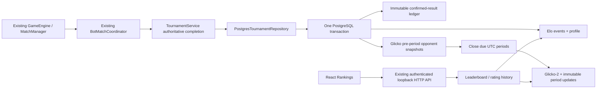

# Phase 10.7 — Tournament scoring, Elo và Glicko-2

## Implementation

Ba hệ thống độc lập: Tournament Points 3–1–0, Elo từng confirmed Ranked match, Glicko-2 theo rating period. Không cộng Elo và Glicko-2 thành điểm tổng hợp. Không tạo engine/runner khác hoặc sửa OTT rules, TCP 1.0, web-1, authentication contract, source eligibility/security gate.



## Canonical result và fairness

`ConfirmedMatchResult` chứa matchId, gameMode, rulesVersion, hai frozen bot identities (botId, ownerId, source version, exact SHA-256), outcome A/B/DRAW/CANCELLED, reason, server-ranked flag và timestamp. SHA-256 của canonical fields bảo vệ duplicate processing: cùng ID/hash là no-op; ID khác hash bị từ chối. Timestamp lấy từ lần terminal checkpoint đầu tiên trong PostgreSQL, không dùng timestamp mới khi retry.

Chỉ composition/backend tạo contract từ authoritative tournament result; không có endpoint nhận kết quả, điểm, K, rating hoặc Ranked flag của client. PostgreSQL xác minh owner và immutable version/hash trước khi ghi ledger. BYE không tạo scoring result. Cancelled/interrupted/infrastructure outcomes không tăng W/D/L hoặc Elo/Glicko. FORFEIT do bot có winner hợp lệ được tính thắng/thua.

Whitelist Ranked hiện tại là game/rules `ott-board-9x9-v1`; RPS, Number Guessing và rules version khác được từ chối Ranked. Identity key là `(botId, gameMode, rulesVersion)`, không phải source version. Save source mới giữ rating, từng match vẫn freeze exact version/hash. Same-owner và same-bot matches không tính rating.

Ranked chỉ áp dụng cho tournament matches mới sau activation của migration V4, vốn đã qua existing verified-worker admission gate. Kết quả lịch sử giữ nguyên, không retroactively cấp rating. Các kết quả lịch sử đọc lại được ghi ledger Unranked. Local standalone Arena và trusted fixture demo giữ Unranked; persistence/history V3 vẫn hoạt động, không chuyển thành Ranked và không có Elo change giả.

## Scoring

Giữ lịch Round Robin hai lượt đổi bên và Single Elimination rematch/seed advancement Phase 9. Standings chỉ nhận FINISHED WIN/DRAW/FORFEIT có shape hợp lệ; bỏ BYE/cancelled/unknown infrastructure results. Win 3, Draw 1, Loss 0; tie-break: points, wins, head-to-head points trong nhóm cùng points/wins, seed order. Không dùng captures làm rating.

## Math và versioned policy

`RatingPolicy.V1`: initial Elo/Glicko 1500; K32 cho pre-match games <20, K24 cho 20–99, K16 từ 100; initial RD350, volatility0.06, tau0.5. `RatingPolicy`/`RatingService` constructor cho cấu hình server, không có client override. Đổi policy phải đổi version và có migration rõ ràng; profile policy mismatch bị fail closed, không âm thầm diễn giải lại lịch sử.

`EloRatingEngine`: hai phía tính từ cùng pre-match snapshot, double precision trong DB, chỉ round UI.

`Glicko2RatingEngine`: conversion 173.7178, variance/delta, revised Illinois iterative volatility update (epsilon1e-6, bounded iteration), inactivity tăng RD, draw score0.5. Reference test dùng ví dụ 1500/RD200 gặp 1400/RD30, 1550/RD100, 1700/RD300 → rating1464.06/RD151.52/volatility≈0.059996 từ [tài liệu chính thức của Mark Glickman](https://www.glicko.net/glicko/glicko2.pdf).

Period v1 = 24 giờ theo UTC epoch. Admission period là thời điểm ledger commit, không backdate late results vào period đã đóng. Glicko opponent snapshots giữ nguyên trong cả period, Elo thay đổi từng trận. Due periods đóng khi admission mới hoặc khi đọc leaderboard/period history; downtime không làm mất period, inactive periods được catch up nguyên tử. Không có scheduler thứ hai. UI có thể chưa phản ánh Glicko mới cho đến lần đọc/admission kế tiếp.

## PostgreSQL / audit / recovery

Migration **V4__rating_ledger.sql** thêm `rating_policy_activation`, `rating_profiles`, `rating_events`, `rating_periods`, `rating_period_updates`, `match_scoring_ledger`. Không rewrite V1–V3, không xóa dữ liệu cũ; không cần leaderboard snapshot table.

Unique match ID và event `(matchId, botId)` ngăn duplicate. Immutable triggers cấm UPDATE/DELETE ledger/events/period updates. Tournament checkpoint, confirmed ledger, hai Elo updates và Glicko admission nằm trong cùng JDBC transaction. Advisory transaction lock `rating-ledger` serialize writes; row locks bảo vệ profiles. Không network execution dưới lock; existing DB lock/statement/socket timeouts áp dụng. Checkpoint lỗi rollback và existing TournamentService fail closed.

Recorded ledger/event sequence là thứ tự authoritative commit dùng cho replay/audit. `RatingService.rebuildProfiles()` là Java administrative recovery API, không expose HTTP: kiểm tra chuỗi Elo và tính lại công thức, replay Glicko periods theo frozen opponent snapshots, phục hồi mutable profiles trong một transaction; không sửa immutable history. Restart recovery giữ completed tournament results, hủy attempt chưa hoàn tất và không tính lại result đã ghi.

## API / frontend

API nằm trong existing local-only server: Origin/Host allowlist và session bắt buộc; không thêm production endpoint.

| GET endpoint | Response |
| --- | --- |
| `/api/local/rankings` | `rankings`, policyVersion/gameMode/rulesVersion; sort Elo DESC, bot UUID deterministic tie-break |
| `/api/local/rankings/glicko2` | Tương tự, sort Glicko-2 DESC |
| `/api/local/rankings/{botId}/history` | `events` (match, Elo before/after, score, game/rules/period) và `periods` (Glicko before/after, RD, volatility, games) |

Leaderboard tối đa100 bots có confirmed eligible games và chưa tombstone; provisional nếu <20 Ranked games. History tối đa100 events/periods. Không trả source, worker metadata, credentials. Không gộp game/rules. Đây là bảng toàn bộ bot thuộc mode được hỗ trợ, không phải điểm tổng hợp nhiều game.

React `/rankings` có Elo mặc định, rank/bot/W-D-L/provisional. Advanced mở Glicko-2/RD/volatility/history và breakdown. Empty/error/loading là dữ liệu thật; không fake stats. Bảng có horizontal scroll container trên mobile. Sidebar thêm Rankings; route dùng existing AuthGuard. Tournament Standings có disclosure scoring/tie-break. Standalone Arena hiển thị Unranked và không tự suy ra Elo change.

## Files

- Backend mới: `bot-match/src/main/java/dev/battlecode/botmatch/rating/{RatingPolicy,EloRatingEngine,Glicko2RatingEngine,ConfirmedMatchResult,RatingService}.java`.
- Migration mới: `bot-match/src/main/resources/db/migration/V4__rating_ledger.sql`.
- Integration: `PostgresTournamentRepository.java`, `LocalArenaHttpServer.java`, `TournamentRules.java`.
- Tests: `RatingEngineTest.java`, `RatingPostgresIT.java`, bổ sung `PostgresPersistenceIT.java` (migration count/restart rating/API authorization).
- Frontend: `Rankings.tsx`, `Rankings.test.tsx`, `Platform.tsx`, `layouts.tsx`, `BotArena.tsx`, `Tournaments.tsx`.
- Test runner: `scripts/test-phase10-postgres.ps1`.

## Verification

- `mvn -P local-bots clean test`: BUILD SUCCESS, **318 regression tests**, không skip.
- `mvn -P local-bots package`: BUILD SUCCESS; toàn bộ regression suite chạy lại trong package, không bỏ qua tests.
- Focused `RatingEngineTest,RatingPostgresIT,PostgresPersistenceIT`: BUILD SUCCESS, **14 tests**, gồm **9 actual PostgreSQL integration tests** và5 math tests. PostgreSQL17 Docker thật trên port loopback động; schema riêng mỗi test và cleanup sau test, không H2/mock database.
- Covered: reference math, win/loss/draw, unequal ratings/K boundaries, duplicate concurrent admission, independent concurrent result, hash conflict, rollback, immutable audit, source upgrade, same-owner/self-play rejection, cross-game/rules whitelist, due/inactive period, deterministic projection rebuild, tournament restart recovery, HTTP session/Origin guards.
- `pnpm test`: **52 tests PASS**,13 files; giữ session/routing/save/version/arena/replay/tournament permission regressions.
- `pnpm build`: PASS (TypeScript + Vite). WSS placeholder `wss://build-verification.invalid/ws` chỉ dùng env tạm cho build verification, không sửa .env/deployment và không dùng artifact này để deploy.

Lệnh focused IT đã chạy (biến môi trường trỏ disposable PostgreSQL):

```powershell
mvn -P local-bots -pl bot-match -am test '-Dtest=RatingEngineTest,RatingPostgresIT,PostgresPersistenceIT' '-Dsurefire.failIfNoSpecifiedTests=false'
```

`scripts/test-phase10-postgres.ps1` cũng đã bổ sung RatingPostgresIT vào bộ IT mặc định để không bỏ sót khi tái chạy.

## Giới hạn / vận hành

- Existing local-bots/PostgreSQL development graph; không expose Ranked lên Render/production, không thêm RPS/Number Guessing vào rated modes.
- Due periods lazy-close, không background timer. Server-owned policy version mới cần migration/adaptation; không cho client chọn policy.
- Leaderboard/history bounded100; chưa pagination hoặc chart/trend riêng. Advanced history cung cấp exact rating changes và period breakdown.
- Không chạy browser end-to-end hoặc live secure-worker tournament trong phase này; frontend dùng rendered automated API mocks, rating persistence tests dùng PostgreSQL thật và authoritative completion fixtures. Các tests không tạo fake product data.
- Không commit/push/deploy. Dùng hướng dẫn local Phase10 hiện có để khởi động ứng dụng; Flyway migrate V4 trước HTTP admission. Có thể dùng scripts/start-phase10-test-db.ps1 để tái chạy IT với `BATTLECODE_TEST_DB_URL/USER/PASSWORD` từ disposable test config.
- PostgreSQL disposable container và file credentials tạm đã được dọn sau khi kiểm thử; không giữ database test chạy nền.
