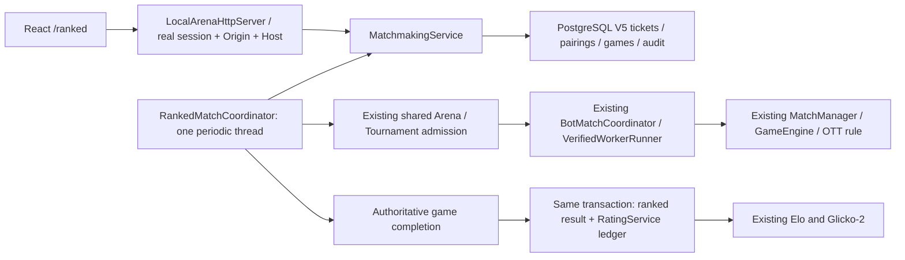
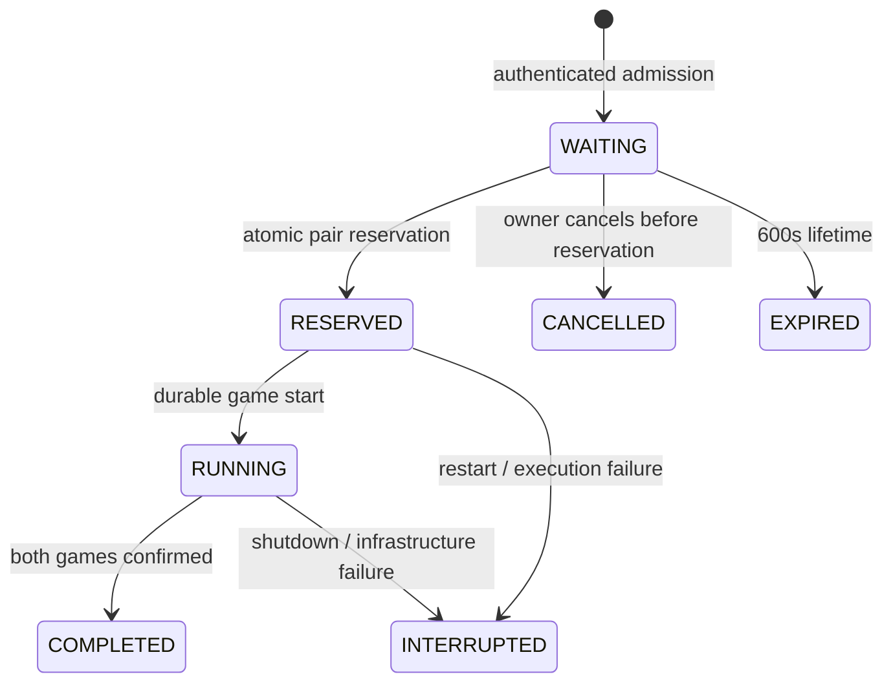

# Phase 10.8 — Competitive integrity & Ranked matchmaking

## Architecture

Local-only Ranked queue integrated into the PostgreSQL/auth application. No new GameEngine, sandbox, worker, BotMatchCoordinator or rating implementation. OTT rules, TCP1.0 and web-1 remain unchanged.



`RankedQueueEntry`, `MatchmakingTicket`, `RankedPairing`, `RankedMatch`, `MatchmakingPolicy`, `MatchmakingService`, `RankedMatchCoordinator` are under `bot-match/.../ranked`. Ticket freezes server-issued owner, bot ID, version, exact source SHA-256, game/rules version, Elo snapshot and queued time. No source bytes or worker credentials in API output.

## Queue state machine



Cancellation is search-only; it cannot cancel a reserved match to avoid a loss. UI shows a conflict if cancellation loses the reservation race. SQL triggers enforce ticket transitions and frozen identity fields. Pair/game transitions are also guarded; terminal execution records cannot be changed. Partial unique indexes enforce one active ticket per owner and per bot.

## Pairing and side policy V1

- Server-owned windows: ±100 initially, ±150 after30s, ±250 after60s, ±350 after120s; never above350. `MatchmakingPolicy` has immutable configurable thresholds/limits and a policy version, not client options.
- Both waiting tickets must fit **both** windows, have different owners/bots, compatible game/rules, live real account sessions, undeleted bots and resolvable exact source versions. The shared verified-worker gate must be live.
- Oldest waiting anchor is considered first to prevent newer entrants continuously displacing it. Its compatible opponents are ordered by Elo difference, waiting time and deterministic ticket ID. This is oldest-anchor aging with closest eligible opponent, not globally minimum-difference selection regardless of waiting time. No compatible opponent means bounded waiting then expiry, not a fabricated match.
- One Ranked pairing has **two games**, with fixed first-side assignment by lexicographically sorted ticket UUIDs and reversed sides in game2. Assignment is persisted before execution and does not inspect results.
- Rating unit is **each game**: two independent immutable match IDs / ledger keys. Tournament points do not apply to queue games. A confirmed game keeps its rating even if the other game is later interrupted; interrupted games have no winner/rating. There is no extra pairing-level Elo award.
- Repeated owner pair is blocked for24h, including interrupted attempts, so creating another bot does not bypass the pair policy.

## Atomicity / execution / recovery

Transactions serialize on `ranked-queue`, lock waiting rows, and insert pairing plus two games while updating both tickets. Only one active Ranked pairing is admitted locally, matching the single existing Arena execution slot. Different-owner concurrent joins and duplicate reservations cannot start multiple games for one ticket. Request idempotency uses existing durable records/fingerprints; a changed payload with the same request ID conflicts.

The coordinator holds the shared Arena reservation across both games. It only tries admission when at least two waiting tickets exist; manual Arena/Tournament work retains the existing admission behavior. Execution uses frozen `BotSubmission` and the existing verified worker through Arena aliases. There is one scheduled task/thread; no per-request execution threads or unbounded client task submissions.

No DB lock/transaction remains open while bots execute. A start that crashes before the battle ID is persisted stays RESERVED and is interrupted at recovery rather than rerun. Progress writes only touch RUNNING records. Terminal snapshot, canonical result, Elo events/profile and Glicko admission commit in one transaction using existing `RatingService`. Duplicate completion is no-op. Persistence/coordinator failure fails closed until application restart.

Startup keeps non-expired WAITING tickets; overdue waiting entries expire. RESERVED/RUNNING tickets, pairings and games become INTERRUPTED. There is no worker-resume assumption, synthetic winner, automatic source replay or duplicate ledger processing. Completed records remain unchanged. Shutdown stops the coordinator, cancels active execution and closes the existing application resources.

## Security / anti-abuse

- Real Phase10 cookie authentication only; no workspace-token fallback for Ranked.
- Existing exact loopback bind, Host/Origin allowlist, CSRF policy and bounded HTTP worker queue apply.
- Only owned exact versions may join; deleted bots and mismatched hash/version fail closed. Save does not mutate a frozen ticket. No client owner/rating/opponent/result/K field is accepted.
- One active owner/bot ticket; queue capacity64; admission/cancel combined limit20 successful mutations per600s (at most10 rapid join/cancel cycles). Retries with the same request ID do not consume a new slot.
- Recent pair avoidance is audited once per owner/prior pairing. More than20 confirmed Ranked games/hour creates a review signal, not an automatic cheating verdict or ban. IP is not used as sole identity/cheating evidence; captures/move counts never affect Elo.
- Game deadline10min; UI updates stop after10min or first network error and require explicit refresh. No automatic join retry or opponent-selection endpoint.

## V5 persistence / retention

`V5__ranked_matchmaking.sql` adds `ranked_queue_tickets`, `ranked_pairings`, `ranked_games`, `matchmaking_audit_events`, partial unique indexes, frozen-version FKs, queue/rate indexes and transition triggers. V1–V4 are not rewritten.

Local retained tickets are bounded4096; existing durable idempotency capacity remains4096 across services. Capacity failure is explicit and does not discard active data. Startup recovery purges audit and terminal execution/ticket records older than30days in FK-safe order. Immutable rating ledger/events remain retained; old replay snapshots may expire with Ranked execution history. History reads cap100 games. Retention does not reset bot rating or enable duplicate active execution.

## APIs

All under `http://127.0.0.1:8090/api/local`, authenticated, same existing Origin/Host guards, no arbitrary query parameters.

| Endpoint | Request / response |
| --- | --- |
| POST `/ranked/queue` | Exact JSON `requestId`, `botId`, `version`, `sourceSha256`; server supplies owner, mode/rules and Elo; returns frozen ticket |
| GET `/ranked/queue/me` | `entry` (nullable ticket/window/duration), `ratings` for owned undeleted bots (server default1500 if not yet rated) |
| DELETE `/ranked/queue/me` | Exact JSON `requestId`; owner cancels WAITING only |
| GET `/ranked/matches` | Latest100 participant-authorized games, snapshots and committed `ratingChanges` |
| GET `/ranked/matches/{matchId}` | Participating owner only; unknown/unauthorized match yields404 |

Games show Elo before/after only when rating events exist in committed PostgreSQL state. An interrupted second game does not hide the first game's valid committed rating. The pairing itself has no synthetic winner or tournament points; individual game outcomes are authoritative.

## Frontend

`/ranked` uses existing AuthGuard/design system: saved bot selection, current Elo, Join Ranked Queue, Searching/window/duration, Cancel Search, Match Found, live turn/status, confirmed result/Elo change and history. Invalid/unequipped bots remain blocked with a visible explanation. No predictions are rendered as committed Elo. Polling is sequential and bounded; submission has an in-flight guard. Page unmount aborts reads and timers; no source runs in browser. Existing Arena remains Unranked.

## Verification

Final command results are recorded after the sequential verification run below. Real database tests use PostgreSQL17 on a disposable loopback port and dedicated schemas; no H2/mock database. Domain tests with a supplied eligibility predicate are distinguished from real worker tests.

- `mvn -P local-bots clean test`: **BUILD SUCCESS,319 regression tests**, no skipped tests.
- `mvn -P local-bots package`: **BUILD SUCCESS**, the319 regression tests ran again; no test-skipping flags.
- Focused policy/PostgreSQL/worker suite: **BUILD SUCCESS,17 tests** (1 pure policy,14 PostgreSQL tests,2 real PostgreSQL + verified-worker end-to-end tests), no skips.
- `pnpm test`: **55 tests PASS**,14 files. `pnpm build`: **PASS**, TypeScript + Vite. Build verification used a temporary `VITE_WS_URL=wss://build-verification.invalid/ws`, not a deployment URL; no .env/deployment change and no deployment of that artifact.
- A concurrent Maven clean mistakenly removed classes during an earlier IT run; that failed run is not counted. All results above are from the subsequent serialized clean-test/IT sequence.

- `MatchmakingPolicyTest`: window boundaries/cap.
- `RankedPostgresIT`: join/cancel/idempotency, ownership, concurrent joins/reservation, frozen ticket trigger, expansion, swap-side completion, rating integration, duplicate result, repeat block, rate limits, expiry, recovery/no new rating, participant history authorization.
- Existing `RatingPostgresIT` and `PostgresPersistenceIT`: rating math projection/rebuild, rollback, auth/Origin, migrations and tournament restart regressions.
- `PostgresWorkerIT`: actual verified OS worker, existing engine and PostgreSQL; two queue games finish with authoritative forfeit, four committed rating events, then fresh server preserves results. Existing real tournament/standalone worker regression is retained.
- Frontend rendered tests: join/cancel frozen payload, server states, authoritative result/Elo display and errors; existing routing/auth/save/replay/tournament tests retained.

No browser manual end-to-end or new escape/security stress suite was run. Real verified-worker integration verifies the existing mandatory gate, not a claim that every possible sandbox escape is impossible. Disposable PostgreSQL and its temporary credential files were cleaned up after verification.

## Changed files

- New: `bot-match/.../ranked/{MatchmakingPolicy,MatchmakingTicket,RankedQueueEntry,RankedPairing,RankedMatch,MatchmakingService,RankedMatchCoordinator}.java`, `V5__ranked_matchmaking.sql`, `RankedPostgresIT.java`, `MatchmakingPolicyTest.java`, `frontend/src/Ranked.tsx`, `Ranked.test.tsx`, this report.
- Updated: `LocalArenaService.java` (compatible shared-admission aliases), `LocalArenaHttpServer.java` (auth endpoints/lifecycle), `PostgresPersistenceIT.java` (V5 count), `PostgresWorkerIT.java` (real Ranked flow), `scripts/test-phase10-postgres.ps1`, `frontend/src/{Platform.tsx,layouts.tsx}`, README.
- No changes to GameEngine, MatchManager, rating engines, OTT rules, TCP1.0, web-1, production deployment or Maven dependency graph.

## Local PowerShell

Docker Desktop Linux engine, Java21, Maven, existing `.env` PostgreSQL credentials and built verified-worker image are required. Do not expose ports beyond the existing loopback development setup.

```powershell
Set-Location D:\Socket\BattleCode
$dockerPath='C:\Users\Admin\AppData\Local\Programs\DockerDesktop\resources\bin\docker.exe'
& $dockerPath compose --env-file .env -f compose.local.yml up -d
mvn -P local-bots package
& .\scripts\run-persistent-local-arena.ps1 -EnvFile .env -Port 8090 -Python 'C:\Users\Admin\miniconda3\python.exe' -Docker 'C:\Users\Admin\AppData\Local\Programs\DockerDesktop\resources\bin\docker.exe'
```

In another PowerShell:

```powershell
$runtimeRoot='C:\Users\Admin\.cache\codex-runtimes\codex-primary-runtime\dependencies'
$env:Path="$runtimeRoot\node\bin;$runtimeRoot\bin\fallback;$env:Path"
Set-Location D:\Socket\BattleCode\frontend
pnpm.cmd exec vite --host 127.0.0.1 --port 5173 --strictPort
```

Open `http://127.0.0.1:5173/ranked`, sign into two different accounts/browser profiles and select owned saved bots. Exactly127.0.0.1 avoids mixing SameSite hostnames. If no live verified gate, queue admission is refused.

To rerun DB/worker tests, create the disposable DB with `scripts/start-phase10-test-db.ps1`, then use `scripts/test-phase10-postgres.ps1 -Worker -Python ... -Docker ...`; it includes RankedPostgresIT. Test credentials stay in ignored `.tools/phase10`, never docs/logs/source.

## Remaining limitations

- Local-only OTT mode/rules, one shared game at a time; manual Arena/Tournament contention delays search. No Internet deployment or distributed worker claiming.
-24h owner-pair cooldown can leave a two-person queue unmatched after one pairing; expiry is600s. This is explicit anti-repeat policy, not proof of cheating.
- History limited100 games; no pagination/reconnect/resume. Cleanup is on startup/recovery, not a separate maintenance service; retained-capacity failures require operator attention.
- Actual abrupt OS kill was not injected; persisted RESERVED/RUNNING crash states and fresh server recovery are exercised. Completed ratings are immutable; interrupted source is not rerun.
- No commit/push/deploy, no OTT/network protocol changes.
