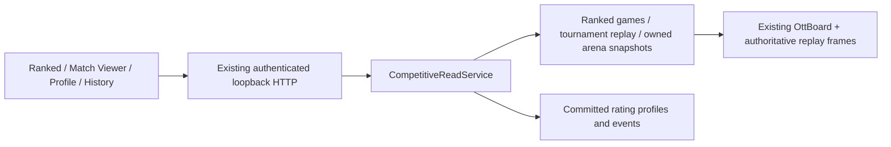

# Phase 10.9 — Competitive UX & live match spectator

## Architecture / audit

Built on Phase10.6 React components, Phase10.8 Ranked queue and PostgreSQL V1–V5. Ranked games already persisted authoritative `board`, `moves`, `frames`, `turn` and `result`; the old DTO lacked display names/date/pre-match Elo. New read projections supply those fields without executing bots or modifying scoring transactions. No new GameEngine, rating engine, verified worker, WebSocket transport or schema migration.



## Routes / behavior

| Route | Product behavior |
| --- | --- |
| `/ranked` | Existing search/admission preserved; Watch match / View replay links |
| `/matches/:matchId` | Participant-authorized live snapshot or recorded replay; board center, bot names/version/public owner display, available pre-match Elo, last move highlight, timeline, result/reason and committed Elo delta |
| `/bots/:botId` | Public rating summary for rated bots, or own unrated bot; owner-only Edit Bot, Elo/W-D-L/games/provisional, actual Elo chart, Advanced Glicko/RD/volatility, accessible recent matches |
| `/rankings` | Elo default, server Glicko ordering in Advanced, name search/provisional filter over actual bounded dataset, profile links and actual rating chart |
| `/match-history` | Participant/owner history; Ranked/Unranked/Tournament distinction, bot names, outcome/date, committed Elo details and viewer link; 50 per page |

Dashboard/My Bots now link profiles and use authorized history summaries with real display names instead of UUID/hash references. Tournament View match is disabled for nonparticipant entries. Each page retains one H1; source hashes and internal IDs are not rendered by default. Existing dark design system and accessible controls retained; no new dependencies/framework.

## Read API contracts

All endpoints are local-only under `http://127.0.0.1:8090/api/local` and require real Phase10 session plus existing exact Origin/Host policy.

| GET | Contract |
| --- | --- |
| `/matches/{id}` | `matchId`, `kind`, `gameMode`, `rulesVersion`, `status`, `date`, side `a/b` display metadata, nullable authoritative `snapshot`, committed `ratingChanges` |
| `/match-history?page=N` | `{matches,page}`; page0 default, 50 rows/page, page0–200 only; deterministic date/id order; summary snapshots omit boards/moves/frames |
| `/bot-profiles/{id}` | Name/public owner display, `canEdit`, mode/rules, stored Elo/Glicko/RD/volatility/W-D-L/games/provisional, latest100 rating events, up to10 accessible recent matches |

Other query parameters and malformed/out-of-range pages are rejected; existing endpoints still reject query parameters. New profile exposes no account ID, source bytes/hash, socket metadata or worker controls. Source is never queried by spectator reads. Game/rules scope is explicitly `ott-board-9x9-v1`; no cross-game composite rating.

Pre-match Elo is taken from committed rating events. It is absent before those events exist; queued Elo is not presented as an exact pre-match rating. Delta is displayed only from committed events. Initial ratings for unrated own bots are server policy defaults, not fake match outcomes/statistics.

## Authorization and compatibility

- Ranked viewers/history: only owners of either ticket.
- Tournament viewers: only owners of either match entry. Being organizer without participating does not grant spectator access. Public tournament bracket/standings metadata remains under the previous contract.
- Standalone Arena history/viewer: initiating owner, because V3 stores that authoritative ownership scope; no inferred spectator role from an arbitrary bot label.
- Profiles: own bot or a bot with confirmed eligible rating games. Other players' unrated/private bot profiles return404. `canEdit` is true only for the owner of an undeleted bot. Recent matches in a profile remain viewer-authorized, not a public opponent history leak.
- Anonymous access returns401; inaccessible match/profile returns404. No new public spectator authorization.

Audit found the previous PostgreSQL `/battles` list/detail had no owner predicate and the legacy tournament snapshot route allowed any authenticated viewer. Those reads are now restricted to prevent bypassing the new participant-only viewer. Shapes remain compatible, but those formerly shared reads now require authorization. No-database fixture demo keeps its original local behavior. TCP1.0/web-1, gameplay, source execution and rating/scoring transactions are unchanged.

## Live / replay / integrity

Projection queries use a read-only PostgreSQL REPEATABLE READ transaction. Game status/snapshot and committed rating events are read from one MVCC snapshot, preventing an old RUNNING board from being combined with a newer terminal rating commit. This changes only reads, not scoring transactions.

Viewer uses sequential polling every1500ms after the previous read completes, with existing5s request timeout and a10min update budget. Unmount/retry aborts pending I/O and clears timers. Error, stale state or budget expiry pauses updates; explicit Refresh starts a fresh read budget. No automatic endless error retry, fake Live animation or worker execution on read.

RUNNING authoritative snapshots are labeled Live. Completed/terminal records are labeled Replay; First/Previous/Next/Last/Play/Pause/speed/range operate on stored frames. Fast executions go directly to Replay. Interrupted records show their recorded state and no fabricated winner or rating for the interrupted game. No frontend winner inference or move application logic.

Backend checks replay bounds, frame count and final board equality. Client also checks frame count, board positions/unique pieces, supported pieces/sides, sequential move numbers and final board consistency. This is structural integrity validation, not a new implementation of game rules or recalculation of historical results. Snapshot null shows Waiting for snapshot, not a fake initial board.

Full viewer replay is bounded1000 moves/1001 frames. History SQL projects result summaries before decoding, so it does not load all replay frames across a page. History resolution performs bounded indexed lookups for at most50 matches; profile recent matches use the accessible latest50-match window. No unlimited response or hidden execution endpoint.

## Responsive / UX

Board uses existing81-cell OttBoard. Desktop has a central board/timeline layout; below900px it stacks and limits timeline height; mobile reduces identity cards and preserves keyboard focus. Tables have horizontal scroll containers. Empty timeline/history/chart sections are omitted, and technical mode/rules details use disclosure. Search/filter reflects only returned real data; no fake totals or predicted Elo.

Browser E2E/manual visual inspection was not executed in this phase. Responsive implementation is CSS-based with rendered frontend regression tests; do not interpret that as device/browser proof.

## Files

- Backend: new `CompetitiveReadService.java`; updated `LocalArenaHttpServer.java` and compatible owner-scoped overloads in `BattleHistoryService.java`.
- Frontend new: `competitive.tsx`, `MatchViewer.tsx`, `BotProfile.tsx`, `CompetitiveHistory.tsx`, `Competitive.test.tsx`.
- Frontend updated: `Platform.tsx`, `pages.tsx`, `Ranked.tsx`, `Rankings.tsx`, `Tournaments.tsx`, `platform.css`, Rankings/Platform tests.
- Tests: `CompetitiveReadPostgresIT.java`; updated PostgreSQL persistence/worker tests and test script.

## Verification

Frontend: `pnpm test` **63 PASS**,15 files; `pnpm build` **PASS** (TypeScript + Vite). Tests cover Live/Replay labels, board rendering, replay controls/play/pause/speed, pending-request abort, damaged replay refusal, committed Elo, profile/editor/chart, history type filtering, Rankings search and previous auth/routing/save/arena/tournament regressions.

Build uses a temporary verification-only `VITE_WS_URL=wss://build-verification.invalid/ws`; no .env/deployment change, no deployment of that artifact.

PostgreSQL tests use real PostgreSQL17 in a disposable Docker container with isolated schemas. `CompetitiveReadPostgresIT` covers participant/privacy, source/hash absence, side mapping, result/rating consistency, damaged replay refusal, no execution/rating on read, restart recovery and history/page bounds. Existing persistence tests cover HTTP session/Origin and private profile rejection. Real verified-worker tests cover completed Ranked/tournament replay, participant access, no source exposure and fresh-server recovery.

Actual results:

- `mvn -P local-bots clean test`: **BUILD SUCCESS,319 regressions**, no skips.
- Initial combined PostgreSQL/rating/Ranked/worker suite: **19 tests PASS**.
- After final pagination/legacy-authorization changes, `CompetitiveReadPostgresIT,PostgresPersistenceIT,PostgresWorkerIT`: **BUILD SUCCESS,11 tests PASS**, including **2 actual verified-worker end-to-end tests**, no skips.
- After MVCC read hardening, those11 tests passed again; focused `CompetitiveReadPostgresIT` then passed **4/4**, including a real table-lock/concurrent-commit race that verifies the reader cannot mix old snapshot/new rating.
- `mvn -P local-bots package` on the final source: **BUILD SUCCESS**,319 regressions ran again, no test-skipping flags.
- Earlier test compile failed due a test variable name collision and was corrected. A later IT run failed because Docker daemon stopped; Docker/container were restored and the11-test final run above passed. Neither failed run is counted as PASS.

## Local commands

Use the Phase10.8 PostgreSQL/verified-worker setup and existing `.env`; keep loopback only.

```powershell
Set-Location D:\Socket\BattleCode
$dockerPath='C:\Users\Admin\AppData\Local\Programs\DockerDesktop\resources\bin\docker.exe'
& $dockerPath compose --env-file .env -f compose.local.yml up -d
mvn -P local-bots package
& .\scripts\run-persistent-local-arena.ps1 -EnvFile .env -Port 8090 -Python 'C:\Users\Admin\miniconda3\python.exe' -Docker $dockerPath
```

Another PowerShell:

```powershell
$runtimeRoot='C:\Users\Admin\.cache\codex-runtimes\codex-primary-runtime\dependencies'
$env:Path="$runtimeRoot\node\bin;$runtimeRoot\bin\fallback;$env:Path"
Set-Location D:\Socket\BattleCode\frontend
pnpm.cmd exec vite --host 127.0.0.1 --port 5173 --strictPort
```

Open `http://127.0.0.1:5173`, authenticate, join Ranked and use Watch match or Match History. Different browser profiles represent different accounts. `scripts/test-phase10-postgres.ps1 -Worker` now includes CompetitiveReadPostgresIT; requires the disposable DB config and actual Docker worker image from the existing scripts.

## Limitations

- Local-only OTT/rules v1. No public spectator, WebSocket extension, reconnect/resume or Internet deployment.
- Tournament running replay may be unavailable until its existing persisted checkpoint; viewer shows Waiting for snapshot rather than fabricating live state. Ranked persisted progress is available through existing coordinator updates.
- Profile recent matches are restricted to matches the current viewer can access in the latest50-record window; rating history is bounded100 events. Match history pagination uses offsets, so new inserts can shift pages; each page is deterministic for a fixed dataset.
- Structural replay checks do not prove cryptographic/semantic game validity; authoritative rules/results remain server-owned.
- No changes to historical results, rating transactions, migrations or worker security. No commit/push/deploy.
- Disposable PostgreSQL containers, schemas and temporary credential files were cleaned up after final verification.
