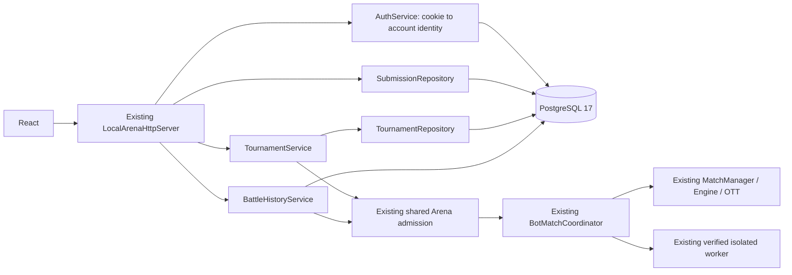

# Phase 10 — accounts and PostgreSQL persistence

Implemented 2026-10-13 for the existing loopback application. No second engine, rule, runner, execution pool, production backend, TCP 1.0/web-1 change, commit, push or deployment.

## Delivered

- PostgreSQL 17 with versioned Flyway migrations, JDBC repositories, constraints, indexes, transactional mutations and a local Compose named volume.
- Registration/login/logout/me, server-owned account identity, BCrypt cost 12, opaque random sessions stored only as SHA-256 hashes, expiry and revocation.
- Account ownership for source reads/edits/deletion/version access and tournament management/registration. JSON cannot supply an owner identity.
- Immutable exact UTF-8 source versions and hash, optimistic expectedVersion, transactional latestVersion update and durable request deduplication. Save does not parse or execute source.
- Persistent tournament metadata/config/entries/frozen references, schedules, authoritative results/champion/standings inputs, replay and ordered move/frame events.
- Persistent standalone Arena admission intents and snapshots/history; confirmed manual battles also survive restart.
- Fail-closed recovery for lost executions, preserving confirmed results and cancelling unfinished attempts without winner, champion, score or automatic replay/resume.
- React `/register`, `/login`, `/account`, protected `/bot-workspace` and `/tournaments`, cookie shared API client, session-expiry/private-content cleanup, and Arena history/replay.

## Architecture and transaction boundaries



`SubmissionRepository` and `TournamentRepository` separate domain contracts from PostgreSQL adapters. JDBC stays in `persistence/`; Engine and rules have no JDBC imports. HTTP owns cookies/Origin checks; auth owns credential/session logic; Arena owns the existing execution graph.

Bot reads have no source/ownership cache. Mutations acquire a transaction advisory lock, verify owner, check durable request fingerprint, validate expectedVersion, insert the immutable version, update latestVersion and persist the exact private response within **one transaction**. Concurrent distinct saves of the same expected version have one winner. Concurrent identical retries return the same version. Source is BYTEA; no newline/Unicode normalization is performed. Delete is a tombstone; old versions remain available to frozen tournament entries and replay references. Deleted source cannot be read through the private HTTP endpoint. A source response in idempotency_records is private database data, never public catalog output.

Tournament RAM state is a bounded write-through execution projection of committed DB state, not an independent durable store. A dedicated PostgreSQL session holds an exclusive application advisory lease; a second local backend using that database is refused. The lease is checked before service operations and checkpoints. No multi-instance scheduling is supported. Registration/status/schedule/result/replay checkpoints atomically update the domain snapshot and normalized rows. Mutations commit the request snapshot in the same transaction. Scheduling starts **after** the RUNNING checkpoint commits. An attempt's RUNNING intent commits before calling the existing Arena. Match results and replay commit before archival/next scheduling. One immutable attempt ID and unique `(tournament,round,slot,attempt)` constrain duplication.

The JSON domain snapshot is the canonical recovery projection; normalized entries/matches/events are derived in the same transaction for integrity/querying. Immutable bot versions supply frozen sources by FK, not source in the public snapshot. Every startup reconstructs the cache from DB and commits recovery before HTTP starts. Any checkpoint failure invalidates the service projection; requests fail closed until restart rather than returning uncommitted state. This implementation deliberately uses one application writer; direct administrative edits require stopping the backend.

Standalone battles commit a PENDING admission intent and exact selection fingerprint before execution. Progress/completion snapshots are written by an observer of the existing coordinator; the observer never executes game logic. Terminal snapshots cannot be downgraded by a late RUNNING write. DB failure cancels the current execution and refuses further history operations until restart. HTTP history reads come from DB; active objects in Arena remain execution handles only. Tournament execution does not create standalone history rows.

## Database schema

| Migration/table | Purpose and constraints |
|---|---|
| V1 `users` | UUID account; unique canonical lowercase username; password hash; timestamps |
| V1 `user_sessions` | User FK; unique token hash; expiry/revocation; indexes on user/expiry |
| V1 `bots` | Owner FK; metadata/latestVersion; tombstone; owner index |
| V1 `bot_versions` | Composite PK; exact source BYTEA 1–32768 bytes; hash; validation status; immutable UPDATE/DELETE trigger |
| V1 latest-version FK | Deferred bot/latestVersion FK ensures version insertion and metadata update commit together |
| V1 `idempotency_records` | Scope/request PK; payload SHA-256; private response JSONB ≤4MiB; creation index |
| V2 `tournaments` | Owner FK; validated format/status/capacity/rematches; config; canonical domain JSONB ≤1MiB; owner/status indexes |
| V2 `tournament_entries` | One owner per tournament; exact `(bot_id,version,hash)` FK; seedOrder |
| V2 `tournament_matches` | Unique round/slot/attempt; entry/winner FKs scoped to tournament; status/reason/timestamps; replay JSONB ≤4MiB |
| V2 `match_events` | Match FK; ordered sequence PK; initial board then validated move/board pairs; each payload ≤16KiB |
| V3 `arena_battles` | Owner FK; request PK/selection hash; unique battle ID; PENDING/RUNNING/terminal status; public snapshot ≤4MiB |

Flyway runs validate/migrate at controlled local application startup, after acquiring the single-writer lease and before execution/HTTP admission. Clean is disabled. It creates a fresh schema and validates existing checksums; it does not import historical RAM data or rewrite old versions. The production server/module/deployment graph is unchanged.

## HTTP and auth contract

Base `http://127.0.0.1:8090/api/local`. Existing exact Host and Origin guards apply to **all** calls, including GET/logout and preflight; requests without Origin are refused. Cookie CORS explicitly returns the allowed Origin and `Access-Control-Allow-Credentials: true`, never wildcard. Use frontend **127.0.0.1**, not mixed localhost/127.0.0.1 hostnames, for SameSite cookies.

| Endpoint | Contract |
|---|---|
| POST `/auth/register` | Exact `{username,password}`; returns 201 `{user:{id,username}}`; no auto-login |
| POST `/auth/login` | Same fields; generic 401 on nonexistent user/wrong password; sets cookie; response user/expiry only |
| POST `/auth/logout` | Exact `{}`; revokes current token hash; expires cookie; idempotent if absent |
| GET `/auth/me` | Valid cookie required; `{user}`; 401 on absent/expired/revoked cookie |
| `/submissions` and existing version/detail/mutation routes | Authenticated; owner-source access; durable request/expectedVersion semantics retained |
| GET `/bots` | Public metadata/version references, initial board and existing capability projection; never source |
| POST `/battles` | Auth required; exact old fixture IDs or saved version/hash selectors and requestId; no source/owner JSON |
| GET `/battles`, `/{id}`, `/{id}/moves` | Public metadata history / authoritative snapshots and replay; no source or internal credentials |
| Existing `/tournaments` routes | Authenticated viewer; admin operations owner-only; participant registers only own version |

Username is 3–32 lowercase ASCII letters/digits/underscores. Registration password minimum is now 8 characters (originally 15 in Phase 10) and maximum 72 exact UTF-8 bytes (BCrypt limit); control characters and malformed encoding are refused. BCrypt cost 12 uses the library's random salt. Unknown-account login performs dummy BCrypt verification. Login errors do not distinguish username/password. Registration conflicts return a generic conflict. The registration minimum is not imposed on existing-account login.

Sessions use 32 SecureRandom bytes, 8-hour lifetime and DB SHA-256 token hash. The cookie is `battlecode_session`, Path `/api/local/`, HttpOnly, SameSite=Strict, Max-Age=28800, no Domain. This transport only serves HTTP loopback, so Secure is omitted **only in this local transport**. HTTPS/public transport is not implemented; it must use Secure cookies and separate deployment review. Forwarded headers cannot activate a trusted HTTPS mode. The session token is never returned as JSON or stored in browser storage; frontend fetch uses `credentials: include`. Only a random nonsecret auth-change marker is stored to notify other tabs to unmount old private content before loading the new account. Legacy workspace headers cannot authenticate in DB mode. Duplicate session cookies are refused.

Auth rate limits are per loopback client address/operation: register 3/minute, login 10/minute; bounded 128 rate buckets, 429/Retry-After 60. Limits are in-memory and reset on restart; multiple local browsers share the address bucket. HTTP keeps its bounded 4 workers/16 queued requests. Authenticated ownership denials return 403; expiry/absence returns 401; DB unavailable returns generic 503. Request/response/error logging does not contain source/password/token/DB password.

## Recovery policy

1. Acquire the single application lease; validate/migrate DB.
2. Load committed tournament snapshots, frozen version references and completed replay.
3. Any tournament last committed RUNNING becomes CANCELLED with `BACKEND_RESTART_INTERRUPTED`; RUNNING/PENDING attempts become CANCELLED, with no new winner. Already CANCELLED tournaments also normalize unfinished attempts after a crash during shutdown/cancel.
4. Keep every confirmed result/replay. Recalculate standings from confirmed attempts only; CANCELLED attempts are not losses, BYE is not a game win. Cancelled tournaments have no champion even if earlier matches earned points.
5. Standalone PENDING/RUNNING intents become CANCELLED. If a snapshot exists, keep its committed board/history and attach cancellation reason; an intent without a battle snapshot remains visible to the operator in DB and its retry is refused. No execution resumes.
6. Users/sessions, live bot metadata/versions, pre-start registrations, completed tournaments and histories remain intact. Graceful shutdown cancels RUNNING tournaments; pre-start tournaments remain available after restart.

Durable idempotency returns the original mutation response snapshot, which can describe an earlier status; GET detail returns current recovered status. A new tournament/request is required to intentionally run again. There is no automatic retry, resume, unfinished-match winner inference or operator recovery endpoint in this phase.

## Run locally — PowerShell

Prerequisites: Java 21/Maven, Python, Docker Desktop Linux/WSL2 engine with cgroups v2; existing pinned isolated worker image. No Docker socket is mounted into a backend container. The Java backend runs locally and uses the existing local supervisor.

```powershell
Set-Location D:\Socket\BattleCode
$docker = 'C:\Users\Admin\AppData\Local\Programs\DockerDesktop\resources\bin\docker.exe'
# First setup only; .env is ignored. Keep an existing .env/password when reusing its volume.
Copy-Item .env.example .env
$dbPassword = [Convert]::ToHexString([Security.Cryptography.RandomNumberGenerator]::GetBytes(32))
$envText = [IO.File]::ReadAllText((Join-Path $PWD '.env')).Replace('replace-with-a-long-random-password', $dbPassword)
[IO.File]::WriteAllText((Join-Path $PWD '.env'), $envText)
& $docker compose --env-file .env -f compose.local.yml up -d --wait
if ($LASTEXITCODE -ne 0) { throw 'PostgreSQL startup failed' }
.\scripts\setup-quickjs.ps1
.\scripts\build-isolated-worker.ps1
mvn -Plocal-bots -pl bot-match -am package
if ($LASTEXITCODE -ne 0) { throw 'Maven failed' }
.\scripts\run-persistent-local-arena.ps1 -EnvFile .env `
  -Python 'C:\Users\Admin\miniconda3\python.exe' -Docker $docker
```

Environment: `BATTLECODE_DB_URL`, `BATTLECODE_DB_USER`, `BATTLECODE_DB_PASSWORD`; Compose additionally uses `BATTLECODE_DB_NAME`. No real credentials are in `.env.example`. The helper imports only these known keys, without evaluating commands. Named volume persists DB data. `docker compose ... down` preserves it; do not use `down -v` unless deliberately deleting your data. Do not change the password in .env for an existing volume without changing its PostgreSQL role password. Backend owns one DB lease; stop the previous backend before starting another. Default DB host port is 5432 loopback, adjustable in Compose if occupied.

Second window:

```powershell
Set-Location D:\Socket\BattleCode\frontend
$runtimeRoot = 'C:\Users\Admin\.cache\codex-runtimes\codex-primary-runtime\dependencies'
$env:Path = "$runtimeRoot\node\bin;$runtimeRoot\bin\fallback;$env:Path"
pnpm.cmd install --frozen-lockfile
pnpm.cmd exec vite --host 127.0.0.1 --port 5173 --strictPort
```

Open http://127.0.0.1:5173/register, create an account, then /login. Use /bot-workspace, /bot-arena and /tournaments. Different accounts can participate from separate browser profiles; each owner registers its own exact saved version. Ctrl+C gracefully cancels active work and releases worker/lease. The legacy fixture-only entrypoint remains separate; it does not provide Phase 10 private account operations. Older phase reports describe historical RAM/token behavior superseded here.

## Bounds and limitations

- Local-only, single backend/database writer; no Internet deployment, email/reset/MFA, account deletion, multi-instance scheduler, retention administration, backup/restore UI or DB-role privilege hardening for public service.
- 128 accounts, 16 active sessions/account; expired/revoked rows cleaned when issuing the next session for that user.
- 32 stored bots globally including tombstones; 16 versions/bot; no physical delete of frozen versions. 4096 durable mutation records globally. These lifetime caps are not reset by backend restart.
- Existing 4 tournaments, 2–16 participants, 512 reserved worst-case tournament attempts; 16 standalone admission/history records. Aborted/rejected intents still consume bounded history. A retention policy is future work, not silently implemented by deleting old evidence.
- Source/metadata acceptance is not a security proof. Saved bots execute only after the existing **live** worker gate succeeds; no parser or sandbox bypass was added.
- Checkpoints and snapshots are bounded; domain/replay working projections consume RAM. This implementation targets a local MVP, not an unlimited history service. DB transactions use connect/socket/statement/lock timeouts and may cancel on outages.
- No migration of lost Phase 8/9 RAM identities/data. No execution or scheduling resume after crash. No manual browser or public deployment test claimed.

## Changed files

- New `SubmissionRepository.java`, `tournament/TournamentRepository.java`; `persistence/{Database,PersistenceJson,AuthService,IdempotencyRepository,PostgresSubmissionRepository,PostgresTournamentRepository,BattleHistoryService}.java`.
- Updated `LocalSubmissionStore`, `LocalArenaHttpServer`, `LocalArenaService`, `SecureLocalArenaMain`, `TournamentService`, `bot-match/pom.xml` (local JDBC/Flyway/BCrypt dependencies; local Jackson BOM aligned to the existing 2.22.0 runner).
- New migrations `V1__accounts_and_bots.sql`, `V2__tournaments_and_replay.sql`, `V3__standalone_arena_history.sql`; `compose.local.yml`, root `.env.example`, `scripts/{run-persistent-local-arena,start-phase10-test-db,test-phase10-postgres}.ps1`.
- Frontend `Auth.tsx`, `auth.css`, `Auth.test.tsx`; updated routing, shared API client, Arena/Workspace copy/history and regression tests for cookie credentials.
- New `PostgresPersistenceIT`, `PostgresWorkerIT`; README, architecture documentation and this report. Preexisting unrelated working-tree changes are preserved.

## Verification

`mvn clean test` and final `mvn package` both **BUILD SUCCESS** (313 ordinary JUnit regressions); isolated worker regression script BUILD SUCCESS (12 additional Java ITs, 6 Python tests); PostgreSQL final suite BUILD SUCCESS (6 persistence/auth/recovery ITs plus 1 real-worker end-to-end IT). Combined JUnit XML reports contain **332 distinct Java tests, zero failures/errors/skips**. PostgreSQL was actual **17.11**, migrated from empty random schemas through V1–V3. Frontend **33 tests across 9 files PASS** and TypeScript/Vite build PASS. Local Compose configuration validation passed. The dedicated labelled PostgreSQL test container/anonymous volume and generated test credentials were removed; no isolated worker containers remained. Developer Compose volumes were not created or deleted by verification.

Coverage includes session hashing/expiry/revocation and persistence, missing Origin CSRF rejection, anonymous mutation denial, forged ownership fields, cross-account source GET/PUT/DELETE denial, exact UTF-8/hash and DB immutability, concurrent conflicting saves and identical-request retries, tombstone/frozen references, exclusive backend lease, confirmed replay with unfinished-attempt recovery, standalone unknown-execution cancellation, current-user/private-UI cleanup including other tabs, and a real authenticated worker-backed manual battle plus Round Robin, concurrent start, changed/deleted latest source, fresh-server history/session/idempotency recovery. Controlled repository recovery fixtures test DB/recovery policy only; the worker IT runs actual isolated JavaScript and the existing engine, with no fake runner or H2.

Explicit IT suites fail when required database/worker configuration is absent; they do not skip to produce PASS. Logs are under ignored `.tools/phase10/`, with JUnit XML in module target reports. An initial Jackson transitive version conflict and test compilation/assertion issues were fixed and their affected suites rerun successfully. No manual browser, public deployment, production load/stress, backup/restore drill or arbitrary infrastructure chaos testing is claimed.

Database test setup/commands:

```powershell
.\scripts\start-phase10-test-db.ps1 -Docker $docker
.\scripts\test-phase10-postgres.ps1 -Worker `
  -Python 'C:\Users\Admin\miniconda3\python.exe' -Docker $docker
mvn clean test
mvn package
.\scripts\test-isolated-worker.ps1 `
  -Python 'C:\Users\Admin\miniconda3\python.exe' -Docker $docker
# frontend:
pnpm.cmd test
pnpm.cmd build
```

Test DB script generates credentials only under ignored `.tools/phase10`, binds a dynamic loopback port, and each test creates/drops its own validated random schema. Cleanup of the dedicated labelled test container is separate from the developer Compose volume. Production frontend verification requires the existing WSS guard; tests use a temporary `wss://build-verification.invalid/ws` environment value, restored afterward. The built placeholder bundle is not a deployment configuration.

Technical references used: [Flyway PostgreSQL support](https://github.com/flyway/flyway/blob/main/documentation/Reference/Database%20Driver%20Reference/PostgreSQL%20Database.md), [BCrypt Java library](https://github.com/patrickfav/bcrypt). Dependencies are pinned in the local module; no production dependency changes.
