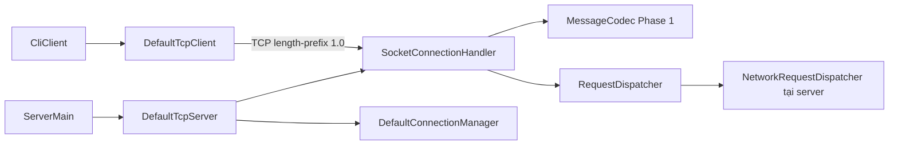

# Báo cáo Phase 2 — TCP Network Runtime

Ngày: 12/10/2026, Asia/Bangkok. Java 21, Maven multi-module. Chỉ transport/protocol policy, không game, database, frontend hoặc lobby/match nghiệp vụ. Không commit/push và không chuyển sang Phase 3.

## Khảo sát và phạm vi

Đã đọc pom.xml, docs/architecture.md, docs/protocol.md, docs/phases.md cùng toàn bộ interfaces/model/codec của network, protocol và client. Không có AGENTS.md trong workspace hoặc các thư mục cha được kiểm tra.

Kế hoạch Phase 1 dự kiến Phase 2 có composition root phụ thuộc competition/engine/rules-impl và triển khai lobby/match. Yêu cầu mới loại trừ phần đó. Khác biệt đã được báo trước khi viết runtime: server chỉ phụ thuộc network/protocol trong production, kế hoạch cũ giữ như lịch sử, nghiệp vụ hoãn. Không sửa protocol 1.0, enums, codec hoặc interface công khai.

## File thêm/sửa

Sửa:

- pom.xml: thêm server vào reactor.
- client/src/main/java/dev/battlecode/client/CliClient.java: thay marker bằng CLI tương tác.
- README.md: build, server/client, cùng máy và LAN.

Thêm:

- network/src/main/java/dev/battlecode/network/DefaultTcpServer.java
- network/src/main/java/dev/battlecode/network/DefaultConnectionManager.java
- network/src/main/java/dev/battlecode/network/SocketConnectionHandler.java
- network/src/main/java/dev/battlecode/network/DeadlineInputStream.java
- client/src/main/java/dev/battlecode/client/DefaultTcpClient.java
- server/pom.xml
- server/src/main/java/dev/battlecode/server/ServerMain.java
- server/src/main/java/dev/battlecode/server/NetworkRequestDispatcher.java
- network/src/test/java/dev/battlecode/network/NetworkResourceIntegrationTest.java
- client/src/test/java/dev/battlecode/client/DefaultTcpClientIntegrationTest.java
- server/src/test/java/dev/battlecode/server/NetworkRequestDispatcherTest.java
- server/src/test/java/dev/battlecode/server/TcpRuntimeIntegrationTest.java
- docs/phase2-report.md và log xác minh Phase 2 ở root.

## Kiến trúc runtime



Production: server → network/protocol; network → protocol; client → protocol. server chỉ phụ thuộc client ở test scope để kiểm tra end-to-end và process CLI. Không gọi competition/engine/rules từ runtime; không dependency vòng.

- ServerSocket bind NetworkConfig; port 0 dùng cho test/OS cấp port. Một accept task và reader/writer virtual tasks cho mỗi connection được nhận.
- ExecutorService virtual threads; admission maxConnections mặc định 256, chưa HELLO cũng chiếm slot. Socket vượt giới hạn bị đóng trước khi tạo worker. Queue ghi 256 message, chỉ một writer, không đan xen frame.
- Concurrent connection map; register/shutdown phối hợp để socket không thoát cleanup. EOF/reset, malformed/truncated, timeout, queue overflow và shutdown đóng transport/xóa context một lần.
- Codec Phase 1 kiểm tra length trước cấp phát, đọc đủ header/body, strict UTF-8, duplicate key, byte dư. Runtime dùng lại codec, không giả định TCP read = message.
- DeadlineInputStream dùng deadline monotonic tổng, cập nhật SO_TIMEOUT theo thời gian còn lại trước mỗi read. Mặc định HELLO 5 giây từ accept, idle 60 giây từ frame cuối, frame 10 giây từ byte đầu. Không reset frame deadline theo mỗi byte.
- Watchdog mỗi 50 ms đóng slow reader khi write kéo dài 10 giây. QUIT/error fatal hoàn tất response write trước disconnect. Shutdown đóng listener/socket, hủy worker/watchdog, await tối đa 10 giây. Không có trận để hủy.
- Adapter server kiểm tra version, direction, connection-bound session, ID duy nhất, payload/schema, rate 20 request/giây burst 40, quota 10,000 request/connection. Sau response thứ 10,000 transport đóng. Không retry/replay/resume.
- HELLO hợp lệ cấp UUID session. UNSUPPORTED_VERSION/HANDSHAKE_REQUIRED/INVALID_SESSION trả ERROR rồi đóng; HELLO payload sai hoặc HELLO lần hai trả lỗi theo protocol. Timeout silent/partial hoặc codec lỗi không có ID an toàn thì đóng, không tạo ID giả.
- LIST_RULES/LIST_ROOMS trả empty page; CREATE_ROOM hợp lệ → RULE_NOT_FOUND; JOIN_ROOM hợp lệ → ROOM_NOT_FOUND; LEAVE_ROOM/START_MATCH/ACTION hợp lệ → INVALID_STATE. Không tạo phòng/trận giả.
- Client reader riêng correlate requestId, kiểm tra ACK.for/session, tách events vào queue bounded. Request serial bằng ReentrantLock; response timer đóng socket nếu write/wait không hoàn tất. Heartbeat nền PING mỗi 20 giây, connect 5 giây/response 10 giây, cleanup không phụ thuộc console input.

Test 20 client ban đầu phát hiện pinning khi virtual thread giữ synchronized trong lúc chờ response. Đã dùng ReentrantLock ở connect/request; test và cleanup sau đó đạt, không tăng timeout để che lỗi.

## Khởi động và kiểm tra

Từ root sau mvn package, terminal server:

```powershell
java -cp "server\target\server-1.0.0-SNAPSHOT.jar;network\target\network-1.0.0-SNAPSHOT.jar;protocol\target\protocol-1.0.0-SNAPSHOT.jar" dev.battlecode.server.ServerMain 127.0.0.1 7777
```

Terminal client:

```powershell
java -cp "client\target\client-1.0.0-SNAPSHOT.jar;protocol\target\protocol-1.0.0-SNAPSHOT.jar" dev.battlecode.client.CliClient 127.0.0.1 7777 Bot-A
```

Nhập ping/list_rules/list_rooms/exit. Bỏ arguments CLI để nhập IP/port/name qua prompt. Ctrl+C dừng server; exit gửi QUIT rồi đóng client. Nếu CLI chờ console khi socket mất, Enter kết thúc vòng console. JAR thông thường cần classpath, không phải fat JAR.

LAN: A bind IP LAN của A (ví dụ 192.168.1.10) hoặc 0.0.0.0, cho phép inbound TCP 7777 trên firewall. B chạy CLI với IP LAN A và cùng port; cần client + protocol JAR và Java 21. README có lệnh đầy đủ/ipconfig/hướng dẫn kiểm tra. Chưa kiểm chứng hai thiết bị LAN thực tế; loopback/process CLI được kiểm chứng tự động.

## Kiểm thử và xác minh

Kết quả chạy thực tế trên source bàn giao, JDK Temurin 21.0.12.1/Maven 3.9.16:

| Lệnh | Kết quả | Thời gian | Log |
|---|---|---:|---|
| mvn clean test | BUILD SUCCESS, 50 tests, 0 failure/error/skipped | 30.283 giây | phase2-clean-test.log |
| mvn package | BUILD SUCCESS, chạy lại 50 tests, 0 failure/error/skipped | 27.292 giây | phase2-package.log |

Toàn reactor gồm parent và 8 module SUCCESS; package tạo 8 module JAR trong target. Surefire XML nằm tại target/surefire-reports của các module có test. Không skip test.

Sandbox mặc định chặn TCP loopback (Permission denied: getsockopt), nên các lệnh nghiệm thu đã chạy với quyền socket mở rộng. Dependency cache vẫn nằm trong workspace. Đây là hạn chế môi trường, không phải test được bỏ qua. Hướng dẫn LAN chưa được thử trên hai thiết bị thực tế.

| Suite | Tests | Loại |
|---|---:|---|
| GameConfigTest | 3 | Unit Phase 1 |
| MessageCodecTest | 11 | Unit Phase 1 |
| RoomTest | 3 | Unit Phase 1 |
| NetworkRequestDispatcherTest | 3 | Unit Phase 2 |
| NetworkResourceIntegrationTest | 2 | Loopback/queue và slow reader |
| DefaultTcpClientIntegrationTest | 4 | Loopback fake peer |
| TcpRuntimeIntegrationTest | 24 | Server/client/CLI process |
| Tổng | 50 | 20 unit + 30 integration |

Bao phủ đủ 10 yêu cầu: một client, 20 client đồng thời, HELLO hợp lệ, version sai, fragmentation, nhiều frame liên tiếp, oversize, abrupt disconnect, HELLO timeout, graceful shutdown. Bổ sung malformed/truncated frame, deadline tổng frame, idle deadline, spoof session, duplicate ID, schema, repeated HELLO, direction, QUIT flush, admission cap, queue overflow, slow reader, client timeout/correlation/event demultiplex và CLI process args/prompt.

Tests loopback/port 0, @Timeout 8 hoặc 15 giây, SO_TIMEOUT/connect timeout, Future.get/waitFor hữu hạn, try-with-resources/finally, assert executor termination. Slow reader dùng dispatcher test double tạo reply lớn để làm đầy TCP send buffer, không thay production protocol hoặc thêm game.

## Hoàn thành và giới hạn

TCP server/client thực tế, framing, handshake, resource limits, lifecycle/timeouts/shutdown, CLI và test đã triển khai. Public interfaces/wire protocol giữ nguyên, bind loopback mặc định. Chưa TLS/account authentication, đúng protocol 1.0.

Không BotClient game loop, game rules, lobby/match/engine nghiệp vụ, database/frontend. Không công bố throughput/load test ngoài 20 client. Phase 2 kết thúc tại đây; không tự bắt đầu phase tiếp theo.
