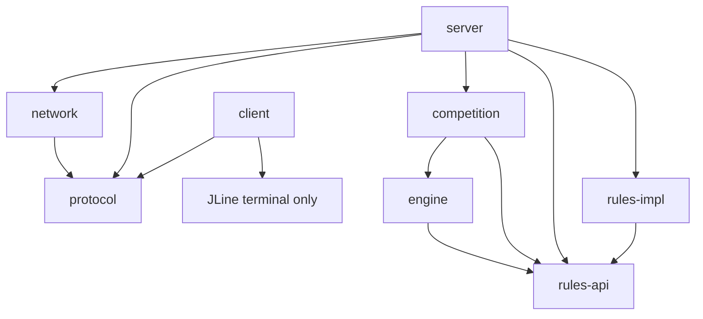

# Báo cáo Phase 3 — Session, Lobby & Room Management

Ngày: 12/10/2026 (Asia/Bangkok). Java 21 + Maven, TCP Socket thuần Java. Chỉ session/lobby/room, không gameplay.

## Khảo sát và hợp đồng

Đã đọc pom.xml, architecture/protocol/phases/phase2-report cùng module competition, rules-api, network, server và client. Interfaces Lobby/RuleRegistry/ConnectionManager/ConnectionHandler/RequestDispatcher đủ để thực hiện; không thêm/sửa interface nghiệp vụ. Không sửa codec hoặc enum protocol, không tạo ROOM_INFO hay đổi schema ACK/ROOM_EVENT.

Mâu thuẫn duy nhất cần đổi hợp đồng: Phase 1 quy định host rời/disconnect WAITING thì đóng phòng; Phase 3 yêu cầu chuyển host. Đã báo và xin xác nhận trước khi sửa; người dùng chọn “Đồng ý chuyển host như đề xuất”. Policy mới: host là thành viên còn lại join sớm nhất theo thứ tự server chấp nhận; chỉ xóa phòng khi rỗng. Chỉ sửa semantics trong architecture/protocol; wire vẫn version 1.0 và giữ nguyên field/command/enum/interface. ROOM_EVENT LEFT báo membership; host identity chưa được công bố trên wire.

## Module và file

```text
rules-api → contracts/registry/config giữ nguyên
protocol → message/codec/enum giữ nguyên
network → TCP runtime giữ nguyên, thêm constructor injection ConnectionManager
competition → InMemoryLobby, LobbyException, RoomNotification
rules-impl → RoomOnlyRule + tests
server → RoomTcpServer, RoomEventPublisher, adapter tích hợp Lobby
client → CLI commands, JLine terminal, asynchronous events
engine → contracts giữ nguyên, không runtime
```

Các file chính thêm:

- competition/src/main/java/dev/battlecode/competition/{InMemoryLobby,LobbyException,RoomNotification}.java
- competition/src/test/java/dev/battlecode/competition/InMemoryLobbyTest.java
- rules-impl/src/main/java/dev/battlecode/rulesimpl/RoomOnlyRule.java
- rules-impl/src/test/java/dev/battlecode/rulesimpl/RoomOnlyRuleTest.java
- server/src/main/java/dev/battlecode/server/{RoomTcpServer,RoomEventPublisher}.java
- server/src/test/java/dev/battlecode/server/RoomManagementIntegrationTest.java
- client/src/main/java/dev/battlecode/client/{CliConsole,TerminalConsole}.java
- client/src/test/java/dev/battlecode/client/TerminalConsoleTest.java

Sửa server/pom.xml, client/pom.xml, NetworkRequestDispatcher, ServerMain, DefaultTcpServer (chỉ bổ sung constructor manager), CliClient, DefaultTcpClient (bổ sung timed event polling), rules-impl/package-info và README/architecture/protocol/report. Test cũ của Phase 1/2 không bị sửa. Maven package copy runtime libraries vào target/dependency của server/client để lệnh chạy ngắn và đầy đủ classpath.

## Dependency graph



server phụ thuộc client chỉ ở test scope. Competition không import java.net/network/protocol; Network không import Competition/Rules/Engine. Engine artifact chỉ chứa contracts do dependency Phase 1, không có implementation hoặc lời gọi gameplay.

## Session lifecycle

```text
TCP CONNECTED --HELLO hợp lệ--> ACTIVE + session LOBBY
LOBBY --create/join--> IN_ROOM
IN_ROOM --leave--> LOBBY
any --QUIT/EOF/reset/timeout/malformed/shutdown--> CLOSED, remove active session
```

Session UUID do dispatcher sinh, register qua Lobby rồi bind connection. Request lấy identity từ context đã bind, không tin UUID payload. Một session tối đa một room. Sau disconnect, session bị xóa khỏi active map; mọi create/join/leave trên ID cũ bị INVALID_SESSION. Không giữ closed sessions vô hạn hoặc resume; register là thao tác server, không phải command client. Mỗi callback cleanup xử lý context một lần; Lobby.disconnect idempotent.

## Room lifecycle

```text
create → WAITING (creator là host và member)
join → WAITING (capacity/membership kiểm tra nguyên tử)
leave/disconnect, còn member → WAITING, transfer host nếu cần
leave/disconnect cuối cùng → CLOSED event, room bị xóa
```

Mỗi room có UUID và immutable GameConfig riêng. LIST_ROOMS chỉ công bố id/ruleId/status/player count/capacity, không đưa session/connection metadata vào page. LIST_RULES lấy registry thật. Pagination offset/limit 1..10, nextOffset=-1 khi hết; mỗi response được thử encode trước để tuân thủ 128 fields/65,536 bytes. Snapshot list nhất quán trong từng request; pagination không phải snapshot token khi lobby thay đổi giữa hai request (schema không có token).

RoomOnlyRule (`room-only-no-gameplay`) validateConfig và từ chối options không khai báo; các giới hạn cơ bản dùng GameConfig Phase 1. Tất cả phương thức GameRule gameplay ném UnsupportedOperationException. START_MATCH/ACTION chỉ validate envelope/schema rồi trả INVALID_STATE, không gọi rule/engine. Registry được inject qua RuleRegistry, bổ sung module luật sau này không cần sửa Network.

## Thread safety và notifications

- Một ReentrantLock cho sessions, membership và rooms; mọi create/join/leave/disconnect được serialize. Không lock ordering giữa phòng; không có I/O dưới Lobby lock.
- LinkedHashSet giữ thứ tự membership, nên chuyển host xác định được và host luôn là member. Room rỗng bị xóa cùng transaction; closed session không để lại ghost member. PlayerSession/Room/GameConfig snapshots bất biến.
- Notification callback chỉ enqueue immutable RoomNotification (không block/throw); server worker riêng gửi qua ConnectionManager/ConnectionHandler. Queue 4096 và một consumer giữ thứ tự mutation. Full notification queue đánh dấu recipient để worker disconnect ngoài Lobby lock, không giữ client bị thiếu event mà im lặng.
- Wire ROOM_EVENT vẫn type CREATED/JOINED/LEFT/CLOSED với roomId/status/players; requestId rỗng, sessionId riêng cho từng recipient. LEFT gửi cho các thành viên bị ảnh hưởng, gồm người rời nếu vẫn kết nối; CLOSED players=0 gửi người cuối cùng rời. Người đã disconnect không nhận message vì route đã xóa.
- Server stop notifications, đóng transport, gọi disconnect cleanup, chờ event executor trong deadline shutdown. Framing, handshake timeout, idle/frame/write timeout, admission, quota/rate limiter của Phase 2 giữ nguyên.
- CLI event worker nhận ngay khi đang readLine. Terminal thật dùng JLine printAbove để giữ buffer đang gõ; pipe dùng output stream thường. JLine 4.4.3 jdk11 phục vụ Java 21, không thay Java Socket. Xem [tài liệu printAbove](https://jline.org/docs/examples/print-above/) và [Java 11–21 classifier](https://jline.org/docs/modules/terminal-providers/).

## Commands và chạy demo

HELLO/PING/QUIT, LIST_RULES/LIST_ROOMS (page), CREATE_ROOM/JOIN_ROOM/LEAVE_ROOM hoạt động thực tế. START_MATCH/ACTION không triển khai. ROOM_INFO không có trong wire protocol, CLI chỉ nhắc dùng LIST_ROOMS.

Từ D:\Socket\BattleCode sau mvn package:

```powershell
# Terminal 1
java -cp "server\target\server-1.0.0-SNAPSHOT.jar;server\target\dependency\*" dev.battlecode.server.ServerMain 127.0.0.1 7777
# Terminal 2
java -cp "client\target\client-1.0.0-SNAPSHOT.jar;client\target\dependency\*" dev.battlecode.client.CliClient 127.0.0.1 7777 Client-A
# Terminal 3
java -cp "client\target\client-1.0.0-SNAPSHOT.jar;client\target\dependency\*" dev.battlecode.client.CliClient 127.0.0.1 7777 Client-B
```

A: list_rules → create_room room-only-no-gameplay 2 100 1000; copy UUID trong ACK, gọi nó là ROOM-01. B: list_rooms → join_room <UUID>. A/B nhận JOINED players=2. B leave_room, A nhận LEFT players=1. A leave_room, CLOSED players=0; B list_rooms count=0. exit trên cả hai, Ctrl+C server. ROOM-01 chỉ là nhãn demo vì schema hiện chỉ có roomId UUID, không có room name.

LAN: A bind IP LAN thật hoặc 0.0.0.0, mở inbound TCP 7777; B chạy CLI với IP A. Copy client JAR cùng toàn bộ thư mục dependency nếu không build repo trên B. README có lệnh đầy đủ và hướng dẫn firewall/ipconfig. Test tự động dùng loopback; chưa thực hiện trên hai máy LAN riêng.

## Kết quả kiểm thử

Kết quả chạy thực tế trên source bàn giao, JDK Temurin 21.0.12.1 / Maven 3.9.16:

| Lệnh | Kết quả | Tests | Thời gian | Log |
|---|---|---:|---:|---|
| mvn clean test | BUILD SUCCESS | 85, 0 failure/error/skipped | 32.289 giây | phase3-clean-test.log |
| mvn package | BUILD SUCCESS | 85, 0 failure/error/skipped | 52.890 giây | phase3-package.log |

Toàn reactor parent + 8 module SUCCESS, không skip test. JAR server/client và runtime dependencies đã tồn tại dưới target; Surefire XML ở target/surefire-reports của các module có test. Build/test được chạy với quyền mở TCP loopback trong môi trường sandbox này; không thay đổi chính sách của server để né hạn chế môi trường.

| Suite | Tests |
|---|---:|
| GameConfigTest | 3 |
| MessageCodecTest | 11 |
| RoomTest | 3 |
| InMemoryLobbyTest | 8 |
| NetworkResourceIntegrationTest | 2 |
| RoomOnlyRuleTest | 2 |
| DefaultTcpClientIntegrationTest | 4 |
| TerminalConsoleTest | 1 |
| NetworkRequestDispatcherTest | 3 |
| TcpRuntimeIntegrationTest | 24 |
| RoomManagementIntegrationTest | 24 |
| Tổng | 85 |

50 regression tests Phase 1/2 giữ nguyên, thêm 35 test. Bao phủ đủ 16 yêu cầu Phase 3: create/list/join/event/full, single membership, transfer host, disconnect/empty cleanup, concurrent create, last-slot/join-disconnect races, spoof/rule missing/shutdown và regression. Bổ sung 20 client tạo phòng đồng thời, host leave/join race, concurrent leaves, pagination/schema privacy, config rule validation, gameplay rejection, malformed/idle cleanup, demo sequence và CLI process nhận event khi đang chờ input.

Race tests dùng CyclicBarrier/CountDownLatch, Future.get timeout; không Thread.sleep để che race. Cleanup được quan sát bằng notification hoặc scheduler polling có deadline, không delay tùy ý. Test mới @Timeout 8/15 giây, loopback port 0, close socket/process/executor trong finally. TerminalConsoleTest kiểm tra buffer “join_room ” đã được gõ, gọi printAbove, gõ tiếp UUID và xác minh readLine trả nguyên lệnh.

## Giới hạn và bàn giao

Chỉ lưu in-memory; restart mất session/phòng. Không account authentication/JWT/resume/TLS; môi trường lab/trusted LAN như Phase 2. Không host identity/ROOM_INFO trên wire. Không gameplay, GameEngine runtime, Bot gameplay, database, frontend hay tournament bracket.

Không commit/push. Kết thúc Phase 3 và không tự chuyển sang phase tiếp theo.
