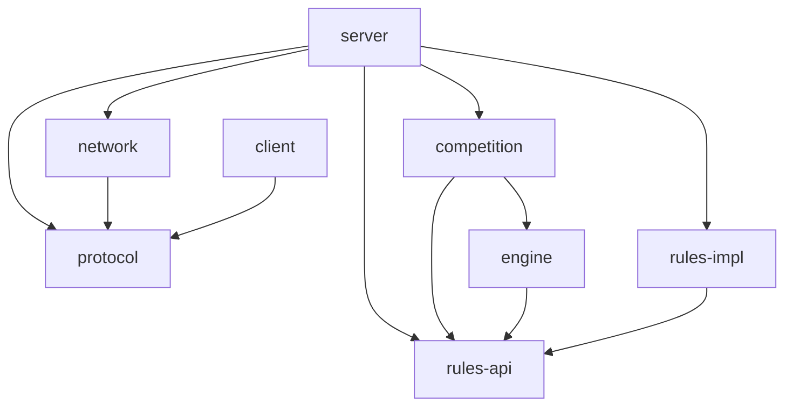

# Báo cáo Phase 4 — Game Engine & Match Lifecycle

Ngày: 12/10/2026, Asia/Bangkok. Java 21 + Maven multi-module, TCP Socket thuần Java. Không production game, không database/frontend/bot gameplay.

## Khảo sát và phê duyệt hợp đồng

Đã khảo sát pom.xml, architecture/protocol/phases/phase3-report, rules-api/engine/competition/rules-impl/server/protocol/network và adapter CLI. GameRule.currentPlayer chỉ biểu đạt một player; submit cũ thiếu expectedTurn; engine chưa có private snapshot/token timeout; RoomOnlyRule chưa công bố capability. Đã dừng, báo khoảng trống và xin xác nhận trước khi sửa. Người dùng xác nhận API bổ sung và disconnect/cancel policy, yêu cầu giữ các phương thức cũ và wire protocol 1.0.

Không sửa public method hiện có hoặc enum/model Phase 1; bổ sung default methods để implementation cũ vẫn compile. Không thêm field, command, protocol enum hay đổi version/framing. Host identity vẫn không có trên wire; chỉ dùng Room.ownerId để authorize server-side. Những reason cancellation là string trong field reason hiện có.

Chính sách đã ghi trước runtime tại docs/phase4-design.md. docs/phases.md là kế hoạch lịch sử; phạm vi Phase 4 hiện tại theo yêu cầu mới, không triển khai luật thứ hai của kế hoạch cũ.

## Cấu trúc và các file thêm/sửa

```text
rules-api/
  GameRule.java                    sửa: compatible default extensions
engine/
  GameEngine.java                  sửa: compatible default overloads
  DefaultGameEngine.java           thêm: runtime, per-match lock
  PlayerSnapshot.java              thêm: immutable private projection
  EngineException.java             thêm: domain errors
  DefaultGameEngineTest.java       thêm trong src/test
competition/
  MatchManager.java                sửa: expectedTurn/shutdown default APIs
  InMemoryLobby.java               sửa: running/finish lifecycle và state guards
  DefaultMatchManager.java         thêm: orchestration/scheduler/shutdown
  MatchNotification.java           thêm: immutable private domain event
  MatchException.java              thêm: domain errors, không phải wire enum
rules-impl/
  RoomOnlyRule.java                 sửa: supportsGameplay=false
server/
  RoomTcpServer.java               sửa: compose engine/manager, close lifecycle
  NetworkRequestDispatcher.java    sửa: START_MATCH/ACTION/error translation
  RoomEventPublisher.java          sửa: shared ordered room/match batch queue
  ServerMain.java                  sửa: thông báo runtime/capability
  FakeMatchRule.java               thêm trong src/test, không production
  MatchLifecycleIntegrationTest.java thêm trong src/test
client/
  CliClient.java                   sửa: start_match/action, cùng wire schema
README.md                          sửa: chạy/test/demo/giới hạn Phase 4
docs/architecture.md               sửa: API/lifecycle/locks/policy
docs/protocol.md                   sửa diễn giải runtime, không đổi schema
docs/phases.md                     sửa: ghi rõ scope mới thay kế hoạch cũ
docs/phase4-design.md              thêm: policy trước triển khai
docs/phase4-report.md              thêm: bàn giao
phase4-clean-test.log              log nghiệm thu
phase4-package.log                 log nghiệm thu
```

Không sửa POM, network/protocol Java sources hay 85 regression tests Phase 1–3. Có phase4-dev-test.log cho vòng phát triển; lỗi build ban đầu (sandbox loopback và compile) đã được sửa, không dùng làm bằng chứng nghiệm thu.

## Dependency và tương tác plugin



Server khởi tạo DefaultGameEngine qua dependency bắc cầu competition -> engine. Competition dùng GameEngine interface. Network không biết room/rule/game; protocol không có thắng/thua; engine không biết ruleId cụ thể và không truy cập socket. Registry chọn rule từ room.ruleId ở MatchManager. Config và RuleState riêng cho mỗi match. Rule phải stateless/reentrant/immutable, chỉ implementation đáng tin cậy do người vận hành đăng ký; không tải hay chạy source do client gửi.

| API mới | Mặc định / ý nghĩa |
|---|---|
| GameRule.supportsGameplay() | true; descriptor override false |
| minimumPlayers(config) | 2, giới hạn 2..maxPlayers |
| activePlayers(state) | singleton currentPlayer |
| isTurnComplete(before,after) | true; simultaneous override false đến khi round complete |
| GameEngine.submit(id,player,expectedTurn,action) | turn >= 0, check/apply nguyên tử |
| timeout(id,generation) | stale/early/terminal no-op |
| snapshot(id,player) | PlayerSnapshot: id/status/turn/generation/deadlineEpochMillis/view riêng |
| MatchManager.submitAction(session,id,expectedTurn,action) | bound membership và engine overload |
| MatchManager.shutdown() | idempotent cancellation và scheduler shutdown |

Overloads mới trên interface có default UnsupportedOperationException để source-compatible với implementation cũ. Runtime mới implement đầy đủ. Legacy submit không có expectedTurn chỉ dùng cho trusted in-process caller; TCP bắt buộc overload có expectedTurn. Legacy timeout(id,player) resolve token hiện tại dưới engine lock. PlayerSnapshot không chứa RuleState hoặc map view của người khác; view Map.copyOf bất biến. GameState cũ chỉ dùng nội bộ giữa trusted components, không encode raw state lên wire.

## Lifecycle và protocol

```text
WAITING room -> RUNNING -> FINISHED (tạm thời) -> CLOSED/xóa
Match initialization (CREATED logic) -> RUNNING -> FINISHED | CANCELLED
IN_ROOM session -> IN_MATCH -> IN_ROOM (tạm thời) -> LOBBY
```

START_MATCH: validate session/member/host/WAITING, registry/capability/config/minimum players. Initialize engine trước khi công bố transaction room/match; initialization lỗi trả INTERNAL_ERROR hoặc INVALID_PAYLOAD, room vẫn WAITING và có thể retry. Descriptor trả INVALID_STATE, không gọi initialState. Concurrent starts chỉ có một thành công. Rule quyết định initial state và evaluate.

ACTION: identity lấy từ session/socket, kiểm tra match membership, state RUNNING, expectedTurn, monotonic deadline, active player và isActionAllowed. applyAction/evaluate/viewFor tạo candidate trước commit; client không được gửi state/result làm authoritative data. Duplicate request ID trả INVALID_PAYLOAD trước mutation; stale turn INVALID_STATE, sai quyền NOT_YOUR_TURN, rule reject ACTION_REJECTED, hết hạn TIMEOUT, rule exception INTERNAL_ERROR và cancel trận.

Turn bắt đầu 0. Sequential default tăng lượt sau mỗi action. Simultaneous giữ cùng turn/deadline/generation; mỗi player submit thành công tối đa một lần trong turn. Action bị từ chối không tiêu thụ quyền. isTurnComplete báo kết thúc round thì tăng lượt, reset submitted/deadline/token. maxTurns đếm lượt hoàn tất; rule finished ưu tiên kết quả hơn MAX_TURNS. Engine không lựa chọn winners.

ACK ACTION có for/matchId/turn được chấp nhận. MATCH_EVENT STARTED/STATE có matchId/turn/deadlineEpochMillis và view.<key> riêng; FINISHED có winners/reason, CANCELLED có reason; requestId rỗng, sessionId đúng recipient. Không thêm status/host/generation trên wire. Terminal event enqueue trước ROOM_EVENT CLOSED, room bị xóa và mọi session còn kết nối về LOBBY. Không tái dùng roomId/matchId. Không thêm ROOM_INFO.

Candidate active players/winners phải thuộc roster. View giới hạn 120 fields và 60,000 byte budget UTF-8 để giữ envelope/event trong giới hạn protocol; reason tối đa 2,048 bytes. Null/oversize/invalid outcome hoặc RuntimeException từ rule thành RULE_ERROR. ViewFor chịu trách nhiệm semantic secrets; engine bảo đảm chỉ đúng view cho đúng player và không serialize raw RuleState.

## Concurrency, timeout và disconnect

Một ReentrantLock lifecycle chung với Lobby bảo vệ start/action/disconnect/finish/shutdown và room/session membership. Engine có per-match ReentrantLock. Thứ tự duy nhất Competition -> Engine, không callback ngược. Creation engine serialize match ID; no double-initialize ID. Không lost update, reverse terminal transition, double-submit hoặc hai active match một room.

Trusted GameRule callbacks chạy đồng bộ dưới lock để candidate không dựa trên stale state; callback phải nhanh và không giữ mutable shared state. Sink notifications bị giới hạn enqueue nonblocking/nonthrowing; runtime sink cụ thể chỉ build immutable batch và queue.offer. Một server queue bounded 4096 batch cho cả room/match giữ mutation order, worker riêng enqueue socket output ngoài khóa nghiệp vụ. Queue đầy đánh dấu recipient để worker disconnect ngoài khóa. Không TCP I/O dưới khóa Engine/Competition.

Scheduler một platform daemon thread quét mỗi 10ms. Deadline authoritative dùng System.nanoTime; epoch chỉ hiển thị. now >= deadline từ chối action kể cả scheduler chưa chạy. Timeout dùng generation; token cũ không tác động lượt mới, callback sớm/terminal là no-op. Pending active players chưa submit nhận onTurnTimeout theo UUID tăng dần; dừng khi rule finished, rồi đóng expired turn một lần. Không tự reset deadline khi chỉ nhận một phần simultaneous round.

RUNNING disconnect gọi onDisconnect một lần. Rule quyết định tiếp tục/finish, engine cancel nếu rule lỗi; không còn connection -> NO_CONNECTED_PLAYERS. Host chuyển cho remaining member join sớm nhất theo Phase 3. JOIN/LEAVE RUNNING bị INVALID_STATE. Server shutdown ngừng start/action, cancel với SERVER_SHUTDOWN, dừng scheduler, event worker và transport. Terminal cleanup chỉ một lần; result còn đọc được sau shutdown. Socket có thể đã đóng nên cancellation event lúc shutdown/disconnect là best effort, không có delivery guarantee/resume.

## Demo và lệnh chạy

Production chỉ có RoomOnlyRule. Lệnh từ D:\Socket\BattleCode sau package:

```powershell
java -cp "server\target\server-1.0.0-SNAPSHOT.jar;server\target\dependency\*" dev.battlecode.server.ServerMain 127.0.0.1 7777
java -cp "client\target\client-1.0.0-SNAPSHOT.jar;client\target\dependency\*" dev.battlecode.client.CliClient 127.0.0.1 7777 Client-A
java -cp "client\target\client-1.0.0-SNAPSHOT.jar;client\target\dependency\*" dev.battlecode.client.CliClient 127.0.0.1 7777 Client-B
```

CLI start_match <roomId>, action <matchId> <turn> [key=value ...] được thêm; descriptor production vẫn trả INVALID_STATE. LAN theo README: server bind IP LAN hoặc 0.0.0.0, mở TCP port, client dùng IP server và copy JAR cùng dependency; không thực hiện test trên hai máy LAN riêng.

Demo gameplay chỉ trong MatchLifecycleIntegrationTest.sequentialTcpDemoFinishesAndClosesRoom: server loopback port động, A tạo phòng fake-sequential, B join, A START_MATCH, A/B ACTION với turn 0/1, nhận STATE/FINISHED rồi CLOSED, có thể tạo phòng mới. Concurrent simultaneous test giữ lượt chung và không mất update. FakeMatchRule chỉ trong server/src/test; engine tests cũng có fake riêng trong test scope, không có cơ chế bật fake trong production.

```powershell
mvn -pl server -am '-Dtest=MatchLifecycleIntegrationTest' '-Dsurefire.failIfNoSpecifiedTests=false' test
```

## Kiểm thử và xác minh

Kết quả thực chạy trên source bàn giao, Temurin JDK 21.0.12.1 và Maven 3.9.16:

| Lệnh | Kết quả | Tests | Thời gian | Log |
|---|---|---:|---:|---|
| mvn clean test | BUILD SUCCESS | 146, 0 failures/errors/skipped | 36.910 giây | phase4-clean-test.log |
| mvn package | BUILD SUCCESS | 146, 0 failures/errors/skipped | 42.593 giây | phase4-package.log |

Parent và toàn bộ 8 module SUCCESS. Tổng 146 tests gồm 85 regression giữ nguyên + 33 engine unit tests + 28 TCP match integration tests mới. Đã đối chiếu Surefire XML của cả reactor, không dùng riêng dòng tổng của server (79 tests) làm tổng dự án. Build được chạy với quyền mở TCP loopback vì sandbox mặc định chặn socket, không skip test hoặc sửa transport để né sandbox.

| Suite | Tests |
|---|---:|
| GameConfigTest | 3 |
| MessageCodecTest | 11 |
| DefaultGameEngineTest (mới) | 33 |
| InMemoryLobbyTest | 8 |
| RoomTest | 3 |
| NetworkResourceIntegrationTest | 2 |
| RoomOnlyRuleTest | 2 |
| DefaultTcpClientIntegrationTest | 4 |
| TerminalConsoleTest | 1 |
| MatchLifecycleIntegrationTest (mới) | 28 |
| NetworkRequestDispatcherTest | 3 |
| RoomManagementIntegrationTest | 24 |
| TcpRuntimeIntegrationTest | 24 |
| Tổng | 146 |

Package tạo đủ 8 module JARs và runtime dependency của server/client. Server production JAR không chứa FakeMatchRule hoặc MatchLifecycleIntegrationTest; engine JAR chứa DefaultGameEngine/PlayerSnapshot. Kiểm tra import không tìm thấy dependency competition/engine/rules-api/rules-impl trong network/protocol sources. Không có circular dependency trong reactor.

Test engine bao phủ init/validate/apply/finish, private immutable view, invalid/wrong player/stale/negative turn, sequential/simultaneous concurrency, duplicate turn, stale expired token, early/late timeout, pending-player timeout, timeout stops at finish, MAX_TURNS, rule/init/validation/disconnect/timeout failure, invalid winners/oversize view, idempotent cancellation, duplicate match ID, shared rule/config isolation và action/disconnect race.

TCP integration bao phủ nonhost/insufficient/duplicate/concurrent start, init failure retry, RoomOnly safety, private STARTED, end-to-end finish/room cleanup, ACTION trước start/sau finish/sai match/sai session/sai quyền/sai payload/stale turn, simultaneous concurrency, double-submit, duplicate request-ID replay, join/leave running, host migration/rule continuation/finish on disconnect/last disconnect, rule failure isolation, maxTurns, scheduler timeout, shutdown và shutdown/action race, config isolation. Concurrent START được gửi vào cùng MatchManager qua barrier vì transport serialize một connection và một room chỉ có một host; TCP adapter authorization được kiểm thử riêng.

Mọi test mới có JUnit timeout hữu hạn, Future/barrier/latch timeout, socket read timeout và resource cleanup/await. Không Thread.sleep để che race. Giữ nguyên 85 regression tests. Cleanup kiểm tra thread/socket/session/room; tests dùng port 0.

## Chức năng và giới hạn bàn giao

Chạy được: generic engine, match lifecycle, sequential/simultaneous mechanics, START_MATCH/ACTION, private events, timeouts/generation, disconnect/cancel/shutdown, room/session terminal cleanup và demo TCP test-only.

Chưa có: production gameplay rule, bot gameplay, DB/frontend/bracket/auth/JWT/TLS. Host identity/capability/action schema của từng luật chưa công bố trên wire 1.0. CLI action fields dạng token không có quoting value chứa khoảng trắng; programmatic TCP client vẫn gửi string payload bình thường.

Khóa lifecycle chung chưa tối ưu throughput giữa các phòng; callback trusted rule dài sẽ trì hoãn lifecycle/timeout/shutdown và không có cưỡng chế sandbox dừng plugin. Engine giữ state/result terminal đến cuối đời runtime, chưa eviction/history API/persistence. Test loopback không chứng minh hai thiết bị LAN. Không thay đổi Network để né giới hạn sandbox.

Không commit/push. Dừng ở Phase 4, không chuyển sang Phase 5.
