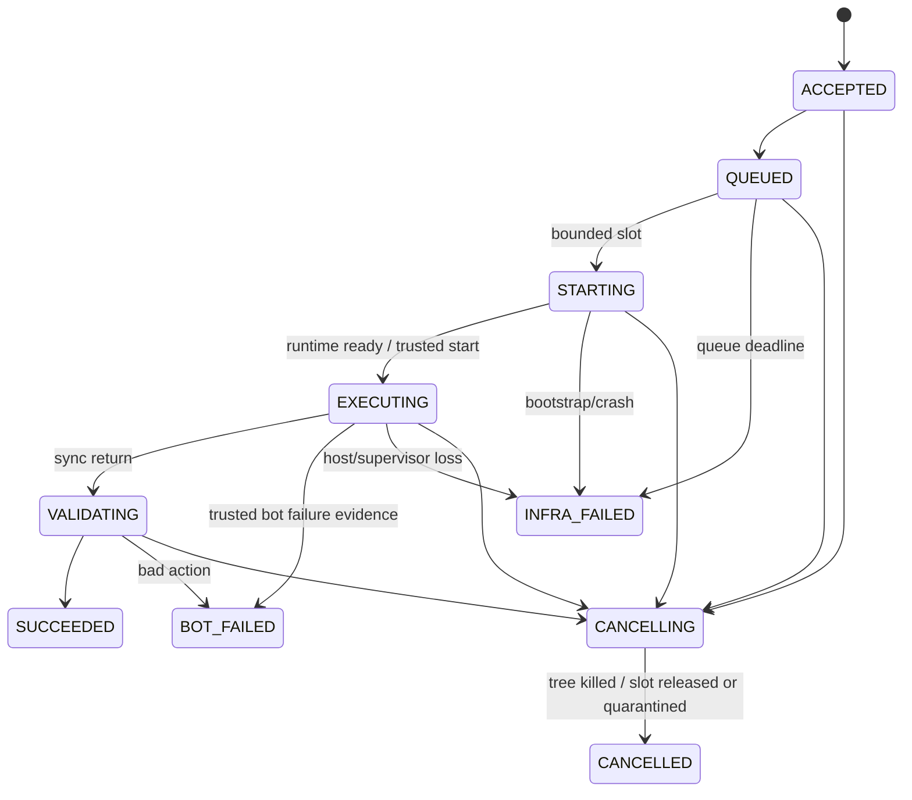
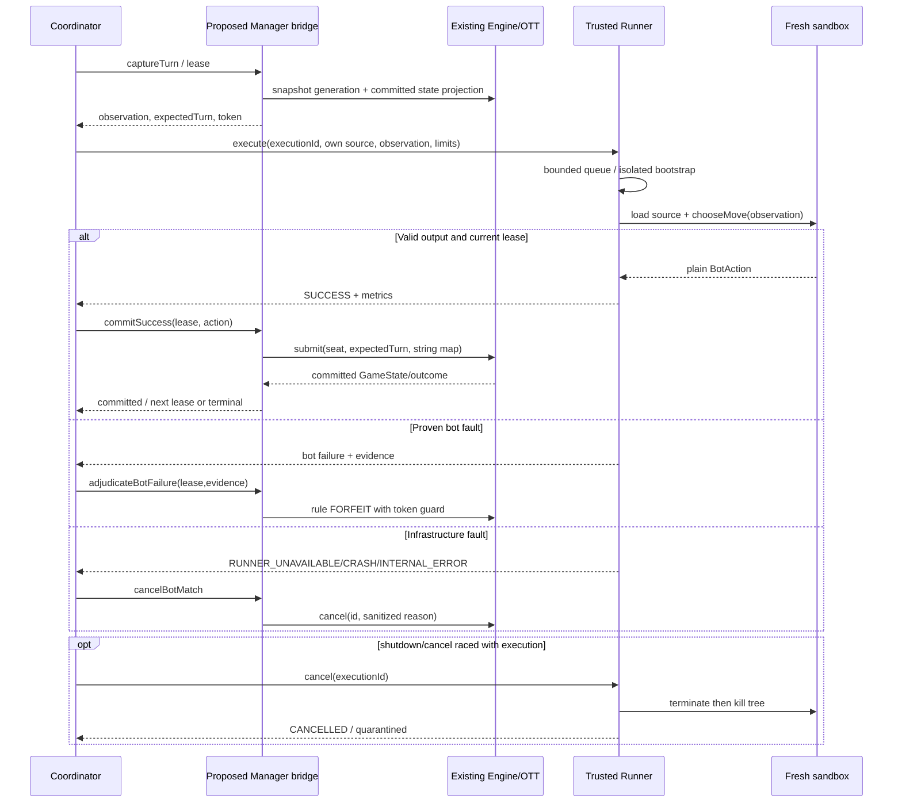

# Phase 8C.1 — Internal execution protocol runner-1 (proposal)

Giao thức service nội bộ mới; không thay TCP1.0/web-1 hoặc bot-1. Các endpoints dưới đây chỉ thiết kế, chưa triển khai. Backend là client được authorize duy nhất; browser/guest không được gọi supervisor.

## Transport và framing

Local: Java adapter ↔ trusted supervisor bằng pipes/private loopback endpoint, authentication per launch; chỉ inherited handles cần thiết. Supervisor ↔ disposable guest dùng stdin/control pipes tách guest diagnostics. Pipe frames là4-byte unsigned big-endian length + UTF-8 JSON, đọc đủ header/body, validate length trước allocate, cap128KiB. Guest không tự tạo response envelope hoặc chọn executionId.

Production external worker: HTTPS POST /internal/runner-1/executions, DELETE /internal/runner-1/executions/{executionId}, GET /internal/runner-1/executions/{executionId}. mTLS hoặc scoped service token được giữ ở supervisor/backend, không vào guest/env. TLS certificate verify; URL allowlist từ operator, không submission-controlled URL/redirect. Một backend instance trong giai đoạn đầu; quota service identity. Health/capabilities endpoint authenticated báo runtime/policy fingerprint và slot availability. Không expose Docker socket hoặc administrative APIs.

POST trả final response synchronous trong bounded request lifetime; GET để reconcile đã gửi mà mất response. Không redirect/fetch URL source. HTTP content-length/chunked reader đều bounded. Invalid service schema/auth là HTTP400/401/403; capacity/startup/unavailable là503 cùng correlated failure nếu executionId hợp lệ. Những HTTP errors không tự tạo bot failure.

## Request schema

```json
{
  "protocolVersion": "runner-1",
  "executionId": "b3cf7f42-81c9-4ca5-a8cf-a3d8c9b6a321",
  "runnerEpoch": "<UUID from authenticated capabilities handshake>",
  "requestExpiresAtEpochMillis": 1791849600000,
  "submission": {
    "submissionId": "9dbcf78d-5bfb-4dea-b492-55b317766def",
    "version": 1,
    "sourceSha256": "<64 lowercase hex characters>",
    "sourceBase64": "<exact UTF-8 bytes encoded as base64>"
  },
  "observation": {
    "apiVersion": "bot-1",
    "gameId": "ott-board-9x9-v1",
    "playerId": "A",
    "turn": 1,
    "boardSize": 9,
    "board": [],
    "legalMoves": [],
    "remainingTimeMs": 1000
  },
  "limits": {
    "profileId": "ott-js-wasm-proposal-v1",
    "cpuTimeMs": 250,
    "wallTimeMs": 1000,
    "memoryBytes": 134217728,
    "heapBytes": 33554432,
    "stackBytes": 1048576,
    "fuel": 10000000,
    "outputBytes": 1024
  }
}
```

Exemple dùng placeholders và empty lists để minh họa shape, không request active-turn hợp lệ; observation thực có toàn bộ live board và active legalMoves. Sandbox chỉ thấy source và observation; executionId/submission hash/service credentials giữ ở trusted layers. Source bytes SHA256 check sau strict base64/UTF-8 decode, không Unicode/newline normalization sau freeze. Validation rejects null/extra/missing keys, duplicates, floats cho integer fields, nonfinite values, excessive depth. Profile allowlist phải khớp numeric limits, không cho caller tăng tùy ý. runtime fingerprint negotiated/preflight, không silently đổi giữa trận. Native local profile có fuel unsupported phải khai báo rõ; WASM profile khác ID, không fake fuel metric.

UUID executionId do backend tạo mới mỗi requested turn. Backend lưu private binding executionId→match/seat/expectedTurn/generation/coordinator epoch/observationHash; không đưa sessionId, match secrets hoặc opponent source vào guest. submissionId/version public với supervisor nhưng không JS observation.

runnerEpoch được supervisor tạo mới mỗi restart; capabilities handshake cung cấp epoch và service time. Request phải echo epoch hiện tại và expiry tối đa30 giây từ service time lúc admission; clock skew tolerance5 giây, vượt skew là infrastructure rejection. Expiry chỉ kiểm soát admission/replay của service envelope, không đo CPU/wall budget của bot. Duplicate có record được lookup trước expiry check; new/unknown ID phải còn hạn. Fields này không đưa vào BotObservation hoặc guest. Backend đóng băng toàn bộ request để retry/reconcile, không gia hạn expiry cho cùng executionId.

## Response discriminated union

```json
{
  "protocolVersion": "runner-1",
  "executionId": "b3cf7f42-81c9-4ca5-a8cf-a3d8c9b6a321",
  "status": "SUCCESS",
  "action": {"pieceId": "A-S2", "to": {"row": 2, "col": 2}},
  "elapsedTimeMs": 3
}
```

```json
{
  "protocolVersion": "runner-1",
  "executionId": "b3cf7f42-81c9-4ca5-a8cf-a3d8c9b6a321",
  "status": "FAILURE",
  "failure": {
    "code": "BOT_TIMEOUT",
    "reason": "GUEST_CPU_BUDGET_EXCEEDED",
    "stage": "EXECUTING",
    "evidence": "SUPERVISOR_CPU_LIMIT"
  },
  "elapsedTimeMs": 250
}
```

Exactly action xor failure; fields corresponding to other branch absent, không null. elapsedTimeMs là integer>=0 đo monotonic source-load→action extraction/validation, không queue/cold-start; failure trước execute dùng0. Guest output không có status/id/timing/failure envelope; trusted supervisor tạo các fields đó. Action chỉ pieceId/to, to chỉ integer row/col; cap output1024 bytes. Strict JSON duplicate detection/trailing-token rejection trước BotAction.decode; verify plain object/data properties, không Promise/thenable/accessor/Proxy output. Backend revalidate schema + captured legalMoves, Engine/Rule là final authority sau lease checks. Invalid guest output → INVALID_ACTION; malformed supervisor envelope/mismatched ID → infrastructure INTERNAL_ERROR, không blame bot.

## Bounds và proposed resource profiles

| Item | Candidate bound, chưa benchmark/approve |
|---|---|
| Source | 32768 UTF-8 bytes; base64 expansion nằm trong total cap |
| Observation | 16384 UTF-8 JSON bytes;12 pieces, tối đa48 moves cho6 quân |
| Total request/frame | 131072 bytes, nesting<=8 |
| Total response | 4096 bytes; action<=1024 bytes |
| failure reason/evidence | enums + sanitized message<=512 UTF-8 bytes |
| guest diagnostics | drain separate pipe, cap2048 bytes, truncate/kill excessive output by policy |
| guest process total / JS heap / stack | 128MiB /32MiB /1MiB candidate |
| guest CPU / wall / Wasm fuel | 250ms /1000ms /10000000 instructions candidate, calibration required |
| queue wait / guest bootstrap | 2000ms /2000ms, infrastructure clocks |
| transport grace / kill grace | 1000ms /500ms, infrastructure clocks |
| local active/pending | 1/4 |
| production active/pending | 2/8 initially; global and backend adapter share same caps |
| in-memory execution records | 128 max including tombstones; terminal retention5min; sau đó GET trả410/unknown, không phân biệt ID chưa tồn tại |

No unlimited executor, waiters, retries or caches. At most one outstanding execution/match. Same execution limits/runtime for A/B; fair round-robin across matches, no one-match monopolization. Source validation occurs before scheduling; source policy/syntax rejected before match means admission error, not an invented match FORFEIT.

BOT room turn timeout proposed10000ms (within current GameConfig bounds), maxTurns>=200. Queue/bootstrap/transport+guest budgets must fit conservative lower-bound engine turn window with safety margin; reject incompatible room config. remainingTimeMs=guest wallTimeMs supplied at execution start, not queue remainder. Existing1000ms manual room deadline is insufficient for external Runner pipeline.

## Execution state machine / cancellation / duplicate



executionId plus SHA256 canonical request fingerprint (gồm epoch/expiry). Duplicate same ID/same body joins existing bounded operation or returns cached terminal result, never starts another guest. Same ID/different body →409 conflict/infrastructure client error, no match blame. A terminal record is write-once; DELETE terminal is idempotent, cannot replace success. Cancellation linearized first prevents late success; success observed after match lease cancellation is discarded. Records never evicted while active; terminal records giữ đủ5 phút, dài hơn admission window30 giây+skew. Capacity full rejects new IDs (RUNNER_UNAVAILABLE reason QUEUE_FULL), không evict để nhận request mới. Sau retention, GET410/unknown; POST nguyên request cũ bị expiry từ chối, nên không khởi chạy lại dù không còn tombstone. Sau restart, epoch cũ bị từ chối. Backend không đổi epoch/expiry để gửi lại execution cũ; reconciliation failure cancels match. Không tuyên bố exactly-once bền vững qua backend restart hoặc caller cố tình tạo request mới; đây là contract giữa trusted services, không persistent execution journal.

Pipes partial/truncated frame, service EOF/crash/mismatch, unknown/unavailable outcome → infrastructure, cancel affected match. Separate guest abnormal exit has RUNNER_CRASH unless trusted supervisor can prove a specific bot resource violation; generic signal/OOM/exit code alone is insufficient. No retry of invalid action, timeout or runtime error. No automatic rerun after supervisor restart.

## Sequence



All Runner I/O/waits outside Manager/Engine locks. Commit/cancel/adjudication atomic through bridge; stale replies do not forfeit the new active side.

## Failure matrix

| Code | Evidence / category | Match policy |
|---|---|---|
| INVALID_ACTION | guest missing/bad/extra/type/nonlegal action | active lease FORFEIT |
| BOT_TIMEOUT | measured guest CPU/wall budget violation with healthy supervisor; source initialization included | active lease FORFEIT |
| BOT_RUNTIME_ERROR | JS syntax/runtime exception, absent chooseMove, Promise/thenable/policy runtime violation | active lease FORFEIT |
| BOT_RESOURCE_LIMIT | proven guest heap/process/stack/fuel/output cap | active lease FORFEIT |
| RUNNER_UNAVAILABLE | admission full, queue/setup/transport expired, capability mismatch | CANCELLED |
| RUNNER_CRASH | worker/unknown guest crash, host OOM, restart or lost outcome | CANCELLED |
| INTERNAL_ERROR | bad service envelope/hash/ID, supervisor bug, unverifiable budget evidence | CANCELLED |
| MATCH_CANCELLED | backend cancellation, stale/terminal lease, shutdown | no new loser; retain already committed result/cancellation |

If host starvation versus bot hang cannot be distinguished, choose infrastructure INTERNAL_ERROR and cancel. Do not equate HTTP timeout with BOT_TIMEOUT. Source submission validation failures are ingress rejects before scheduling; no code-submission API is added now. Existing session/requestId/expectedTurn/out-of-turn errors remain unchanged, outside this failure taxonomy.
