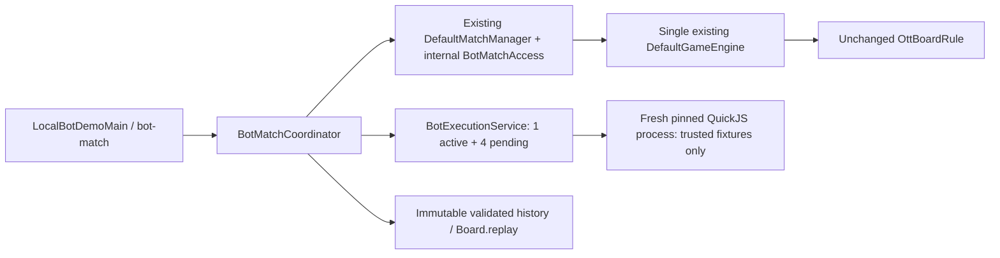

# Phase 8C — Local executable bot runner report

2026-10-13, D:\Socket\BattleCode. Implemented8C.2–8C.4 local prototype; security scope remains TRUSTED_FIXTURES_ONLY. See [contracts](phase8c2-report.md), [runtime/security limits](phase8c3-report.md), [coordinator](phase8c4-report.md).

## Files added/changed in this phase

- Added bot-runner/pom.xml; src/main/java/dev/battlecode/botrunner: BotSubmission, BotExecutionLimits, BotExecutionRequest, BotExecutionResult, BotExecutionFailure, BotRunner, FakeBotRunner, StrictActionCodec, BotExecutionService, TrustedBotFixtures, TrustedQuickJsRunner.
- Added bot-runner/src/main/resources:8 reviewed bot fixtures and2 trusted QuickJS control fragments; tests RunnerContractTest, QuickJsPrototypeTest, ControlFramingTest.
- Added bot-match/pom.xml; BotMatchCoordinator, LocalBotDemoMain, BotMatchCoordinatorTest.
- Added competition/BotMatchAccess.java; updated DefaultMatchManager.java for latest-state references, internal BOT lease/start/commit/cancel and cause-aware watchdog.
- Updated root pom.xml local-bots profile and .gitignore .tools/; added scripts/setup-quickjs.ps1 and scripts/run-local-bots.ps1.
- Corrected WebOnlyDeploymentIntegrationTest shutdown helper: directly assert no correlated PING response after shutdown, HTTP listener gone and zero server resources; do not assume JDK buffered send produces a particular exception/onClose timing. Same five regression tests retained.
- Added four phase reports; README and architecture append local runtime instructions.

Pre-existing uncommitted8B/8C.1 changes are preserved. No8C modifications to engine, rule contracts/implementations, TCP1.0/web-1, frontend, ServerMain, server POM or deployment configuration. No commit/push/deploy.



## Run on Windows11

```powershell
Set-Location D:\Socket\BattleCode
.\scripts\setup-quickjs.ps1
mvn clean test
mvn package
.\scripts\run-local-bots.ps1
```

QuickJS0.16.2 executable is ignored under .tools/; it is not committed or copied to Render. Tests use module-relative default path or BATTLECODE_QUICKJS / -Dbattlecode.quickjs. Only the pinned Windows artifact is accepted by this prototype. Default Windows Maven reactor includes both local modules; explicit -Plocal-bots can select them. Production Linux server graph does not activate this profile. No tests are skipped to conceal missing runtime: local real-JS tests fail if setup is absent.

## Final verification

| Verification | Actual final outcome |
|---|---|
| Focused bot-runner/reactor | BUILD SUCCESS;30 new runner tests +7 rules-api tests |
| Focused WEB_ONLY regression | BUILD SUCCESS;5 tests,0 failures/errors/skips |
| mvn clean test | BUILD SUCCESS,2026-10-13 08:19:57 +07;287 tests |
| mvn package | BUILD SUCCESS,2026-10-13 08:21:07 +07;287 tests again, no skips |
| Total regression/new |244 existing +43 new;0 failures,0 errors,0 skipped |
| New tests |14 RunnerContractTest +4 ControlFramingTest +12 QuickJsPrototypeTest +13 BotMatchCoordinatorTest |
| Packaged CLI demo | Exit0; actual external JavaScript,200 validated moves, MOVE_LIMIT_REACHED draw, replayMatches=true |
| Cleanup after final CLI | liveProcesses=0; observed qjs processes=0 and battlecode-trusted-* temp directories=0 |

Per-module totals: rules-api7, protocol11, engine33, competition13, network2, rules-impl52, client9, server117, bot-runner30, bot-match13. Counts were aggregated from actual TEST-*.xml files after final package. No Docker image/deployment, OS sandbox proof or public arbitrary-source execution is claimed.

Final packaged demo match2237ea36-6f5f-47e0-8abb-3fb5d4c352fc: FirstLegalMoveBot vs CapturePriorityBot,200 legal moves, no winners (MOVE_LIMIT_REACHED), replayMatches=true. Source A SHA-256=a87c17ec47bb4ebb5ad2f271042870232ef2f220446571962264785166ff592c; source B SHA-256=98539c593c0003af37fe685c07e2cdcc80f89507912c7143ce4706df7bc02ce9. Both fresh processes used the same pinned QuickJS artifact/profile. These tests and CLI executed JavaScript; FakeBotRunner is only used in explicitly labeled failure/concurrency tests.

Local ignored logs: .tools/runner-focused.log, .tools/web-only-focused.log, .tools/phase8c-clean-test.log, .tools/phase8c-package.log, .tools/local-bot-demo.log and .tools/production-graph.log. Existing Jetty deprecation/Surefire manifest warnings remain; final builds did not fail or skip tests.

Protected-file audit:71 pre-existing files covering engine, rules-api, rules-impl, protocol, frontend, Dockerfile/.dockerignore and server/pom.xml have unchanged SHA-256 compared with the8C.1 baseline. Production graph validation `mvn '-P!local-bots' -pl server -am validate` BUILD SUCCESS, nine projects including parent and no bot modules. This validates graph isolation; no Linux Docker image was built here.

During verification an earlier package failed on the old WEB_ONLY test helper expecting Exception while its ACK wait threw AssertionError. A first attempt to wait only on listener.closed also timed out because JDK may defer abrupt EOF signaling. The final helper checks observable shutdown behavior directly and its focused five-test run passed. No test was removed, ignored or converted to a catch-all Throwable assertion. Initial QuickJS bootstrap/module-path problems and sandbox loopback restrictions were also resolved before final runs.

## Remaining work and risks

AppContainer/Job Object isolation, CPU250ms hard quota and total-process128MiB RAM cap are absent. Heap/stack CLI options are configured, not stress-certified. Native process kill is not containment against malicious fork/escape; QuickJS CLI retains loader/host capabilities. Compilation/module initialization currently consumes bootstrap budget rather than guest budget. Full remote runner-1 epoch/expiry/HTTPS protocol, durable replay/audit, runtime restart recovery and public submissions remain unimplemented.256 records/service is bounded/fail-closed; multiple long matches can exhaust this demo lifetime and cancel new work as infrastructure.

Two bot fixtures receive identical profiles/fresh contexts; output and legality are validated by trusted backend/unchanged rule. CPU evidence is required to assign BOT_TIMEOUT at wall expiry; missing evidence cancels, preventing wall-time host delay alone becoming a loss. Render runs the existing backend only; this local executor is excluded from its dependency/build graph. Phase8C.5 and public security review have not begun.
