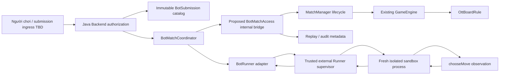
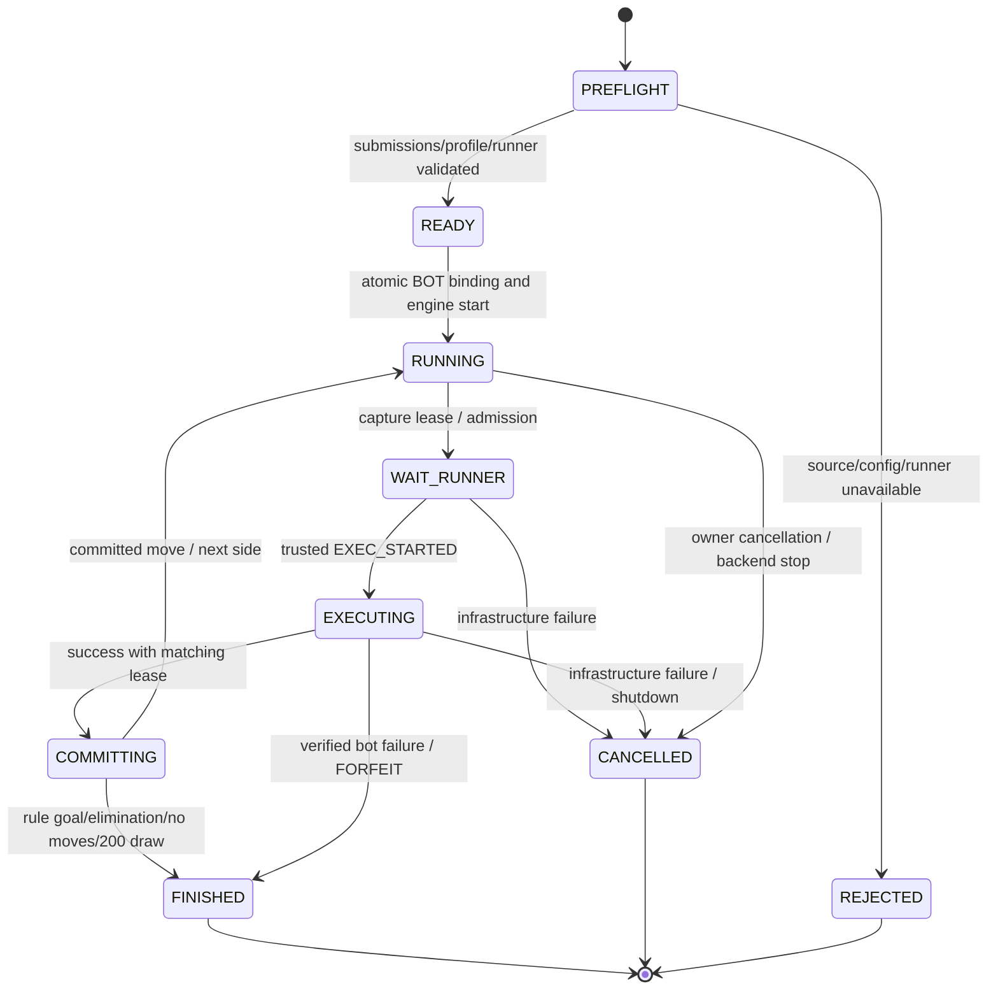

# Phase 8C.1 — JavaScript Bot Runner design

Ngày 2026-10-13. Đây là proposal để phê duyệt, không API hoặc executor đã triển khai. Chỉ tạo tài liệu; không sửa Java/frontend/dependencies/deployment. Giữ bot-1, ott-board-9x9-v1 và clarification Phase8A: invalid BotAction ở lượt được yêu cầu → FORFEIT, lỗi request giữ ERROR.

## Source thực tế và giới hạn tích hợp

| Source | Hợp đồng đã kiểm tra |
|---|---|
| rules-api.bot.BotObservation | Record immutable, sort board/legalMoves; remainingTimeMs do caller cung cấp |
| rules-api.bot.BotAction.decode(Object) | Exact map pieceId/to, to.row/col Integer hoặc Long trong int range; không parser JSON |
| OttBoardRule.observation(RuleState,UUID,long) | Tạo typed observation A/B từ private roster/state |
| OttBoardRule.history(RuleState) | Immutable validated MoveEvent list |
| OttBoardRule.isActionAllowed/applyAction | Active submission được phân xử; sai map/nước → FORFEIT |
| GameEngine.start/submit | Trả GameState chứa RuleState; expectedTurn kiểm tra nguyên tử |
| GameEngine.snapshot | Chỉ PlayerSnapshot(status,turn,generation,deadlineEpochMillis,view), không RuleState |
| GameEngine.timeout(id,generation) | Stale/early no-op; đến deadline gọi rule.onTurnTimeout |
| GameEngine.cancel(id,reason) | Có cancellation, không pause/resume |
| MatchManager.startMatch | Chỉ trả UUID, không GameState/typed observation |
| MatchManager.submitAction | Trả GameState; lifecycle + engine lock; publish/terminal cleanup |
| DefaultMatchManager.tick | Mỗi10ms gọi engine.timeout cho mọi active match, chưa có BOT mode |
| MatchStatus | CREATED/RUNNING/FINISHED/CANCELLED, không PAUSED |
| NetworkRequestDispatcher / network | Bound session, requestId, schema và expectedTurn guards; không bot executor |

Vì vậy coordinator không thể gọi một API snapshot chứa RuleState hay pause deadline đã có sẵn. Không parse compact string view thành state thứ hai, không reflection để lấy private engine state. Engine deadline hiện bắt đầu khi start/advance, trước queue/cold start Runner; để tránh xử thua vì infrastructure cần integration hooks trước Phase8C.4.

## Architecture và trust boundaries

Backend authorize submission owner và match creation, giữ source/catalog secret. Manager là authority room/membership/start/commit/cancel. Engine là authority atomic state/turn/deadline/rule. Rule tính board/legal/outcome. Coordinator chỉ scheduling và correlation, không tính thắng/thua hoặc tự apply board. Runner adapter kiểm soát transport; supervisor admission/resource/kill; sandbox chỉ own source + public observation. Replay đọc committed history, không chạy lại code để xác định kết quả.

Proposed module bot-runner phụ thuộc rules-api cho DTO; không phụ thuộc competition/engine/network. server composition/coordinator dùng bot-runner cùng services hiện có; bridge generic nằm cạnh manager. External native/Wasm worker là artifact riêng, không Maven dependency vào JavaScript engine trong JVM. Tên module/package chưa được triển khai; không thêm dependencies trong bước này.

## Abstraction contracts tối thiểu (proposal)

| Abstraction | Immutable contract / trách nhiệm |
|---|---|
| BotSubmission | submissionId, version>0, owner reference backend-only, apiVersion/gameId, exact UTF-8 source bytes, SHA256 source hash, validation/runtime-policy version; freeze tại match start |
| BotExecutionLimits | Immutable profileId, CPU/wall/fuel/heap/process/stack/output limits; queue/startup/transport budgets phân biệt với bot budget |
| BotExecutionRequest | executionId, runnerEpoch/admission expiry, immutable submission snapshot, BotObservation, approved limits; không opponent source/identity/token |
| BotExecutionResult | executionId, exactly one BotAction hoặc BotExecutionFailure, measured elapsedTimeMs; supervisor evidence/metrics backend-only |
| BotExecutionFailure | code + bounded reason + trusted stage/evidence, không raw exception/source/path/token; matrix trong protocol |
| BotRunner | Async execute(request) → completion; cancel(executionId) idempotent → completion; close() bounded cancel/drain/kill. Admission failure trả infrastructure failure, không exception mất correlation |
| BotMatchCoordinator | bind/startInternalMatch, schedule active seat, cancel(matchId,reason), close. Không nhận BotAction trực tiếp từ client và không tự sửa GameState |

Chữ ký mô tả: CompletionStage<BotExecutionResult> execute(BotExecutionRequest); CompletionStage<Void> cancel(UUID executionId); close(). Đây không phải source Java đã tạo. Completion không có nghĩa action đã commit. cancel complete chỉ khi guest stopped hoặc worker bị quarantine; hủy CompletableFuture không được coi là kill process. Result DTO phải defensive-copy/validate; owner reference không serialize đến guest/worker.

## Proposed BotMatchAccess integration, chưa có trong source

Một bridge mới, không thêm method vào GameRule/GameEngine/MatchManager trong bước thiết kế. Cần phê duyệt trước implementation:
1. Register BOT mode và hai server-owned seats trước start, freeze submission bindings. MatchManager vẫn start với identity host hợp lệ; ingress authorization dành cho con người được xác định riêng, không đổi nickname thành quyền.
2. DefaultMatchManager lưu reference tới latest committed GameState trả về từ engine.start/submit/timeout/disconnect, dưới lifecycle lock. Đây là snapshot reference, không board mirror/second engine. Mọi mutation vẫn qua manager; không expose reference cho runner.
3. captureTurn(matchId, trusted projector) tạo lease immutable dưới lifecycle lock: matchId/seatUUID/expectedTurn/generation/coordinator epoch/observationHash và typed observation. Projector injected từ server gọi OttBoardRule.observation; competition không import rules-impl. Không I/O hoặc source compilation trong lock.
4. commitSuccess(lease,action), adjudicateBotFailure(lease,evidence), cancelBotMatch(matchId,reason) do manager kiểm tra lease/current state dưới cùng lifecycle lock rồi gọi engine; terminal() hiện có xử lý notifications/room cleanup.
5. BOT-mode tick quản lý cause-aware watchdog: queue/setup/unreachable/crash → CANCELLED; chỉ chứng cứ bot-caused deadline/resource/runtime failure mới FORFEIT. Manual games giữ tick/onDisconnect policy cũ. Coordinator không gọi engine.cancel trực tiếp rồi bỏ qua manager cleanup.

Lease có generation/expectedTurn cùng coordinator epoch; atomically stale-check trước commit/adjudication. Existing expectedTurn overload vẫn bắt buộc. Infra cancellation không dùng fake disconnect hoặc timeout. Bot-caused failure có thể phân xử bằng empty action map cho active seat (Ott rule đã FORFEIT), hoặc timeout(generation) sau deadline khi nguyên nhân đã chứng minh là bot; giữ failure evidence riêng trong audit, GameResult.reason vẫn FORFEIT. Không đưa các failure code mới vào wire enums.

deadlineEpochMillis chỉ để display; không dùng đồng hồ wall để điều phối an toàn. Manager ghi conservative monotonic lower-bound từ timestamp trước engine operation + room turn timeout, không giả định đọc được private engine deadline. Engine vẫn authoritative khi submit. BOT watchdog phải ngăn generic timeout quyết định sai cause; nếu integration không bảo đảm điều này thì bot matches không được enable.

## Bot match lifecycle

WAIT_RUNNER/EXECUTING/COMMITTING là coordinator phases, không MatchStatus mới. Chọn cancel thay pause vì chưa có pause/deadline suspension API. Không replay execution sau crash/restart. Hai bot seats server-owned, không runner socket sessions; mất Runner không gọi MatchManager.disconnect. Human viewer disconnect không tự xử thua bot; mô hình owner cancellation/viewer identity cần phê duyệt. Giữ nguyên disconnect policy manual rooms.

## Fairness và determinism

Hai bot cùng match có cùng runtime build/profile/policy, một execution fresh mỗi lượt; không guest heap/global/cache mutable dùng lại. Bắt đầu active side A theo rule; một outstanding lease/match. Bounded fair queue giữa matches, nguồn đối phương không ở request. CPU/fuel quota giống nhau, không đo tốc độ client. Queue/cold start/transport không bị tính làm BOT_TIMEOUT.

V1 đề xuất cấm Math.random/Date/timers/crypto và nondeterministic host imports; không seed field trong bot-1. Nếu cần randomness, phải phê duyệt seeded generator profile riêng và lưu seed/algorithm/version; không lấy executionId làm seed. remainingTimeMs là fixed guest wall budget khi bắt đầu source loading, giống cho hai bên; không phản ánh queue hay client clock. Bot không được đọc live timer để làm kết quả phụ thuộc host tốc độ.

Replay authoritative từ initial board + validated MoveEvent list. Audit manifest đóng băng source hashes/versions, side bindings, rule/runtime/limits/policy versions, observation hashes, execution outcome/evidence và final result. Không claim bit-for-bit re-execution qua native/Wasm/hardware khác; board replay không phụ thuộc code rerun. Backend restart mất in-memory match như Phase7D; Runner restart cancel tất cả affected outstanding leases, không auto resume.

## Acceptance và open decisions

Chỉ enable sau tests chứng minh no stale/double commit, infra không gây FORFEIT, zero network/FS/subprocess capability, kill/cleanup bounded, immutable identities/hashes và deterministic board replay. Cần approve: local/production sandbox, candidate limits, bridge/BOT watchdog/server-owned seats, cancel policy, JS subset/randomness policy, source retention/ownership/ingress. Chi tiết [protocol](phase8c-execution-protocol.md), [security](phase8c-security.md), [plan](phase8c-implementation-plan.md).
