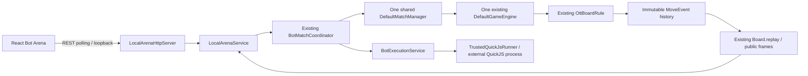

# Phase 8D — Web Bot Battle Arena

Implemented 2026-10-13. Local development only; no commit, push or deployment.

## Delivered

- React route `/bot-arena`: approved bot selection, start, live 9×9 board, 12 server-provided initial pieces, ROCK/PAPER/SCISSORS and A/B styling, captured pieces, last-move highlights, backend turn and result, battle log.
- Replay uses backend-provided immutable board frames: initial position, board after move N, capture events and final result. Previous/Next/Reset, seek slider, Play/Pause and speed controls.
- UI states: IDLE, STARTING, RUNNING, FINISHED, CANCELLED, ERROR. One in-flight start, finite 5-second fetch timeout, serialized 500ms polling, maximum 90 seconds per monitoring attempt. Error recovery resumes monitoring the known battle rather than starting another one. Unmount clears polling and aborts fetches.
- REST API is a separate transport and local entry point. TCP 1.0, web-1 and existing production ServerMain/Gateway are unchanged.
- Actual pinned QuickJS Phase 8C runner, exactly FirstLegalMoveBot and CapturePriorityBot. No FakeBotRunner, browser execution, eval, Node vm or source upload.

## Architecture



LocalArenaMain is an independent opt-in composition root. It creates **one** existing engine, manager, lobby and registry for every battle in this arena process. It does not run a second implementation of OTT, and does not attach local endpoints to the production TCP/WebSocket server. Run this arena backend instead of requiring ServerMain for this demo.

The coordinator retains its original `start(first, second)` API and adds an overload with a `Consumer<Progress>`. Progress contains immutable observation/history and is published after capture/commit, outside Engine/Competition locks. Viewer exceptions cannot change adjudication. The HTTP projection serializes only public board/move/result DTOs; source bytes, submission hashes, seats/session identities, executable paths, execution IDs and runner fingerprint are omitted.

Only one battle may run at a time. Engine/manager remain shared. A completed battle's coordinator/runner is closed before the next one; the next battle gets a fresh bounded execution cache so the Phase 8C 256-record limit does not invalidate later matches. At most 16 battles are retained, with no eviction of idempotency keys; restart the local backend when full. All history is in memory.

## HTTP contract

Base: `http://127.0.0.1:8090/api/local`.

| Method/path | Response |
|---|---|
| GET /bots | `{bots: [trusted IDs], initialBoard: Piece[]}` |
| POST /battles | 201 Snapshot; exact JSON fields `botA`, `botB`, UUID `requestId` |
| GET /battles/{id} | Atomic immutable Snapshot, including current board, history, frames and nullable final result |
| GET /battles/{id}/moves | `{id, moves: MoveEvent[], frames: Piece[][]}` |

POST example:

```json
{"botA":"FirstLegalMoveBot","botB":"CapturePriorityBot","requestId":"2bfe31c5-a761-4938-927f-e6b36f4bb3d7"}
```

Snapshot fields: `id, botA, botB, status, turn, currentSide, board, moves, frames, result`.
`status` is RUNNING/FINISHED/CANCELLED. Turn is one-based. Terminal currentSide is informational; it is not authorization to submit a move.

Piece: `{id, owner: A|B, type: ROCK|PAPER|SCISSORS, position: {row,col}}`. Coordinates are zero-based, display coordinates are one-based.

MoveEvent: `{number, side, pieceId, from, to, captured: Piece|null}`. `frames[0]` is the initial board; `frames[n]` is the authoritative board after validated move n. Frames are projected using existing `Board.replay`, not new movement/capture code. Consumers use one response atomically; independently requested snapshots may naturally have different move counts while running.

Result: `{outcome: WIN|DRAW|FORFEIT|CANCELLED, winner: A|B|null, reason}`. Outcomes are classified by backend GameResult. Unknown infrastructure/cancellation reasons produce CANCELLED, never an invented loss. Browser does not compute victory/draw/forfeit.

Same requestId and same bots returns the same battle snapshot. A conflicting body returns 400; another request while a battle runs or history is full returns 409. Invalid/extra/duplicate JSON fields, unknown bots, or invalid IDs return 400. Unknown battle returns 404. Oversize request returns 413. Runner/startup faults return 409/503. No source field is accepted. POST requires Content-Type exactly application/json. Queries are unsupported.

## Local security and deployment boundary

- Module remains in `local-bots` Maven profile; production server has no dependency on bot-match/runner.
- Entry point requires explicit `--local-development`; rejects environment `RENDER` or `BATTLECODE_MODE=WEB_ONLY`.
- HTTP binds only IPv4 127.0.0.1. No configurable public bind address.
- Exact Host validation rejects DNS rebinding hosts. Every API request requires an allowed Origin; allowlist is exactly `http://127.0.0.1:5173` and `http://localhost:5173`. No wildcard CORS, credentials or remote origin. OPTIONS supports GET/POST and Content-Type.
- Four HTTP workers, bounded queue 16, listener backlog 16; entry point caps connections at 32 and request/response duration at 10s. Request body at most 2048 bytes, JSON depth 8, duplicate fields/trailing tokens rejected.
- Shutdown stops HTTP, cancels coordinator work, closes runner/execution service and stops manager. No HTTP I/O under business locks.
- React arena functionality is DEV-only. Production builds show an unavailable message and never fetch the loopback bot API.
- Windows trusted fixture execution retains Phase 8C limitations: OS isolation, CPU quota and total process-memory enforcement are not proven. This feature is **not an arbitrary-code sandbox** and must not be exposed publicly.

## Exact PowerShell launch commands

Backend terminal (Java 21/Maven, Windows):

```powershell
Set-Location D:\Socket\BattleCode
# Only if the pinned runtime has not been installed:
# .\scripts\setup-quickjs.ps1
mvn -Plocal-bots -pl bot-match -am package
.\scripts\run-local-arena.ps1
```

Default backend port 8090. Alternate: ` .\scripts\run-local-arena.ps1 -Port 8091`, then change VITE_BOT_API_URL accordingly. Do not set WEB_ONLY/RENDER in the local terminal; use a separate clean local terminal if those variables are set for deployment work.

Frontend terminal:

```powershell
Set-Location D:\Socket\BattleCode\frontend
pnpm install --frozen-lockfile
$env:VITE_BOT_API_URL='http://127.0.0.1:8090'
pnpm exec vite --host 127.0.0.1 --port 5173 --strictPort
```

Open `http://127.0.0.1:5173/bot-arena`. Select the two bots, Start Battle, then replay the backend history. The normal Multiplayer route `/` retains its existing WebSocket configuration; it is not required for local Bot Arena. Stop both terminals with Ctrl+C. Vercel/Render deployment files are unchanged.

## Changed files

- `bot-match/.../BotMatchCoordinator.java`: compatible progress callback.
- Added `LocalArenaService.java`, `LocalArenaHttpServer.java`, `LocalArenaMain.java`, `LocalArenaHttpServerTest.java`.
- Added `frontend/src/BotArena.tsx`, `BotArena.test.tsx`, `bot-arena.css`; modified `frontend/src/main.tsx`, `frontend/.env.example`.
- Added `scripts/run-local-arena.ps1`, this report; README local arena instructions.
- No engine, game rule, MatchManager, protocol, dependency, lockfile or deployment changes in Phase 8D.

## Verification

| Completed command | Actual result |
|---|---|
| `mvn -Plocal-bots -pl bot-match -am package` | BUILD SUCCESS, 51.411s; 153 tests, 0 failures/errors/skipped across affected dependency reactor |
| Focused `LocalArenaHttpServerTest` test run | BUILD SUCCESS, 4 tests before adding active-shutdown test; final package runs all 5 API tests |
| `pnpm test` | 18 tests passed in 6 files, including 3 new Arena tests |
| `pnpm build` | TypeScript + Vite production build successful |

API tests cover explicit local activation, exact/missing/invalid Origin, approved catalog/12 initial pieces, rejection of source/unknown bots/oversize body, idempotency, concurrent-start rejection, actual FirstLegalMoveBot vs CapturePriorityBot execution, final DRAW after 200 moves, 201 replay frames, history/current-board consistency, no source/execution metadata in response, listener shutdown and cancellation of an active battle without forfeit. Frontend tests cover 81 cells/highlights, backend result/frame rendering, repeat-click prevention, reset/next replay and backend errors.

Frontend production build used a temporary process environment `VITE_WS_URL=wss://build-verification.invalid/ws` solely to exercise the pre-existing production WSS build guard; the developer's local WS configuration was restored, no environment file was changed. That verification bundle is **not a configured deployable backend endpoint**. Local Arena runs with Vite DEV as above.

Logs: `.tools/phase8d-package.log`, `.tools/phase8d-api-test.log`, `.tools/phase8d-frontend-test.log`, `.tools/phase8d-frontend-build.log`. No QuickJS process remained after tests.

No manual browser test or Phase 8C.5 security stress test was requested/run. No full reactor clean test is claimed for this phase; package covers the affected module and its dependency reactor. Existing server/network/client tests were not rerun, and those modules were not modified.
