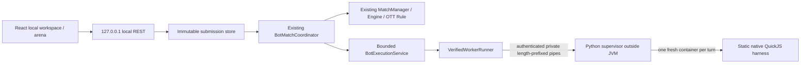

# Phase 8F.1 — isolated worker

Implemented on Windows 11 using Docker Desktop's WSL2 Linux engine. Production ServerMain, Render/Vercel, TCP 1.0 and web-1 are unchanged.

Files: `isolated-worker/guest.c`, `Dockerfile`, `worker.py`, `.gitignore`; `bot-runner/.../VerifiedWorkerRunner.java`; `scripts/build-isolated-worker.ps1`, `run-secure-local-arena.ps1`, `test-isolated-worker.ps1`.

The Docker runtime image is scratch with only the statically linked guest and QuickJS license. QuickJS-NG 0.16.2 source archive SHA-256 is `97c80625b26775a4c7ca618c004d4ea24cf99cbf867e4eba78bd927a8b23d106`; builder Alpine image is pinned by digest. Runtime admission uses the locally built exact image ID, not a mutable tag or a downloaded capability approval. Host user directories and the Docker socket are never mounted. Every scope is generated with an unpredictable owner label; cleanup touches only that owner's containers.

The native harness has no quickjs-libc, host bindings, filesystem/network/process APIs or usable module loader. JavaScript eval/Function and intrinsic dynamic-code constructors are removed. The native `JS_Eval` compiler API compiles source **inside the restricted guest**, not inside Java or Python and not as the security boundary. Kernel restrictions are installed before untrusted input is parsed. Observation is deeply immutable; output is inspected through native property descriptors and serialized from approved primitive values, without calling user getters/toJSON/JSON.stringify.

Runner protocol `runner-1` uses four-byte big-endian lengths, request cap 128KiB and response cap 8KiB, correlation UUID, source ID/version/hash/base64 bytes, observation and exact local limits. A random 256-bit token is sent in private pipes, never guest argv/environment or browser responses. Duplicate IDs return the recorded result; conflicting payloads are infrastructure errors. No worker listener or execute(source) HTTP endpoint exists.

Worker lifecycle: startup → live verification → eligible/unavailable → execute → cleanup-confirmed result. EOF, malformed/auth-invalid transport and supervisor crash revoke Java admission and trigger owner-scoped emergency cleanup. Shutdown closes pipes, cancels jobs, waits boundedly and removes remaining scopes. This local worker is not part of the production server build graph.

Residual trusted components are the host operator, supervisor, native harness, QuickJS, Docker/WSL2 runtime and Linux kernel. Verification demonstrates configured controls in this environment; it is not a proof that these components contain no vulnerabilities or a public multi-tenant security certification.
