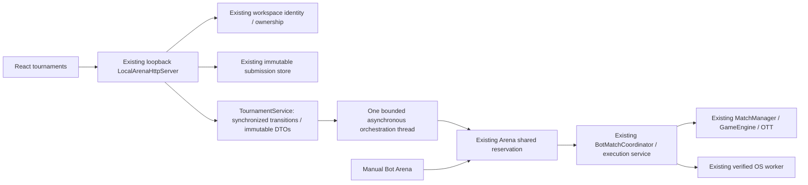

# Phase 9 — local tournament system

Implemented backend and React frontend on 2026-10-13. Uses the existing OTT rule, GameEngine/MatchManager, BotMatchCoordinator, VerifiedWorkerRunner, LocalSubmissionStore, LocalWorkspaceSessions and secure local Arena. No second engine, game implementation, JavaScript runner, production route or execution pool was introduced. No commit/push/deploy.

## Features

- Immutable public domain models: Tournament, TournamentConfig, TournamentEntry, TournamentRound, TournamentMatch, TournamentStanding, TournamentResult, TournamentStatus, TournamentFormat.
- Lifecycle CREATED → REGISTRATION_OPEN → REGISTRATION_CLOSED → RUNNING → FINISHED, with cancellation from nonterminal states. Deadline automatically closes registration on read/registration check. At least two participants are required to start.
- Creation, listing/details, open/close, own saved-version registration, withdrawal, start/cancel, matches, standings, bracket and authoritative match snapshots/replay.
- One entry per owner per tournament; 2–16 entrants. Entry freezes owner ID, bot ID, name, version, exact source hash and immutable UTF-8 bytes. Later save/delete cannot change the entry or match. Private source storage is never serialized into public DTOs.
- Round Robin: every pair has two matches with swapped sides; N × (N−1) matches, no self-match. Immutable attempt UUIDs are deterministic within the tournament.
- Single Elimination: seeded pairings, BYEs for non-power-of-two fields; next round is only created after every previous result/advancement is confirmed. DRAW causes up to the configured 0–2 rematches with swapped sides, then the published lower seedOrder advances.
- Round Robin standings: WIN 3, DRAW 1, LOSS 0; offending FORFEIT counts as loss/forfeit. CANCELLED/unknown infrastructure outcomes receive no points. Tie-break is points, wins, head-to-head points within the tied points/wins group, then seedOrder. Move count is not a tie-break.
- React `/tournaments`: lobby/create, owner controls, own saved-version registration/withdrawal, participants, rounds, current/completed matches, champion, standings, bracket/BYE/winner highlight, match viewer using the existing OttBoard with live snapshots, battle log, replay Reset/Previous/Play/Pause/Next/speed.

## Runtime and concurrency



One running tournament reserves the existing Arena admission slot for its entire execution. Manual battles receive 409 while reserved; starting a tournament during a manual battle also receives 409. Another tournament cannot run concurrently. Reservation is released after scheduling/cleanup stops. The orchestration thread schedules matches sequentially; it does not execute JavaScript itself. Existing one active worker execution/four service queue slots and all guest CPU/RAM/wall/source/output limits remain unchanged.

Tournament mutations/idempotency are atomic under the service monitor. Execution, waiting, cancellation and HTTP I/O occur outside that monitor and outside Engine/Competition business locks. Result commits replace a unique match key once; later DRAW bracket advancement does not rewrite its authoritative GameResult. New rounds wait for confirmed outcomes. Client standings/results cannot be written.

Tournament snapshots contain metadata and results, not all replay frames. A match viewer fetches one authoritative snapshot/history at a time. Terminal tournament matches are archived from the Arena's 16 manual-history slots into bounded tournament replay storage, preserving manual history limits. Concurrent completion/archive reads retry the immutable archived snapshot.

The worker's original 4096 execution-record limit is retained **per match generation**, rather than exhausted across a long tournament. Java's borrowed match scope gets a monotonically increasing generation; authenticated internal EXECUTE supports this additive field. A newer generation retires completed older records only when no execution is active; requests from older generations are rejected before execution. In-generation duplicate IDs still return the same result or reject conflicts. No stale replay can restart an old turn. TCP 1.0/web-1/BotAction/BotObservation are unchanged.

## Deterministic policy

Seed ordering sorts entries by lowercase SHA-256 of UTF-8 `seed:ownerUUID:botUUID:version`, with entry UUID only as a final collision tie-break. The seed and draw-rematch limit are immutable configuration; seedOrder is published during registration/closed registration and frozen on start. Initial elimination BYEs go to the first seed positions. RR pairs are enumerated by seed position i<j, then A/B and B/A consecutively (one sequential match per numbered round).

The authoritative battle result remains DRAW when seed tie-break advances someone. `TournamentMatch.winnerId` then denotes bracket advancement; it does not invent a game WIN. TournamentResult reason records that a seed tie-break was used. Intermediate rematch draws are marked DRAW_REPLAY; standings are primarily the RR scoring view, while elimination's authoritative output is bracket/champion.

Infrastructure failure cancels the affected match/tournament and stops all further scheduling, with no assigned winner or score for interrupted matches. Already confirmed earlier match scores remain visible as partial standings, but cancelled tournaments have no champion. Pending matches are marked CANCELLED with interruption reason. There is no automatic infrastructure retry/resume: create a new tournament after restoring a verified worker. Owner cancellation and server shutdown propagate to the currently running coordinator/worker. Backend match monitoring is bounded to 8 minutes, then requests cancellation; unconfirmed cancellation stops scheduling after another 10 seconds without inventing a result.

## Local API

All tournament endpoints require `X-Battlecode-Workspace` issued by `/api/local/workspace-session`, exact allowlisted Origin and valid loopback Host. Secure local composition is required; the legacy fixture-only entrypoint cannot expose tournament operations. Never trust JSON ownerId: extra ownerId/source/results fields are rejected.

| Method / endpoint | Behavior |
|---|---|
| GET /api/local/tournaments | Tournament list + server-derived viewerOwnerId |
| POST /api/local/tournaments | Create; HTTP 201 |
| GET /api/local/tournaments/{id} | Immutable tournament + canManage/viewerOwnerId |
| POST /api/local/tournaments/{id}/open | Tournament owner only |
| POST /api/local/tournaments/{id}/close | Owner locks registration |
| POST /api/local/tournaments/{id}/register | Register caller's owned exact saved version; live gate required |
| POST /api/local/tournaments/{id}/withdraw | Withdraw caller's entry while registration open |
| POST /api/local/tournaments/{id}/start | Owner only, live gate and shared admission |
| POST /api/local/tournaments/{id}/cancel | Owner cancels nonterminal tournament |
| GET /api/local/tournaments/{id}/matches | Public match metadata/result list |
| GET /api/local/tournaments/{id}/standings | Server-calculated standings |
| GET /api/local/tournaments/{id}/bracket | Confirmed rounds/advancements/result |
| GET /api/local/tournaments/{id}/matches/{matchId} | Existing authoritative Arena snapshot/frames/moves/result |

Create fields are exactly requestId, name, format, maxParticipants, seed, maxDrawRematches and optional registrationDeadline (UTC Instant string or null). Register fields are exactly requestId, botId, version, sourceSha256. Other mutations accept exactly requestId. Mutations use canonical UUID request IDs, scoped per owner. Identical retry returns the original immutable response without repeating effects; changed payload with the same ID is 400. Use GET for current status after a retry.

```json
{"requestId":"<UUID>","name":"Local Cup","format":"ROUND_ROBIN","maxParticipants":4,"seed":42,"maxDrawRematches":1,"registrationDeadline":null}
```

Malformed schema/JSON/UTF-8/enum/date/hash/UUID is 400, ownership/identity/Origin/Host denial 403, missing resource 404, transition/capacity/admission/gate conflict 409, oversized body 413, unavailable server/response capacity 503. Pending/BYE match has no executable snapshot and returns 409. JSON timestamps serialize as ISO-8601 strings without adding dependencies. Submission list adds metadata-only immutable version/hash references for version selection, preserving existing fields and source privacy.

## Bounds and limits

- Four retained tournaments; 2048 owner-scoped mutation records; 512 reserved match attempts across backend lifetime. Admission reserves the worst-case match budget before start; finished/cancelled reservations remain charged because histories are retained. No unlimited tournament/match creation.
- One tournament scheduler thread, queue capacity 1, one shared Arena reservation/execution. Existing guest 128MiB process/32MiB heap/250ms CPU/1000ms wall/1024-byte action and fresh context are unchanged.
- Tournament request ≤4096 bytes; strict duplicate/trailing JSON detection, nesting cap 8; response hard cap 4MiB. Detail/list exclude source and replay blobs; viewer retrieves one match. Underlying submissions still max 32 bots/16 versions and source ≤32KiB.
- Browser polls every second with 5-second fetch timeout and 15-minute monitoring limit. Refresh explicitly resumes monitoring; no frontend timeout awards a loss. Unmount clears timers/aborts requests. Matches may take longer than one monitoring window.
- In-memory only: backend restart loses tournaments, sources, ownership and replay. Local workspace tokens are local browser ownership, not Internet-grade accounts/authentication.
- No public deployment, Render execution, automatic worker recovery/resume, infrastructure retry API, persistence, prizes, Swiss format, production accounts, load/stress certification or manual browser testing in this phase.

## Files

Added `bot-match/src/main/java/dev/battlecode/botmatch/tournament/` with nine models plus TournamentRules/TournamentService; `bot-match/src/test/java/dev/battlecode/botmatch/tournament/TournamentServiceTest.java`; `bot-match/.../TournamentWorkerSecurityIT.java`; `frontend/src/{Tournaments.tsx,Tournaments.test.tsx,tournaments.css}` and this report.

Updated LocalArenaService (shared reservation/archive/cancellation), LocalArenaHttpServer (strict local router/ownership/DTO timestamps/bounds), VerifiedWorkerRunner and isolated-worker/worker.py (bounded match generation), isolated-worker/test_worker.py and VerifiedWorkerSecurityIT (real stale-generation checks), scripts/test-isolated-worker.ps1 (includes real tournaments), frontend local-submissions.ts (shared authenticated local API), main.tsx (route), BotArena.tsx (navigation), README. Existing unrelated changes from prior phases were preserved. No Maven dependency, production ServerMain, GameEngine, MatchManager, OTT/RPS/Number Guessing, TCP/web-1 or deployment change.

## Run (PowerShell)

From D:\Socket\BattleCode, with running Docker Desktop Linux/WSL2 engine, Python and Java 21/Maven:

```powershell
Set-Location D:\Socket\BattleCode
# First setup only; existing pinned artifacts may be reused:
.\scripts\setup-quickjs.ps1
.\scripts\build-isolated-worker.ps1
mvn -Plocal-bots -pl bot-match -am package
if ($LASTEXITCODE -ne 0) { throw 'Build failed' }
.\scripts\run-secure-local-arena.ps1 `
  -Python 'C:\Users\Admin\miniconda3\python.exe' `
  -Docker 'C:\Users\Admin\AppData\Local\Programs\DockerDesktop\resources\bin\docker.exe'
```

Second PowerShell window:

```powershell
Set-Location D:\Socket\BattleCode\frontend
$runtimeRoot = 'C:\Users\Admin\.cache\codex-runtimes\codex-primary-runtime\dependencies'
$env:Path = "$runtimeRoot\node\bin;$runtimeRoot\bin\fallback;$env:Path"
pnpm.cmd install --frozen-lockfile
pnpm.cmd exec vite --host 127.0.0.1 --port 5173 --strictPort
```

Open http://127.0.0.1:5173/tournaments. Each participant uses its own browser/session workspace identity, saves a bot in /bot-workspace and registers its exact version when registration is open. Owner closes registration, then starts. Default API 127.0.0.1:8090; exact Origins localhost:5173 / 127.0.0.1:5173. No wildcard CORS or Internet endpoint. Ctrl+C cancels scheduler/current match and closes the worker.

## Verification

Executed commands:

```powershell
mvn clean test
mvn package
.\scripts\test-isolated-worker.ps1 `
  -Python 'C:\Users\Admin\miniconda3\python.exe' `
  -Docker 'C:\Users\Admin\AppData\Local\Programs\DockerDesktop\resources\bin\docker.exe'
# frontend, after setting PATH above:
pnpm.cmd test
pnpm.cmd build
```

Real sandbox suites are explicit *SecurityIT tests, fail if runtime unavailable, and were run; none are skipped to get PASS. Domain tests use a controlled execution-port result provider to isolate scheduling/scoring policy; that provider is not used by production and is not counted as real execution evidence. Real tournament IT uses HTTP, saved sources, live verified worker and existing engine.

Coverage: RR N=2/3/4; elimination N=3/4/5 and BYEs; DRAW swapped-side rematches/seed advancement; FORFEIT, head-to-head/standings; deadlines/withdrawal/frozen defensive bytes; idempotency/conflicting IDs; concurrent registration/start; missing gate; shared admission and shutdown. Real RR N=2 verifies exact old version after save, source privacy, foreign-owner denial, forged JSON identity, hash tampering, frozen authoritative replay and scores. Real elimination N=3 verifies BYE/two rounds/champion. Real infrastructure loss stops scheduling with no winner/score. Phase 8F security/failure/privacy regressions and generation rollover run against actual Docker scopes.

Verification results: `mvn clean test` and `mvn package` both BUILD SUCCESS, with 313 ordinary JUnit tests and no failures/errors/skips. The explicit isolated-worker suites passed 12 additional JUnit tests (6 worker security, 3 saved-battle security, 3 tournament end-to-end), for 325 distinct Java tests. Python supervisor tests passed 6 tests; frontend passed 27 tests across 8 files and its TypeScript/Vite production build succeeded. The frontend build used a temporary nonlocal WSS verification URL, restored afterward; this artifact is not a deployment configuration.

Evidence logs are in ignored `.tools/phase9/` and JUnit XML reports. An initial real test exposed missing Instant serialization; it was fixed and rerun. No manual browser/public deployment verification is claimed.

Final focused rerun after cancellation DTO changes: `TournamentServiceTest` (12) and `TournamentWorkerSecurityIT` (3) passed, BUILD SUCCESS. These are reruns of the counts above, not additional distinct tests.
