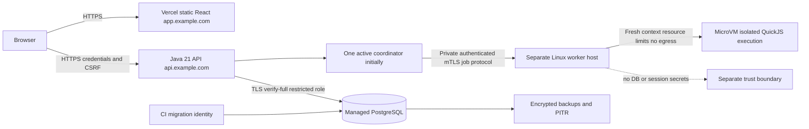
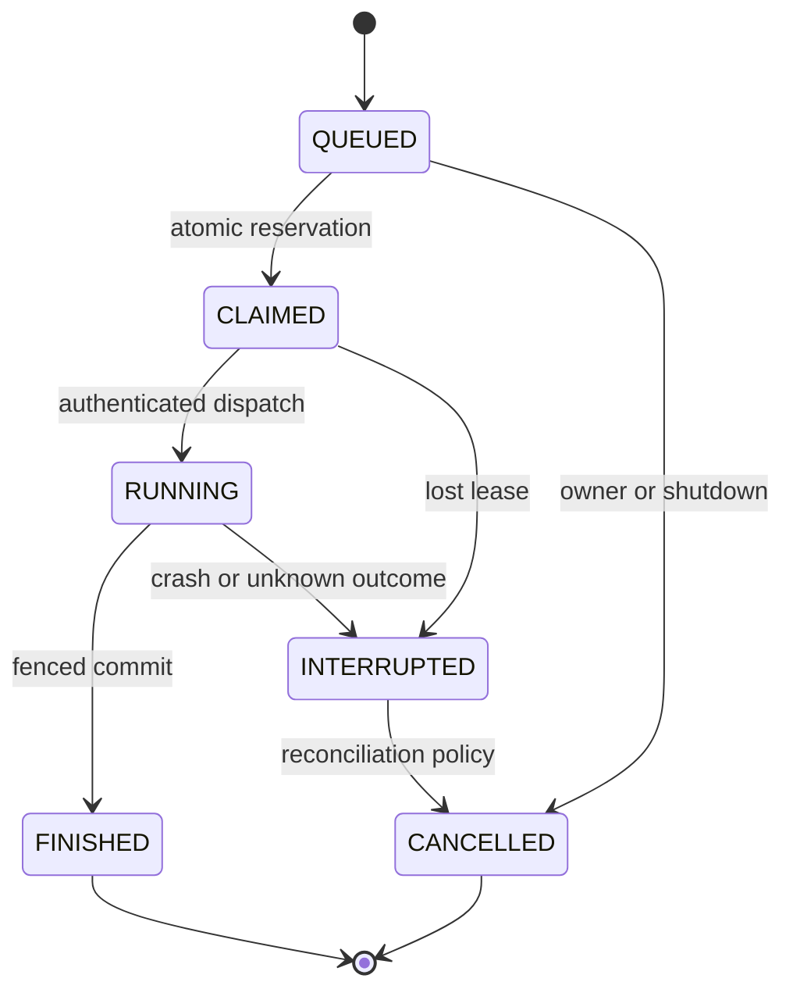

# Phase 11A: production architecture

Status: architecture and offline policy preparation; online competitive runtime is **BLOCKED**. No deployment authorization follows from this document. TCP 1.0, web-1, GameEngine, rules, tournament points 3–1–0, Elo V1 and Glicko-2 V1 remain unchanged.

## Source audit and current boundary

Phase 10.9 has code, tests and `phase10-9-report.md`: participant-authorized persisted match viewer, replay, history and profiles. It is a local feature implementation, not a production release. Browser end-to-end/staging acceptance is not recorded. `frontend/src/local-submissions.ts` and AuthGuard explicitly prevent production competitive API use. Live tournament views depend on existing persisted checkpoints; offset history can shift under inserts. No public spectator entitlement is implied.

Actual deployment graphs differ:

* `server/ServerMain` + `ServerLaunchConfig` + `RoomTcpServer`: TCP/local or WEB_ONLY `/ws` and `/health`. Root Dockerfile builds this graph, not authenticated competitive APIs or bot workers.
* `bot-match/SecureLocalArenaMain` + `LocalArenaHttpServer`: account/submission/arena/tournament/ranked/read APIs, loopback only, separate verified Python/Docker supervisor and PostgreSQL. New guard rejects staging/production, RENDER and WEB_ONLY at entrypoint and HTTP constructor.
* `VerifiedWorkerRunner` verifies local capabilities and pinned image through a private pipe to `isolated-worker/worker.py`. Docker Desktop evidence is not evidence of production isolation.

## Target deployment (not implemented)



One engine/rule implementation and existing business services remain authoritative. API never executes JavaScript. No arbitrary-source path is added to server WEB_ONLY. Worker receives only frozen source bytes, version/hash, sanitized observation and execution limits; never opponent source, account sessions, DB credentials or internal state. Browser receives authorized snapshots/history, never worker controls or source of another account.

Preferred worker boundary is a dedicated Linux host/service with per-execution microVM isolation, denied guest network, no host mounts, no Docker socket, nonroot, read-only root, bounded ephemeral storage and file descriptors/PIDs/CPU/RAM/output. A gVisor variant requires a separate reviewed capability matrix. Containers sharing the host kernel are not sufficient escape-proof evidence. Supervisor compromise remains a risk; isolate its identity, credentials and network from API/DB. KVM/runtime availability must be verified on the chosen provider.

## Authentication and web policy

Existing AuthService: bcrypt cost12, registration password minimum 8 characters and maximum 72 UTF-8 bytes, random32-byte opaque session token, only token SHA-256 stored, 8h expiry, revocation and bounded sessions. Existing-account login does not enforce the registration minimum. Existing cookie is HTTP-loopback `battlecode_session`, HttpOnly, SameSite=Strict, `/api/local/`; it has no Secure attribute. Keep local behavior. Production requires a separate HTTPS transport and cookie adapter.

Target: host-only `__Host-battlecode_session; Secure; HttpOnly; SameSite=Lax; Path=/`, no Domain, rotation on login/privilege change, server expiry/revocation unchanged unless separately versioned. Use exact HTTPS Origin CORS echo with credentials, Vary: Origin, explicit methods/headers and no wildcard. Unsafe requests require a session-bound synchronizer token and Origin verification; login/register need a pre-auth bootstrap token to prevent login CSRF. Logout must be POST with CSRF and matching cookie deletion attributes. Revoke sessions on password rotation. No password reset/MFA/account recovery is currently implemented; define support policy before launch.

Use app.example.com and api.example.com: different origin but same schemeful site; fetch credentials include is still required. Vercel/Render default domains are cross-site: Lax will not deliver cookies for cross-site fetch, while None+Secure can still be blocked by third-party-cookie policy. Do not solve this by weakening local cookie/CORS. Prefer same-site custom domains or a reviewed same-origin BFF. Browser TLS/CORS/CSRF tests are a release gate, not covered by a Java policy check. [MDN CORS](https://developer.mozilla.org/en-US/docs/Web/HTTP/Guides/CORS), [cookies](https://developer.mozilla.org/en-US/docs/Web/HTTP/Guides/Cookies).

Reverse proxy: trust Forwarded/X-Forwarded-* only from configured proxy CIDRs, reject direct access/spoofed chains, normalize public host/scheme once. Existing loopback Host validation cannot simply be replaced with trusting arbitrary headers. Rate limiting must combine edge IP/account limits and shared storage; current in-memory remote-address limiter would group users behind a proxy. Preserve generic credential errors and timing mitigation. Add CSP with exact connect-src, HSTS after HTTPS validation, nosniff, frame-ancestors none, Referrer-Policy and no-store on auth/source responses. Redact cookies/tokens/passwords/source/JDBC secrets before logging; never enable HTTP body logging.

## PostgreSQL audit and operating plan

`persistence/Database` opens DriverManager connections (no pool), connect timeout5s/socket15s, statement10s/lock5s; default transactions READ COMMITTED. `CompetitiveReadService` uses read-only REPEATABLE READ for snapshot bundles. New offline preflight requires explicit `sslmode=verify-full`; current local Database does not enforce TLS. Provision trusted CA through restricted deployment files/JDBC configuration; validate certificate chain, hostname, expiry and negative trust cases. [pgJDBC TLS](https://jdbc.postgresql.org/documentation/ssl/).

Flyway V1–V5 audit:

| Migration | Existing integrity | Production gap |
|---|---|---|
| V1 | Users/sessions, owner/FK, source bytes<=32KiB, immutable versions and hash/version identity | Local user/version/idempotency caps; retention/account-deletion policy |
| V2 | Tournament frozen entries, bounded snapshots/replays/events, immutable events | In-memory write-through projection, single app lifecycle |
| V3 | Unique arena admission request/hash/battle identity and persisted snapshots | Unknown start/commit recovery requires durable execution intent |
| V4 | Unique immutable match ledger, rating events, period updates and policy/mode isolation | Global lock bottleneck, scheduled period closure/restore rehearsal |
| V5 | Active owner/bot uniqueness, pair/game uniqueness, queue status transition guards and audit | No distributed claim epoch; ranked game snapshot lacks SQL size check; bounded producer only |

No migrations rewritten or added in 11A. Use separate migration role (DDL only during CI controlled release), runtime role with minimum SELECT/INSERT/UPDATE and explicit grants, read role for future replicas. Revoke superuser/CREATEDB/CREATEROLE and source-table access from reporting. Introduce bounded pool with connection budget across replicas, acquisition timeout, idle/max lifetime and no pool reuse for session advisory-lock ownership. Test lock connection loss explicitly.

Existing `pg_try_advisory_lock(810102025)` holds a global application lease; it prevents multiple application writers. This protects more than Ranked: tournament projections are in memory. **Do not start multiple existing API replicas, even with one coordinator flag.** Future read replicas need an independent read-only repository path. [PostgreSQL locking](https://www.postgresql.org/docs/current/explicit-locking.html).

Use additive expand/contract migrations, immutable Flyway checksums and deployment lock. Rehearse on restored copy; rollback app only if schema backward-compatible, otherwise roll forward. Destructive rollback requires restore with explicit loss window approval. Managed encrypted backups/PITR, separate backup identity, retention and restore access audit are mandatory. Proposed RPO<=15min/RTO<=2h are targets, unmeasured. Quarterly restore must reconcile frozen hashes, FK/ledger counts, replay and rebuilt rating equality before reopening queue. Keep queue disabled during restore; invalidate stale sessions/jobs/epochs. Periodic cleanup must cover expired sessions, idempotency, queued/terminal jobs, source/replay storage and security audit; immutable ledger retention requires legal/product policy, not direct DELETE bypass.

## Distributed concurrency and recovery design

Current `MatchmakingService` serializes ranked queue transactions with advisory lock and row locks, active uniqueness and frozen selections. Ranked coordinator has one process-local scheduler/shared arena slot; recovery updates active records globally. Tournament/manual/ranked share capacity. It is not a distributed scheduler.

```mermaid
sequenceDiagram
 participant API
 participant DB
 participant C as Coordinator
 participant W as Isolated Worker
 API->>DB: Owner/session validation; idempotent admission; frozen version/hash
 C->>DB: Transaction: oldest eligible pair, capacity reservation, epoch and outbox
 DB-->>C: jobId, generation, lease expiry
 C->>W: mTLS execute(executionId, generation, deadline, frozen input)
 W-->>C: authenticated action/failure and execution identity
 C->>DB: CAS current generation + terminal result + ledger admission
 DB-->>C: committed or same-result duplicate
```

Future distributed claim uses `FOR UPDATE SKIP LOCKED` over eligible oldest tickets, stable timestamp/id tie break, bounded wait/aging metrics and per-owner admission. SKIP LOCKED alone can starve locked tickets: monitor and reconcile, do not claim strict global FIFO. Atomically reserve shared capacity and record durable intent/outbox. Network I/O occurs after commit, never under engine/competition/DB locks. Worker heartbeat updates lease only for matching epoch; completion CAS checks jobId, generation, frozen hash, expected state and deadline. Old heartbeat/result cannot revive expired work. Reclaim increments epoch and cancels old execution; unknown result is reconciled rather than blindly resubmitted. Requests have bounded dedup lifetime, overload response and cancellation acknowledgement; same ID/different payload is conflict.



These are proposed internal states, not changes to protocol enums. Infrastructure failure cancels/interrupts without bot forfeit; bot timeout/runtime/invalid action/resource failure follows existing forfeit contract. Persist each completed swapped game independently; failure of game2 must not erase game1. Server restart must not replay unknown arbitrary execution automatically. Drain admissions, stop claims, cancel executions with deadline, reconcile/checkpoint then close pool; lease loss immediately fails closed.

Ratings: preserve Points3–1–0, Elo/Glicko policyV1, mode/rules isolation, frozen hash and anti-repeat. Actual `RatingPolicy.V1` is initial1500, Elo K32 before20 games/K24 before100/K16 thereafter; Glicko initial RD350, volatility0.06, tau0.5, UTC86400s periods. Existing matchmaking owner-pair cooldown is24h, waiting expiry600s, mutation limit20 per600s; suspected high frequency produces review signals, not automatic rating edits. `RatingService` global ledger lock + unique match/hash gives exactly-once **admission**, not exactly-once execution. Matching duplicate no-op; different payload conflict. Commit terminal result/ledger/events/profile/period admission transactionally. On DB timeout with unknown commit query durable key; retry the identical admission, never recalculate from new ratings. Global rating lock initially retained; fixed lock order with queue/result writes, bounded retries only for known rollback and metrics. Period closure needs a dedicated idempotent bounded scheduler and policy-preserving downtime catch-up. Rebuild/audit and abuse review remain admin-only, no silent score rewriting. Duplicate tests are local DB evidence, not multi-region proof.

## Configuration and observability

`config/staging.env.example` and `config/production.env.example` introduce offline policy declarations. `ProductionPreflight.validate(Map)` does no network/DB/attestation and never prints supplied secrets. `requireOnlineRuntime` always refuses. `BATTLECODE_ENV` missing means local only; unknown/blank/staging/production cannot launch local competitive HTTP. Existing server WEB_ONLY behavior remains intact.

Existing runtime variables: BATTLECODE_DB_URL/USER/PASSWORD, BATTLECODE_MODE, RENDER, VITE_WS_URL, DEV-only VITE_BOT_API_URL. Added offline-only keys are listed in templates: public/trusted/worker origins, cookie policy, CSRF policy, worker auth/isolation, active coordinator count. No frontend production competitive variable is wired in 11A. DB secret length check is hygiene, not entropy proof; a typed `microvm`/`mtls` value is not attestation. TLS connectivity, cookie site relationship, secret provenance/rotation and worker gate require runtime evidence. Templates use reserved `.invalid` and empty password intentionally; never copy dev credentials.

Target structured logs: server-generated correlationId, user pseudonymous ID, jobId/matchId, generation, route/status/duration/error category; reject oversized client IDs. No bodies/source/credentials/tokens/secret paths. Metrics: queue depth/oldest age, capacity, claim/heartbeat expiry, worker CPU/RAM/time/output/cleanup failures, gate state, match infrastructure vs bot failure, pool/lock/commit errors, duplicate/conflict admission, rating period lag. Alerts: gate loss => close admission; ledger conflict => investigate; saturation =>429/503 Retry-After. Public liveness is process-only; readiness checks DB/lease/worker gate and migration compatibility without exposing secrets. Worker unavailable disables execution, while safe account/read APIs may remain healthy in future separated runtime. Current `/health` belongs to room server, not competitive readiness. Audit login/role/session revoke/queue abuse/worker image change/admin rebuild as append-only sanitized events with access/retention policy.
